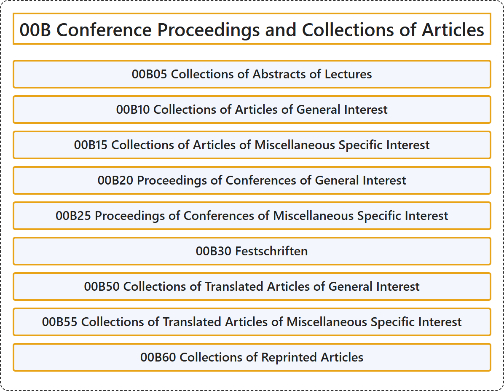

# 00B Conference Proceedings and Collections of Articles

## Classification

## Glossary

| Term | Definition | 中文翻译 | Source |
|---|---|---|---|
| **00B Conference Proceedings and Collections of Articles** 会议论文集与文章汇编 | (No definition) | （无定义） | [Associate Editors of Mathematical Reviews and zbMATH, 2020](https://msc2020.org/) |
| **00B05 Collections of Abstracts of Lectures** 讲座摘要汇编 | (No definition) | （无定义） | [Associate Editors of Mathematical Reviews and zbMATH, 2020](https://msc2020.org/) |
| **00B10 Collections of Articles of General Interest** 一般性文章汇编 | (No definition) | （无定义） | [Associate Editors of Mathematical Reviews and zbMATH, 2020](https://msc2020.org/) |
| **00B15 Collections of Articles of Miscellaneous Specific Interest** 杂项专门性文章汇编 | (No definition) | （无定义） | [Associate Editors of Mathematical Reviews and zbMATH, 2020](https://msc2020.org/) |
| **00B20 Proceedings of Conferences of General Interest** 一般性会议论文集 | (No definition) | （无定义） | [Associate Editors of Mathematical Reviews and zbMATH, 2020](https://msc2020.org/) |
| **00B25 Proceedings of Conferences of Miscellaneous Specific Interest** 杂项专门性会议论文集 | (No definition) | （无定义） | [Associate Editors of Mathematical Reviews and zbMATH, 2020](https://msc2020.org/) |
| **00B30 Festschriften** 纪念文集 | (No definition) | （无定义） | [Associate Editors of Mathematical Reviews and zbMATH, 2020](https://msc2020.org/) |
| **00B50 Collections of Translated Articles of General Interest** 一般性翻译文章汇编 | (No definition) | （无定义） | [Associate Editors of Mathematical Reviews and zbMATH, 2020](https://msc2020.org/) |
| **00B55 Collections of Translated Articles of Miscellaneous Specific Interest** 杂项专门性翻译文章汇编 | (No definition) | （无定义） | [Associate Editors of Mathematical Reviews and zbMATH, 2020](https://msc2020.org/) |
| **00B60 Collections of Reprinted Articles** 重印文章汇编 | (No definition) | （无定义） | [Associate Editors of Mathematical Reviews and zbMATH, 2020](https://msc2020.org/) |

## References

Associate Editors of Mathematical Reviews and zbMATH. (2020). *MSC2020: Mathematics Subject Classification system*. Retrieved October 27, 2026, from <https://msc2020.org/>
