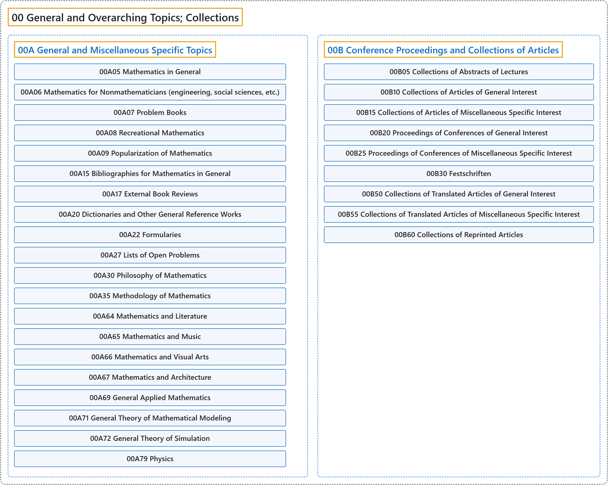

# 00 General and Overarching Topics; Collections

## Classification

## Glossary

| Term | Definition | 中文翻译 | Source |
|---|---|---|---|
| **00 General and Overarching Topics; Collections** 一般与综合性主题；文集 | (context) "Mathematics is a broad-ranging field of study in which **the properties and interactions of idealized objects** are examined." | （语境）数学是一个范围广泛的研究领域，它考察**理想化对象的性质和相互作用**。 | [Weisstein, n.d., "Mathematics" entry, para. 1](https://mathworld.wolfram.com/Mathematics.html#:~:text=Mathematics%20is%20a%20broad%2Dranging%20field%20of%20study) |
| **[00A General and Miscellaneous Specific Topics](00a-general-and-miscellaneous-specific-topics.md)** 一般及杂项专题 | (No definition) | （无定义） | [Associate Editors of Mathematical Reviews and zbMATH, 2020](https://msc2020.org/) |
| **[00B Conference Proceedings and Collections of Articles](00b-conference-proceedings-and-collections-of-articles.md)** 会议论文集与文章汇编 | (No definition) | （无定义） | [Associate Editors of Mathematical Reviews and zbMATH, 2020](https://msc2020.org/) |

## References

Associate Editors of Mathematical Reviews and zbMATH. (2020). *MSC2020: Mathematics Subject Classification system*. Retrieved October 27, 2026, from <https://msc2020.org/>

Weisstein, E. W. (n.d.). *Mathematics*. MathWorld: A Wolfram Resource. Retrieved October 27, 2026, from <https://mathworld.wolfram.com/Mathematics.html>
