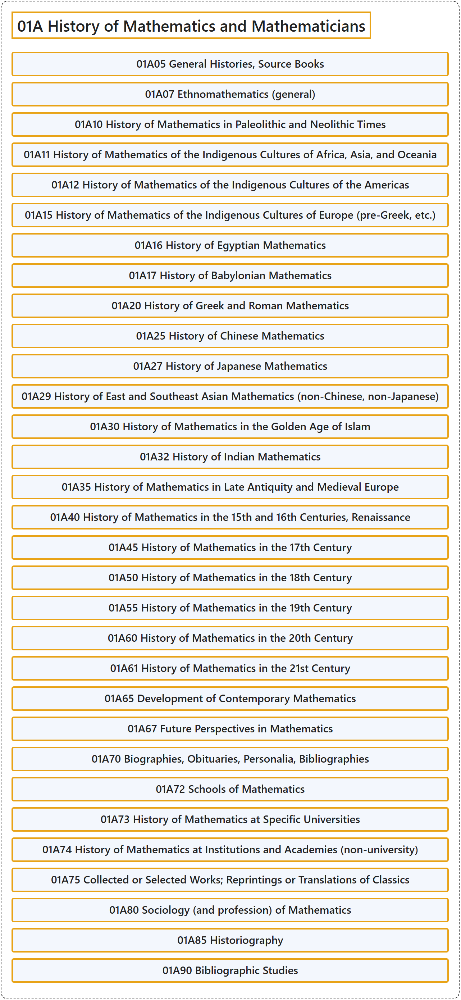

# 01A History of Mathematics and Mathematicians

## Classification

## Glossary

| Term | Definition | 中文翻译 | Source |
|---|---|---|---|
| **01A History of Mathematics and Mathematicians** 数学史与数学家 | (No definition) | （无定义） | [Associate Editors of Mathematical Reviews and zbMATH, 2020](https://msc2020.org/) |
| **01A05 General Histories, Source Books** 通史、原始资料集 | (No definition) | （无定义） | [Associate Editors of Mathematical Reviews and zbMATH, 2020](https://msc2020.org/) |
| **01A07 Ethnomathematics (general)** 民族数学（一般） | (No definition) | （无定义） | [Associate Editors of Mathematical Reviews and zbMATH, 2020](https://msc2020.org/) |
| **01A10 History of Mathematics in Paleolithic and Neolithic Times** 旧石器与新石器时代的数学史 | (No definition) | （无定义） | [Associate Editors of Mathematical Reviews and zbMATH, 2020](https://msc2020.org/) |
| **01A11 History of Mathematics of the Indigenous Cultures of Africa, Asia, and Oceania** 非洲、亚洲与大洋洲土著文化的数学史 | (No definition) | （无定义） | [Associate Editors of Mathematical Reviews and zbMATH, 2020](https://msc2020.org/) |
| **01A12 History of Mathematics of the Indigenous Cultures of the Americas** 美洲土著文化的数学史 | (No definition) | （无定义） | [Associate Editors of Mathematical Reviews and zbMATH, 2020](https://msc2020.org/) |
| **01A15 History of Mathematics of the Indigenous Cultures of Europe (pre-Greek, etc.)** 欧洲土著文化的数学史（前希腊等） | (No definition) | （无定义） | [Associate Editors of Mathematical Reviews and zbMATH, 2020](https://msc2020.org/) |
| **01A16 History of Egyptian Mathematics** 埃及数学史 | (No definition) | （无定义） | [Associate Editors of Mathematical Reviews and zbMATH, 2020](https://msc2020.org/) |
| **01A17 History of Babylonian Mathematics** 巴比伦数学史 | (No definition) | （无定义） | [Associate Editors of Mathematical Reviews and zbMATH, 2020](https://msc2020.org/) |
| **01A20 History of Greek and Roman Mathematics** 希腊与罗马数学史 | (No definition) | （无定义） | [Associate Editors of Mathematical Reviews and zbMATH, 2020](https://msc2020.org/) |
| **01A25 History of Chinese Mathematics** 中国数学史 | (No definition) | （无定义） | [Associate Editors of Mathematical Reviews and zbMATH, 2020](https://msc2020.org/) |
| **01A27 History of Japanese Mathematics** 日本数学史 | (No definition) | （无定义） | [Associate Editors of Mathematical Reviews and zbMATH, 2020](https://msc2020.org/) |
| **01A29 History of East and Southeast Asian Mathematics (non-Chinese, non-Japanese)** 东亚与东南亚数学史（非中国、非日本） | (No definition) | （无定义） | [Associate Editors of Mathematical Reviews and zbMATH, 2020](https://msc2020.org/) |
| **01A30 History of Mathematics in the Golden Age of Islam** 伊斯兰黄金时代的数学史 | (No definition) | （无定义） | [Associate Editors of Mathematical Reviews and zbMATH, 2020](https://msc2020.org/) |
| **01A32 History of Indian Mathematics** 印度数学史 | (No definition) | （无定义） | [Associate Editors of Mathematical Reviews and zbMATH, 2020](https://msc2020.org/) |
| **01A35 History of Mathematics in Late Antiquity and Medieval Europe** 古代晚期与中世纪欧洲的数学史 | (No definition) | （无定义） | [Associate Editors of Mathematical Reviews and zbMATH, 2020](https://msc2020.org/) |
| **01A40 History of Mathematics in the 15th and 16th Centuries, Renaissance** 15 与 16 世纪、文艺复兴时期的数学史 | (No definition) | （无定义） | [Associate Editors of Mathematical Reviews and zbMATH, 2020](https://msc2020.org/) |
| **01A45 History of Mathematics in the 17th Century** 17 世纪数学史 | (No definition) | （无定义） | [Associate Editors of Mathematical Reviews and zbMATH, 2020](https://msc2020.org/) |
| **01A50 History of Mathematics in the 18th Century** 18 世纪数学史 | (No definition) | （无定义） | [Associate Editors of Mathematical Reviews and zbMATH, 2020](https://msc2020.org/) |
| **01A55 History of Mathematics in the 19th Century** 19 世纪数学史 | (No definition) | （无定义） | [Associate Editors of Mathematical Reviews and zbMATH, 2020](https://msc2020.org/) |
| **01A60 History of Mathematics in the 20th Century** 20 世纪数学史 | (No definition) | （无定义） | [Associate Editors of Mathematical Reviews and zbMATH, 2020](https://msc2020.org/) |
| **01A61 History of Mathematics in the 21st Century** 21 世纪数学史 | (No definition) | （无定义） | [Associate Editors of Mathematical Reviews and zbMATH, 2020](https://msc2020.org/) |
| **01A65 Development of Contemporary Mathematics** 当代数学的发展 | (No definition) | （无定义） | [Associate Editors of Mathematical Reviews and zbMATH, 2020](https://msc2020.org/) |
| **01A67 Future Perspectives in Mathematics** 数学的未来展望 | (No definition) | （无定义） | [Associate Editors of Mathematical Reviews and zbMATH, 2020](https://msc2020.org/) |
| **01A70 Biographies, Obituaries, Personalia, Bibliographies** 传记、讣告、人物志、文献目录 | (No definition) | （无定义） | [Associate Editors of Mathematical Reviews and zbMATH, 2020](https://msc2020.org/) |
| **01A72 Schools of Mathematics** 数学学派 | (No definition) | （无定义） | [Associate Editors of Mathematical Reviews and zbMATH, 2020](https://msc2020.org/) |
| **01A73 History of Mathematics at Specific Universities** 特定大学的数学史 | (No definition) | （无定义） | [Associate Editors of Mathematical Reviews and zbMATH, 2020](https://msc2020.org/) |
| **01A74 History of Mathematics at Institutions and Academies (non-university)** 机构与学院（非大学）的数学史 | (No definition) | （无定义） | [Associate Editors of Mathematical Reviews and zbMATH, 2020](https://msc2020.org/) |
| **01A75 Collected or Selected Works; Reprintings or Translations of Classics** 文集或选集；经典著作的重印或翻译 | (No definition) | （无定义） | [Associate Editors of Mathematical Reviews and zbMATH, 2020](https://msc2020.org/) |
| **01A80 Sociology (and profession) of Mathematics** 数学社会学（及职业） | (No definition) | （无定义） | [Associate Editors of Mathematical Reviews and zbMATH, 2020](https://msc2020.org/) |
| **01A85 Historiography** 史学史 | (No definition) | （无定义） | [Associate Editors of Mathematical Reviews and zbMATH, 2020](https://msc2020.org/) |
| **01A90 Bibliographic Studies** 文献学研究 | (No definition) | （无定义） | [Associate Editors of Mathematical Reviews and zbMATH, 2020](https://msc2020.org/) |

## References

Associate Editors of Mathematical Reviews and zbMATH. (2020). *MSC2020: Mathematics Subject Classification system*. Retrieved October 27, 2026, from <https://msc2020.org/>
