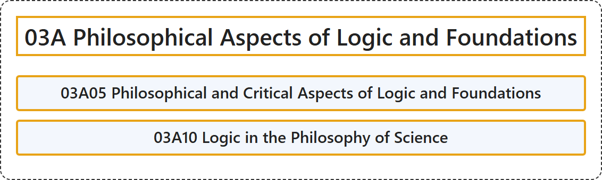

# 03A Philosophical Aspects of Logic and Foundations

## Classification

## Glossary

| Term | Definition | 中文翻译 | Source |
|---|---|---|---|
| **03A Philosophical Aspects of Logic and Foundations** 逻辑与基础的哲学方面 | (No definition) | （无定义） | [Associate Editors of Mathematical Reviews and zbMATH, 2020](https://msc2020.org/) |
| **03A05 Philosophical and Critical Aspects of Logic and Foundations** 逻辑与基础的哲学及批判方面 | (No definition) | （无定义） | [Associate Editors of Mathematical Reviews and zbMATH, 2020](https://msc2020.org/) |
| **03A10 Logic in the Philosophy of Science** 科学哲学中的逻辑 | (No definition) | （无定义） | [Associate Editors of Mathematical Reviews and zbMATH, 2020](https://msc2020.org/) |

## References

Associate Editors of Mathematical Reviews and zbMATH. (2020). *MSC2020: Mathematics Subject Classification system*. Retrieved October 27, 2026, from <https://msc2020.org/>
