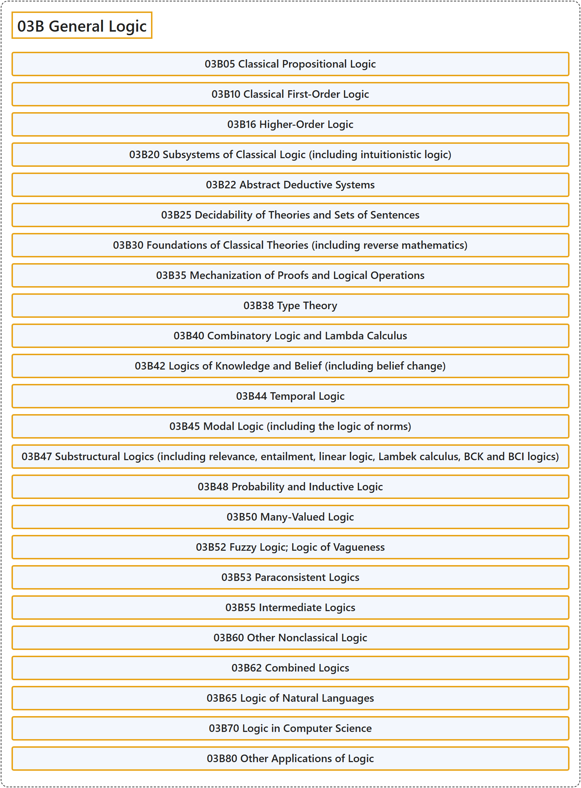

# 03B General Logic

## Classification

## Glossary

| Term | Definition | 中文翻译 | Source |
|---|---|---|---|
| **03B General Logic** 一般逻辑 | (No definition) | （无定义） | [Associate Editors of Mathematical Reviews and zbMATH, 2020](https://msc2020.org/) |
| **03B05 Classical Propositional Logic** 经典命题逻辑 | (No definition) | （无定义） | [Associate Editors of Mathematical Reviews and zbMATH, 2020](https://msc2020.org/) |
| **03B10 Classical First-Order Logic** 经典一阶逻辑 | (No definition) | （无定义） | [Associate Editors of Mathematical Reviews and zbMATH, 2020](https://msc2020.org/) |
| **03B16 Higher-Order Logic** 高阶逻辑 | (No definition) | （无定义） | [Associate Editors of Mathematical Reviews and zbMATH, 2020](https://msc2020.org/) |
| **03B20 Subsystems of Classical Logic (including intuitionistic logic)** 经典逻辑的子系统（包括直觉主义逻辑） | (No definition) | （无定义） | [Associate Editors of Mathematical Reviews and zbMATH, 2020](https://msc2020.org/) |
| **03B22 Abstract Deductive Systems** 抽象演绎系统 | (No definition) | （无定义） | [Associate Editors of Mathematical Reviews and zbMATH, 2020](https://msc2020.org/) |
| **03B25 Decidability of Theories and Sets of Sentences** 理论与语句集的可判定性 | (No definition) | （无定义） | [Associate Editors of Mathematical Reviews and zbMATH, 2020](https://msc2020.org/) |
| **03B30 Foundations of Classical Theories (including reverse mathematics)** 经典理论的基础（包括逆向数学） | (No definition) | （无定义） | [Associate Editors of Mathematical Reviews and zbMATH, 2020](https://msc2020.org/) |
| **03B35 Mechanization of Proofs and Logical Operations** 证明与逻辑运算的机械化 | (No definition) | （无定义） | [Associate Editors of Mathematical Reviews and zbMATH, 2020](https://msc2020.org/) |
| **03B38 Type Theory** 类型论 | (No definition) | （无定义） | [Associate Editors of Mathematical Reviews and zbMATH, 2020](https://msc2020.org/) |
| **03B40 Combinatory Logic and Lambda Calculus** 组合逻辑与 lambda 演算 | (No definition) | （无定义） | [Associate Editors of Mathematical Reviews and zbMATH, 2020](https://msc2020.org/) |
| **03B42 Logics of Knowledge and Belief (including belief change)** 知识与信念的逻辑（包括信念修正） | (No definition) | （无定义） | [Associate Editors of Mathematical Reviews and zbMATH, 2020](https://msc2020.org/) |
| **03B44 Temporal Logic** 时序逻辑 | (No definition) | （无定义） | [Associate Editors of Mathematical Reviews and zbMATH, 2020](https://msc2020.org/) |
| **03B45 Modal Logic (including the logic of norms)** 模态逻辑（包括规范逻辑） | (No definition) | （无定义） | [Associate Editors of Mathematical Reviews and zbMATH, 2020](https://msc2020.org/) |
| **03B47 Substructural Logics (including relevance, entailment, linear logic, Lambek calculus, BCK and BCI logics)** 子结构逻辑（包括相关逻辑、蕴涵逻辑、线性逻辑、Lambek 演算、BCK 与 BCI 逻辑） | (No definition) | （无定义） | [Associate Editors of Mathematical Reviews and zbMATH, 2020](https://msc2020.org/) |
| **03B48 Probability and Inductive Logic** 概率与归纳逻辑 | (No definition) | （无定义） | [Associate Editors of Mathematical Reviews and zbMATH, 2020](https://msc2020.org/) |
| **03B50 Many-Valued Logic** 多值逻辑 | (No definition) | （无定义） | [Associate Editors of Mathematical Reviews and zbMATH, 2020](https://msc2020.org/) |
| **03B52 Fuzzy Logic; Logic of Vagueness** 模糊逻辑；模糊性逻辑 | (No definition) | （无定义） | [Associate Editors of Mathematical Reviews and zbMATH, 2020](https://msc2020.org/) |
| **03B53 Paraconsistent Logics** 次协调逻辑 | (No definition) | （无定义） | [Associate Editors of Mathematical Reviews and zbMATH, 2020](https://msc2020.org/) |
| **03B55 Intermediate Logics** 中间逻辑 | (No definition) | （无定义） | [Associate Editors of Mathematical Reviews and zbMATH, 2020](https://msc2020.org/) |
| **03B60 Other Nonclassical Logic** 其他非经典逻辑 | (No definition) | （无定义） | [Associate Editors of Mathematical Reviews and zbMATH, 2020](https://msc2020.org/) |
| **03B62 Combined Logics** 组合逻辑系统 | (No definition) | （无定义） | [Associate Editors of Mathematical Reviews and zbMATH, 2020](https://msc2020.org/) |
| **03B65 Logic of Natural Languages** 自然语言的逻辑 | (No definition) | （无定义） | [Associate Editors of Mathematical Reviews and zbMATH, 2020](https://msc2020.org/) |
| **03B70 Logic in Computer Science** 计算机科学中的逻辑 | (No definition) | （无定义） | [Associate Editors of Mathematical Reviews and zbMATH, 2020](https://msc2020.org/) |
| **03B80 Other Applications of Logic** 逻辑的其他应用 | (No definition) | （无定义） | [Associate Editors of Mathematical Reviews and zbMATH, 2020](https://msc2020.org/) |

## References

Associate Editors of Mathematical Reviews and zbMATH. (2020). *MSC2020: Mathematics Subject Classification system*. Retrieved October 27, 2026, from <https://msc2020.org/>
