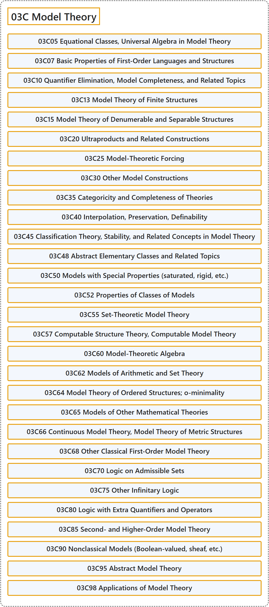

# 03C Model Theory

## Classification

## Glossary

| Term | Definition | 中文翻译 | Source |
|---|---|---|---|
| **03C Model Theory** 模型论 | (No definition) | （无定义） | [Associate Editors of Mathematical Reviews and zbMATH, 2020](https://msc2020.org/) |
| **03C05 Equational Classes, Universal Algebra in Model Theory** 方程类、模型论中的泛代数 | (No definition) | （无定义） | [Associate Editors of Mathematical Reviews and zbMATH, 2020](https://msc2020.org/) |
| **03C07 Basic Properties of First-Order Languages and Structures** 一阶语言与结构的基本性质 | (No definition) | （无定义） | [Associate Editors of Mathematical Reviews and zbMATH, 2020](https://msc2020.org/) |
| **03C10 Quantifier Elimination, Model Completeness, and Related Topics** 量词消去、模型完备性及相关专题 | (No definition) | （无定义） | [Associate Editors of Mathematical Reviews and zbMATH, 2020](https://msc2020.org/) |
| **03C13 Model Theory of Finite Structures** 有限结构的模型论 | (No definition) | （无定义） | [Associate Editors of Mathematical Reviews and zbMATH, 2020](https://msc2020.org/) |
| **03C15 Model Theory of Denumerable and Separable Structures** 可数与可分结构的模型论 | (No definition) | （无定义） | [Associate Editors of Mathematical Reviews and zbMATH, 2020](https://msc2020.org/) |
| **03C20 Ultraproducts and Related Constructions** 超积及相关构造 | (No definition) | （无定义） | [Associate Editors of Mathematical Reviews and zbMATH, 2020](https://msc2020.org/) |
| **03C25 Model-Theoretic Forcing** 模型论力迫 | (No definition) | （无定义） | [Associate Editors of Mathematical Reviews and zbMATH, 2020](https://msc2020.org/) |
| **03C30 Other Model Constructions** 其他模型构造 | (No definition) | （无定义） | [Associate Editors of Mathematical Reviews and zbMATH, 2020](https://msc2020.org/) |
| **03C35 Categoricity and Completeness of Theories** 理论的范畴性与完备性 | (No definition) | （无定义） | [Associate Editors of Mathematical Reviews and zbMATH, 2020](https://msc2020.org/) |
| **03C40 Interpolation, Preservation, Definability** 插值、保持、可定义性 | (No definition) | （无定义） | [Associate Editors of Mathematical Reviews and zbMATH, 2020](https://msc2020.org/) |
| **03C45 Classification Theory, Stability, and Related Concepts in Model Theory** 分类理论、稳定性及模型论中的相关概念 | (No definition) | （无定义） | [Associate Editors of Mathematical Reviews and zbMATH, 2020](https://msc2020.org/) |
| **03C48 Abstract Elementary Classes and Related Topics** 抽象初等类及相关专题 | (No definition) | （无定义） | [Associate Editors of Mathematical Reviews and zbMATH, 2020](https://msc2020.org/) |
| **03C50 Models with Special Properties (saturated, rigid, etc.)** 具特殊性质的模型（饱和、刚性等） | (No definition) | （无定义） | [Associate Editors of Mathematical Reviews and zbMATH, 2020](https://msc2020.org/) |
| **03C52 Properties of Classes of Models** 模型类的性质 | (No definition) | （无定义） | [Associate Editors of Mathematical Reviews and zbMATH, 2020](https://msc2020.org/) |
| **03C55 Set-Theoretic Model Theory** 集合论模型论 | (No definition) | （无定义） | [Associate Editors of Mathematical Reviews and zbMATH, 2020](https://msc2020.org/) |
| **03C57 Computable Structure Theory, Computable Model Theory** 可计算结构理论、可计算模型论 | (No definition) | （无定义） | [Associate Editors of Mathematical Reviews and zbMATH, 2020](https://msc2020.org/) |
| **03C60 Model-Theoretic Algebra** 模型论代数 | (No definition) | （无定义） | [Associate Editors of Mathematical Reviews and zbMATH, 2020](https://msc2020.org/) |
| **03C62 Models of Arithmetic and Set Theory** 算术与集合论的模型 | (No definition) | （无定义） | [Associate Editors of Mathematical Reviews and zbMATH, 2020](https://msc2020.org/) |
| **03C64 Model Theory of Ordered Structures; o-minimality** 序结构的模型论；o-极小性 | (No definition) | （无定义） | [Associate Editors of Mathematical Reviews and zbMATH, 2020](https://msc2020.org/) |
| **03C65 Models of Other Mathematical Theories** 其他数学理论的模型 | (No definition) | （无定义） | [Associate Editors of Mathematical Reviews and zbMATH, 2020](https://msc2020.org/) |
| **03C66 Continuous Model Theory, Model Theory of Metric Structures** 连续模型论、度量结构的模型论 | (No definition) | （无定义） | [Associate Editors of Mathematical Reviews and zbMATH, 2020](https://msc2020.org/) |
| **03C68 Other Classical First-Order Model Theory** 其他经典一阶模型论 | (No definition) | （无定义） | [Associate Editors of Mathematical Reviews and zbMATH, 2020](https://msc2020.org/) |
| **03C70 Logic on Admissible Sets** 可容许集上的逻辑 | (No definition) | （无定义） | [Associate Editors of Mathematical Reviews and zbMATH, 2020](https://msc2020.org/) |
| **03C75 Other Infinitary Logic** 其他无穷逻辑 | (No definition) | （无定义） | [Associate Editors of Mathematical Reviews and zbMATH, 2020](https://msc2020.org/) |
| **03C80 Logic with Extra Quantifiers and Operators** 带额外量词与算子的逻辑 | (No definition) | （无定义） | [Associate Editors of Mathematical Reviews and zbMATH, 2020](https://msc2020.org/) |
| **03C85 Second- and Higher-Order Model Theory** 二阶与高阶模型论 | (No definition) | （无定义） | [Associate Editors of Mathematical Reviews and zbMATH, 2020](https://msc2020.org/) |
| **03C90 Nonclassical Models (Boolean-valued, sheaf, etc.)** 非经典模型（布尔值模型、层模型等） | (No definition) | （无定义） | [Associate Editors of Mathematical Reviews and zbMATH, 2020](https://msc2020.org/) |
| **03C95 Abstract Model Theory** 抽象模型论 | (No definition) | （无定义） | [Associate Editors of Mathematical Reviews and zbMATH, 2020](https://msc2020.org/) |
| **03C98 Applications of Model Theory** 模型论的应用 | (No definition) | （无定义） | [Associate Editors of Mathematical Reviews and zbMATH, 2020](https://msc2020.org/) |

## References

Associate Editors of Mathematical Reviews and zbMATH. (2020). *MSC2020: Mathematics Subject Classification system*. Retrieved October 27, 2026, from <https://msc2020.org/>
