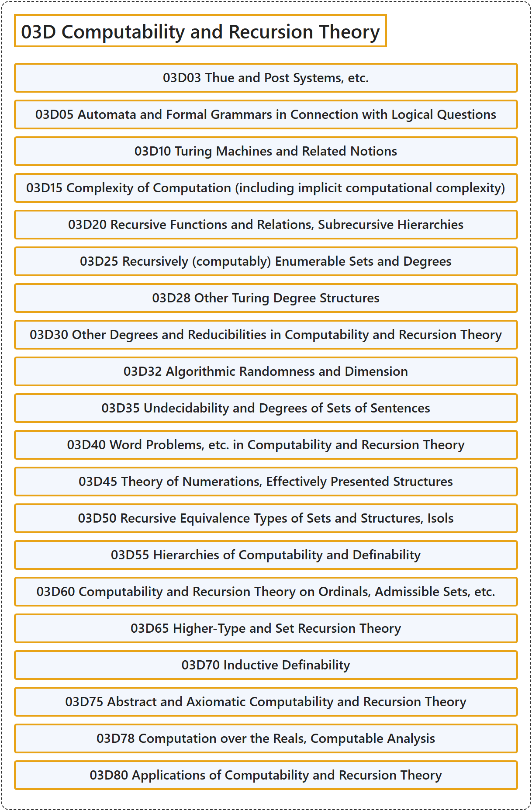

# 03D Computability and Recursion Theory

## Classification

## Glossary

| Term | Definition | 中文翻译 | Source |
|---|---|---|---|
| **03D Computability and Recursion Theory** 可计算性与递归论 | (No definition) | （无定义） | [Associate Editors of Mathematical Reviews and zbMATH, 2020](https://msc2020.org/) |
| **03D03 Thue and Post Systems, etc.** Thue 系统与 Post 系统等 | (No definition) | （无定义） | [Associate Editors of Mathematical Reviews and zbMATH, 2020](https://msc2020.org/) |
| **03D05 Automata and Formal Grammars in Connection with Logical Questions** 与逻辑问题相关的自动机与形式文法 | (No definition) | （无定义） | [Associate Editors of Mathematical Reviews and zbMATH, 2020](https://msc2020.org/) |
| **03D10 Turing Machines and Related Notions** 图灵机及相关概念 | (No definition) | （无定义） | [Associate Editors of Mathematical Reviews and zbMATH, 2020](https://msc2020.org/) |
| **03D15 Complexity of Computation (including implicit computational complexity)** 计算复杂性（包括隐式计算复杂性） | (No definition) | （无定义） | [Associate Editors of Mathematical Reviews and zbMATH, 2020](https://msc2020.org/) |
| **03D20 Recursive Functions and Relations, Subrecursive Hierarchies** 递归函数与递归关系、次递归层次 | (No definition) | （无定义） | [Associate Editors of Mathematical Reviews and zbMATH, 2020](https://msc2020.org/) |
| **03D25 Recursively (computably) Enumerable Sets and Degrees** 递归（可计算）可枚举集与度 | (No definition) | （无定义） | [Associate Editors of Mathematical Reviews and zbMATH, 2020](https://msc2020.org/) |
| **03D28 Other Turing Degree Structures** 其他图灵度结构 | (No definition) | （无定义） | [Associate Editors of Mathematical Reviews and zbMATH, 2020](https://msc2020.org/) |
| **03D30 Other Degrees and Reducibilities in Computability and Recursion Theory** 可计算性与递归论中的其他度与可归约性 | (No definition) | （无定义） | [Associate Editors of Mathematical Reviews and zbMATH, 2020](https://msc2020.org/) |
| **03D32 Algorithmic Randomness and Dimension** 算法随机性与维数 | (No definition) | （无定义） | [Associate Editors of Mathematical Reviews and zbMATH, 2020](https://msc2020.org/) |
| **03D35 Undecidability and Degrees of Sets of Sentences** 语句集的不可判定性与度 | (No definition) | （无定义） | [Associate Editors of Mathematical Reviews and zbMATH, 2020](https://msc2020.org/) |
| **03D40 Word Problems, etc. in Computability and Recursion Theory** 可计算性与递归论中的字问题等 | (No definition) | （无定义） | [Associate Editors of Mathematical Reviews and zbMATH, 2020](https://msc2020.org/) |
| **03D45 Theory of Numerations, Effectively Presented Structures** 编号理论、有效表示的结构 | (No definition) | （无定义） | [Associate Editors of Mathematical Reviews and zbMATH, 2020](https://msc2020.org/) |
| **03D50 Recursive Equivalence Types of Sets and Structures, Isols** 集合与结构的递归等价型、孤立集 | (No definition) | （无定义） | [Associate Editors of Mathematical Reviews and zbMATH, 2020](https://msc2020.org/) |
| **03D55 Hierarchies of Computability and Definability** 可计算性与可定义性的层次 | (No definition) | （无定义） | [Associate Editors of Mathematical Reviews and zbMATH, 2020](https://msc2020.org/) |
| **03D60 Computability and Recursion Theory on Ordinals, Admissible Sets, etc.** 序数、可容许集等上的可计算性与递归论 | (No definition) | （无定义） | [Associate Editors of Mathematical Reviews and zbMATH, 2020](https://msc2020.org/) |
| **03D65 Higher-Type and Set Recursion Theory** 高阶类型与集合递归论 | (No definition) | （无定义） | [Associate Editors of Mathematical Reviews and zbMATH, 2020](https://msc2020.org/) |
| **03D70 Inductive Definability** 归纳可定义性 | (No definition) | （无定义） | [Associate Editors of Mathematical Reviews and zbMATH, 2020](https://msc2020.org/) |
| **03D75 Abstract and Axiomatic Computability and Recursion Theory** 抽象与公理化可计算性与递归论 | (No definition) | （无定义） | [Associate Editors of Mathematical Reviews and zbMATH, 2020](https://msc2020.org/) |
| **03D78 Computation over the Reals, Computable Analysis** 实数上的计算、可计算分析 | (No definition) | （无定义） | [Associate Editors of Mathematical Reviews and zbMATH, 2020](https://msc2020.org/) |
| **03D80 Applications of Computability and Recursion Theory** 可计算性与递归论的应用 | (No definition) | （无定义） | [Associate Editors of Mathematical Reviews and zbMATH, 2020](https://msc2020.org/) |

## References

Associate Editors of Mathematical Reviews and zbMATH. (2020). *MSC2020: Mathematics Subject Classification system*. Retrieved October 27, 2026, from <https://msc2020.org/>
