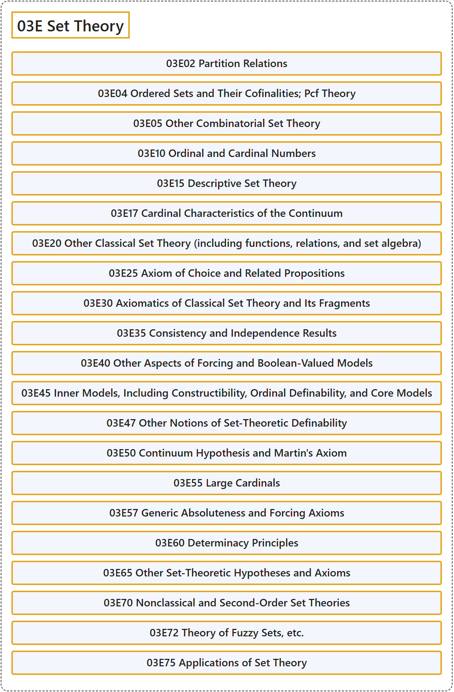

# 03E Set Theory

## Classification

## Glossary

| Term | Definition | 中文翻译 | Source |
|---|---|---|---|
| **03E Set Theory** 集合论 | (No definition) | （无定义） | [Associate Editors of Mathematical Reviews and zbMATH, 2020](https://msc2020.org/) |
| **03E02 Partition Relations** 划分关系 | (No definition) | （无定义） | [Associate Editors of Mathematical Reviews and zbMATH, 2020](https://msc2020.org/) |
| **03E04 Ordered Sets and Their Cofinalities; Pcf Theory** 序集及其共尾性；pcf 理论 | (No definition) | （无定义） | [Associate Editors of Mathematical Reviews and zbMATH, 2020](https://msc2020.org/) |
| **03E05 Other Combinatorial Set Theory** 其他组合集合论 | (No definition) | （无定义） | [Associate Editors of Mathematical Reviews and zbMATH, 2020](https://msc2020.org/) |
| **03E10 Ordinal and Cardinal Numbers** 序数与基数 | (No definition) | （无定义） | [Associate Editors of Mathematical Reviews and zbMATH, 2020](https://msc2020.org/) |
| **03E15 Descriptive Set Theory** 描述集合论 | (No definition) | （无定义） | [Associate Editors of Mathematical Reviews and zbMATH, 2020](https://msc2020.org/) |
| **03E17 Cardinal Characteristics of the Continuum** 连续统的基数特征 | (No definition) | （无定义） | [Associate Editors of Mathematical Reviews and zbMATH, 2020](https://msc2020.org/) |
| **03E20 Other Classical Set Theory (including functions, relations, and set algebra)** 其他经典集合论（包括函数、关系与集代数） | (No definition) | （无定义） | [Associate Editors of Mathematical Reviews and zbMATH, 2020](https://msc2020.org/) |
| **03E25 Axiom of Choice and Related Propositions** 选择公理及相关命题 | (No definition) | （无定义） | [Associate Editors of Mathematical Reviews and zbMATH, 2020](https://msc2020.org/) |
| **03E30 Axiomatics of Classical Set Theory and Its Fragments** 经典集合论及其片段的公理化 | (No definition) | （无定义） | [Associate Editors of Mathematical Reviews and zbMATH, 2020](https://msc2020.org/) |
| **03E35 Consistency and Independence Results** 相容性与独立性结果 | (No definition) | （无定义） | [Associate Editors of Mathematical Reviews and zbMATH, 2020](https://msc2020.org/) |
| **03E40 Other Aspects of Forcing and Boolean-Valued Models** 力迫与布尔值模型的其他方面 | (No definition) | （无定义） | [Associate Editors of Mathematical Reviews and zbMATH, 2020](https://msc2020.org/) |
| **03E45 Inner Models, Including Constructibility, Ordinal Definability, and Core Models** 内模型，包括可构造性、序数可定义性与核心模型 | (No definition) | （无定义） | [Associate Editors of Mathematical Reviews and zbMATH, 2020](https://msc2020.org/) |
| **03E47 Other Notions of Set-Theoretic Definability** 集合论可定义性的其他概念 | (No definition) | （无定义） | [Associate Editors of Mathematical Reviews and zbMATH, 2020](https://msc2020.org/) |
| **03E50 Continuum Hypothesis and Martin's Axiom** 连续统假设与马丁公理 | (No definition) | （无定义） | [Associate Editors of Mathematical Reviews and zbMATH, 2020](https://msc2020.org/) |
| **03E55 Large Cardinals** 大基数 | (No definition) | （无定义） | [Associate Editors of Mathematical Reviews and zbMATH, 2020](https://msc2020.org/) |
| **03E57 Generic Absoluteness and Forcing Axioms** 广义绝对性与力迫公理 | (No definition) | （无定义） | [Associate Editors of Mathematical Reviews and zbMATH, 2020](https://msc2020.org/) |
| **03E60 Determinacy Principles** 决定性原理 | (No definition) | （无定义） | [Associate Editors of Mathematical Reviews and zbMATH, 2020](https://msc2020.org/) |
| **03E65 Other Set-Theoretic Hypotheses and Axioms** 其他集合论假设与公理 | (No definition) | （无定义） | [Associate Editors of Mathematical Reviews and zbMATH, 2020](https://msc2020.org/) |
| **03E70 Nonclassical and Second-Order Set Theories** 非经典与二阶集合论 | (No definition) | （无定义） | [Associate Editors of Mathematical Reviews and zbMATH, 2020](https://msc2020.org/) |
| **03E72 Theory of Fuzzy Sets, etc.** 模糊集理论等 | (No definition) | （无定义） | [Associate Editors of Mathematical Reviews and zbMATH, 2020](https://msc2020.org/) |
| **03E75 Applications of Set Theory** 集合论的应用 | (No definition) | （无定义） | [Associate Editors of Mathematical Reviews and zbMATH, 2020](https://msc2020.org/) |

## References

Associate Editors of Mathematical Reviews and zbMATH. (2020). *MSC2020: Mathematics Subject Classification system*. Retrieved October 27, 2026, from <https://msc2020.org/>
