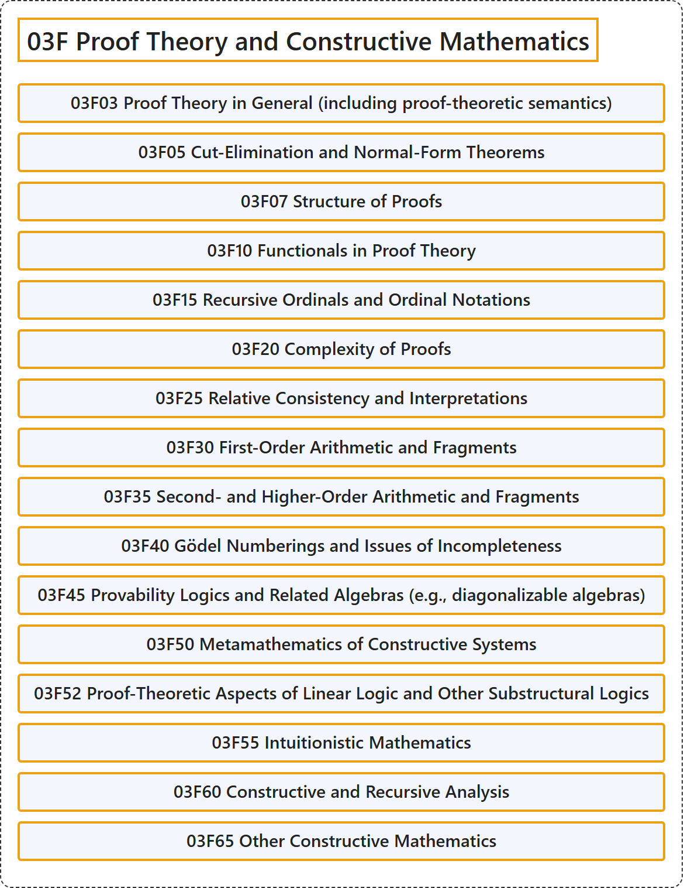

# 03F Proof Theory and Constructive Mathematics

## Classification

## Glossary

| Term | Definition | 中文翻译 | Source |
|---|---|---|---|
| **03F Proof Theory and Constructive Mathematics** 证明论与构造性数学 | (No definition) | （无定义） | [Associate Editors of Mathematical Reviews and zbMATH, 2020](https://msc2020.org/) |
| **03F03 Proof Theory in General (including proof-theoretic semantics)** 一般证明论（包括证明论语义） | (No definition) | （无定义） | [Associate Editors of Mathematical Reviews and zbMATH, 2020](https://msc2020.org/) |
| **03F05 Cut-Elimination and Normal-Form Theorems** 割消去与范式定理 | (No definition) | （无定义） | [Associate Editors of Mathematical Reviews and zbMATH, 2020](https://msc2020.org/) |
| **03F07 Structure of Proofs** 证明的结构 | (No definition) | （无定义） | [Associate Editors of Mathematical Reviews and zbMATH, 2020](https://msc2020.org/) |
| **03F10 Functionals in Proof Theory** 证明论中的泛函 | (No definition) | （无定义） | [Associate Editors of Mathematical Reviews and zbMATH, 2020](https://msc2020.org/) |
| **03F15 Recursive Ordinals and Ordinal Notations** 递归序数与序数记法 | (No definition) | （无定义） | [Associate Editors of Mathematical Reviews and zbMATH, 2020](https://msc2020.org/) |
| **03F20 Complexity of Proofs** 证明的复杂性 | (No definition) | （无定义） | [Associate Editors of Mathematical Reviews and zbMATH, 2020](https://msc2020.org/) |
| **03F25 Relative Consistency and Interpretations** 相对相容性与解释 | (No definition) | （无定义） | [Associate Editors of Mathematical Reviews and zbMATH, 2020](https://msc2020.org/) |
| **03F30 First-Order Arithmetic and Fragments** 一阶算术及其片段 | (No definition) | （无定义） | [Associate Editors of Mathematical Reviews and zbMATH, 2020](https://msc2020.org/) |
| **03F35 Second- and Higher-Order Arithmetic and Fragments** 二阶与高阶算术及其片段 | (No definition) | （无定义） | [Associate Editors of Mathematical Reviews and zbMATH, 2020](https://msc2020.org/) |
| **03F40 Gödel Numberings and Issues of Incompleteness** 哥德尔编号与不完备性问题 | (No definition) | （无定义） | [Associate Editors of Mathematical Reviews and zbMATH, 2020](https://msc2020.org/) |
| **03F45 Provability Logics and Related Algebras (e.g., diagonalizable algebras)** 可证明性逻辑及相关代数（例如可对角化代数） | (No definition) | （无定义） | [Associate Editors of Mathematical Reviews and zbMATH, 2020](https://msc2020.org/) |
| **03F50 Metamathematics of Constructive Systems** 构造系统的元数学 | (No definition) | （无定义） | [Associate Editors of Mathematical Reviews and zbMATH, 2020](https://msc2020.org/) |
| **03F52 Proof-Theoretic Aspects of Linear Logic and Other Substructural Logics** 线性逻辑与其他子结构逻辑的证明论方面 | (No definition) | （无定义） | [Associate Editors of Mathematical Reviews and zbMATH, 2020](https://msc2020.org/) |
| **03F55 Intuitionistic Mathematics** 直觉主义数学 | (No definition) | （无定义） | [Associate Editors of Mathematical Reviews and zbMATH, 2020](https://msc2020.org/) |
| **03F60 Constructive and Recursive Analysis** 构造与递归分析 | (No definition) | （无定义） | [Associate Editors of Mathematical Reviews and zbMATH, 2020](https://msc2020.org/) |
| **03F65 Other Constructive Mathematics** 其他构造数学 | (No definition) | （无定义） | [Associate Editors of Mathematical Reviews and zbMATH, 2020](https://msc2020.org/) |

## References

Associate Editors of Mathematical Reviews and zbMATH. (2020). *MSC2020: Mathematics Subject Classification system*. Retrieved October 27, 2026, from <https://msc2020.org/>
