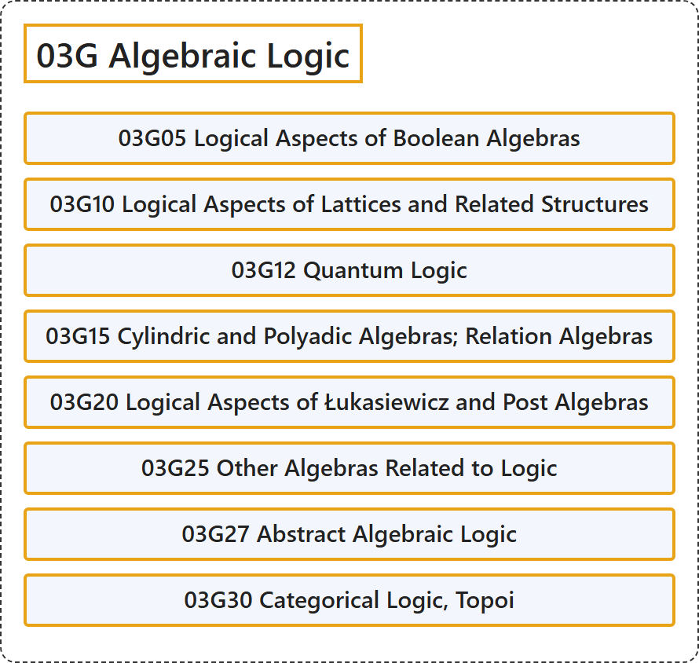

# 03G Algebraic Logic

## Classification

## Glossary

| Term | Definition | 中文翻译 | Source |
|---|---|---|---|
| **03G Algebraic Logic** 代数逻辑 | (No definition) | （无定义） | [Associate Editors of Mathematical Reviews and zbMATH, 2020](https://msc2020.org/) |
| **03G05 Logical Aspects of Boolean Algebras** 布尔代数的逻辑方面 | (No definition) | （无定义） | [Associate Editors of Mathematical Reviews and zbMATH, 2020](https://msc2020.org/) |
| **03G10 Logical Aspects of Lattices and Related Structures** 格及相关结构的逻辑方面 | (No definition) | （无定义） | [Associate Editors of Mathematical Reviews and zbMATH, 2020](https://msc2020.org/) |
| **03G12 Quantum Logic** 量子逻辑 | (No definition) | （无定义） | [Associate Editors of Mathematical Reviews and zbMATH, 2020](https://msc2020.org/) |
| **03G15 Cylindric and Polyadic Algebras; Relation Algebras** 柱代数与多元代数；关系代数 | (No definition) | （无定义） | [Associate Editors of Mathematical Reviews and zbMATH, 2020](https://msc2020.org/) |
| **03G20 Logical Aspects of Łukasiewicz and Post Algebras** 卢卡西维茨代数与 Post 代数的逻辑方面 | (No definition) | （无定义） | [Associate Editors of Mathematical Reviews and zbMATH, 2020](https://msc2020.org/) |
| **03G25 Other Algebras Related to Logic** 与逻辑相关的其他代数 | (No definition) | （无定义） | [Associate Editors of Mathematical Reviews and zbMATH, 2020](https://msc2020.org/) |
| **03G27 Abstract Algebraic Logic** 抽象代数逻辑 | (No definition) | （无定义） | [Associate Editors of Mathematical Reviews and zbMATH, 2020](https://msc2020.org/) |
| **03G30 Categorical Logic, Topoi** 范畴逻辑、拓扑斯 | (No definition) | （无定义） | [Associate Editors of Mathematical Reviews and zbMATH, 2020](https://msc2020.org/) |

## References

Associate Editors of Mathematical Reviews and zbMATH. (2020). *MSC2020: Mathematics Subject Classification system*. Retrieved October 27, 2026, from <https://msc2020.org/>
