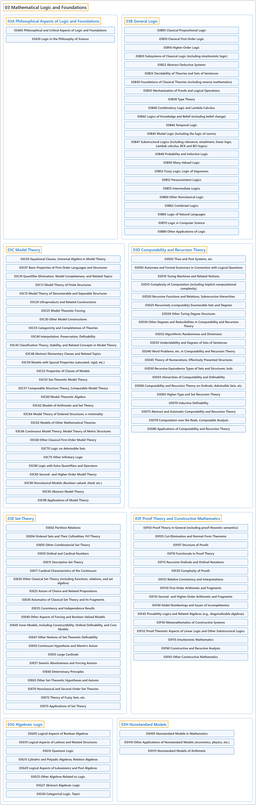

# 03 Mathematical Logic and Foundations

## Classification

## Glossary

| Term | Definition | 中文翻译 | Source |
|---|---|---|---|
| **03 Mathematical Logic and Foundations** 数理逻辑与基础 | "Logic is the **formal mathematical study** of the methods, structure, and validity of **mathematical deduction and proof**." | 逻辑是对**数学演绎与证明**的方法、结构和有效性所作的**形式化数学研究**。 | [Weisstein, n.d., "Logic" entry, para. 1](https://mathworld.wolfram.com/Logic.html#:~:text=Logic%20is%20the%20formal%20mathematical%20study) |
| **[03A Philosophical Aspects of Logic and Foundations](03a-philosophical-aspects-of-logic-and-foundations.md)** 逻辑与基础的哲学方面 | (No definition) | （无定义） | [Associate Editors of Mathematical Reviews and zbMATH, 2020](https://msc2020.org/) |
| **[03B General Logic](03b-general-logic.md)** 一般逻辑 | (No definition) | （无定义） | [Associate Editors of Mathematical Reviews and zbMATH, 2020](https://msc2020.org/) |
| **[03C Model Theory](03c-model-theory.md)** 模型论 | (No definition) | （无定义） | [Associate Editors of Mathematical Reviews and zbMATH, 2020](https://msc2020.org/) |
| **[03D Computability and Recursion Theory](03d-computability-and-recursion-theory.md)** 可计算性与递归论 | (No definition) | （无定义） | [Associate Editors of Mathematical Reviews and zbMATH, 2020](https://msc2020.org/) |
| **[03E Set Theory](03e-set-theory.md)** 集合论 | (No definition) | （无定义） | [Associate Editors of Mathematical Reviews and zbMATH, 2020](https://msc2020.org/) |
| **[03F Proof Theory and Constructive Mathematics](03f-proof-theory-and-constructive-mathematics.md)** 证明论与构造性数学 | (No definition) | （无定义） | [Associate Editors of Mathematical Reviews and zbMATH, 2020](https://msc2020.org/) |
| **[03G Algebraic Logic](03g-algebraic-logic.md)** 代数逻辑 | (No definition) | （无定义） | [Associate Editors of Mathematical Reviews and zbMATH, 2020](https://msc2020.org/) |
| **[03H Nonstandard Models](03h-nonstandard-models.md)** 非标准模型 | (No definition) | （无定义） | [Associate Editors of Mathematical Reviews and zbMATH, 2020](https://msc2020.org/) |

## References

Associate Editors of Mathematical Reviews and zbMATH. (2020). *MSC2020: Mathematics Subject Classification system*. Retrieved October 27, 2026, from <https://msc2020.org/>

Weisstein, E. W. (n.d.). *Logic*. MathWorld: A Wolfram Resource. Retrieved October 27, 2026, from <https://mathworld.wolfram.com/Logic.html>
