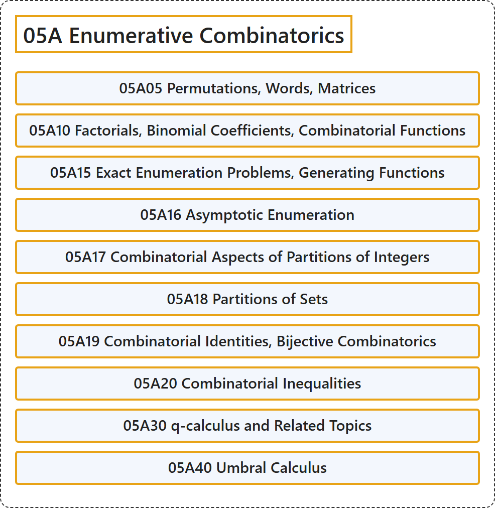

# 05A Enumerative Combinatorics

## Classification

## Glossary

| Term | Definition | 中文翻译 | Source |
|---|---|---|---|
| **05A Enumerative Combinatorics** 计数组合学 | (No definition) | （无定义） | [Associate Editors of Mathematical Reviews and zbMATH, 2020](https://msc2020.org/) |
| **05A05 Permutations, Words, Matrices** 排列、字、矩阵 | (No definition) | （无定义） | [Associate Editors of Mathematical Reviews and zbMATH, 2020](https://msc2020.org/) |
| **05A10 Factorials, Binomial Coefficients, Combinatorial Functions** 阶乘、二项式系数、组合函数 | (No definition) | （无定义） | [Associate Editors of Mathematical Reviews and zbMATH, 2020](https://msc2020.org/) |
| **05A15 Exact Enumeration Problems, Generating Functions** 精确计数问题、生成函数 | (No definition) | （无定义） | [Associate Editors of Mathematical Reviews and zbMATH, 2020](https://msc2020.org/) |
| **05A16 Asymptotic Enumeration** 渐近计数 | (No definition) | （无定义） | [Associate Editors of Mathematical Reviews and zbMATH, 2020](https://msc2020.org/) |
| **05A17 Combinatorial Aspects of Partitions of Integers** 整数分拆的组合方面 | (No definition) | （无定义） | [Associate Editors of Mathematical Reviews and zbMATH, 2020](https://msc2020.org/) |
| **05A18 Partitions of Sets** 集合的划分 | (No definition) | （无定义） | [Associate Editors of Mathematical Reviews and zbMATH, 2020](https://msc2020.org/) |
| **05A19 Combinatorial Identities, Bijective Combinatorics** 组合恒等式、双射组合学 | (No definition) | （无定义） | [Associate Editors of Mathematical Reviews and zbMATH, 2020](https://msc2020.org/) |
| **05A20 Combinatorial Inequalities** 组合不等式 | (No definition) | （无定义） | [Associate Editors of Mathematical Reviews and zbMATH, 2020](https://msc2020.org/) |
| **05A30 q-calculus and Related Topics** q 演算及相关专题 | (No definition) | （无定义） | [Associate Editors of Mathematical Reviews and zbMATH, 2020](https://msc2020.org/) |
| **05A40 Umbral Calculus** 影演算 | (No definition) | （无定义） | [Associate Editors of Mathematical Reviews and zbMATH, 2020](https://msc2020.org/) |

## References

Associate Editors of Mathematical Reviews and zbMATH. (2020). *MSC2020: Mathematics Subject Classification system*. Retrieved October 27, 2026, from <https://msc2020.org/>
