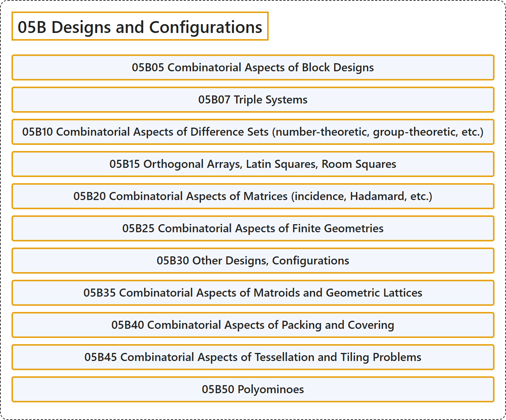

# 05B Designs and Configurations

## Classification

## Glossary

| Term | Definition | 中文翻译 | Source |
|---|---|---|---|
| **05B Designs and Configurations** 设计与构形 | (No definition) | （无定义） | [Associate Editors of Mathematical Reviews and zbMATH, 2020](https://msc2020.org/) |
| **05B05 Combinatorial Aspects of Block Designs** 区组设计的组合方面 | (No definition) | （无定义） | [Associate Editors of Mathematical Reviews and zbMATH, 2020](https://msc2020.org/) |
| **05B07 Triple Systems** 三元系 | (No definition) | （无定义） | [Associate Editors of Mathematical Reviews and zbMATH, 2020](https://msc2020.org/) |
| **05B10 Combinatorial Aspects of Difference Sets (number-theoretic, group-theoretic, etc.)** 差集的组合方面（数论、群论等） | (No definition) | （无定义） | [Associate Editors of Mathematical Reviews and zbMATH, 2020](https://msc2020.org/) |
| **05B15 Orthogonal Arrays, Latin Squares, Room Squares** 正交表、拉丁方、Room 方 | (No definition) | （无定义） | [Associate Editors of Mathematical Reviews and zbMATH, 2020](https://msc2020.org/) |
| **05B20 Combinatorial Aspects of Matrices (incidence, Hadamard, etc.)** 矩阵的组合方面（关联、哈达玛等） | (No definition) | （无定义） | [Associate Editors of Mathematical Reviews and zbMATH, 2020](https://msc2020.org/) |
| **05B25 Combinatorial Aspects of Finite Geometries** 有限几何的组合方面 | (No definition) | （无定义） | [Associate Editors of Mathematical Reviews and zbMATH, 2020](https://msc2020.org/) |
| **05B30 Other Designs, Configurations** 其他设计、构形 | (No definition) | （无定义） | [Associate Editors of Mathematical Reviews and zbMATH, 2020](https://msc2020.org/) |
| **05B35 Combinatorial Aspects of Matroids and Geometric Lattices** 拟阵与几何格的组合方面 | (No definition) | （无定义） | [Associate Editors of Mathematical Reviews and zbMATH, 2020](https://msc2020.org/) |
| **05B40 Combinatorial Aspects of Packing and Covering** 填充与覆盖的组合方面 | (No definition) | （无定义） | [Associate Editors of Mathematical Reviews and zbMATH, 2020](https://msc2020.org/) |
| **05B45 Combinatorial Aspects of Tessellation and Tiling Problems** 镶嵌与铺砌问题的组合方面 | (No definition) | （无定义） | [Associate Editors of Mathematical Reviews and zbMATH, 2020](https://msc2020.org/) |
| **05B50 Polyominoes** 多联骨牌 | (No definition) | （无定义） | [Associate Editors of Mathematical Reviews and zbMATH, 2020](https://msc2020.org/) |

## References

Associate Editors of Mathematical Reviews and zbMATH. (2020). *MSC2020: Mathematics Subject Classification system*. Retrieved October 27, 2026, from <https://msc2020.org/>
