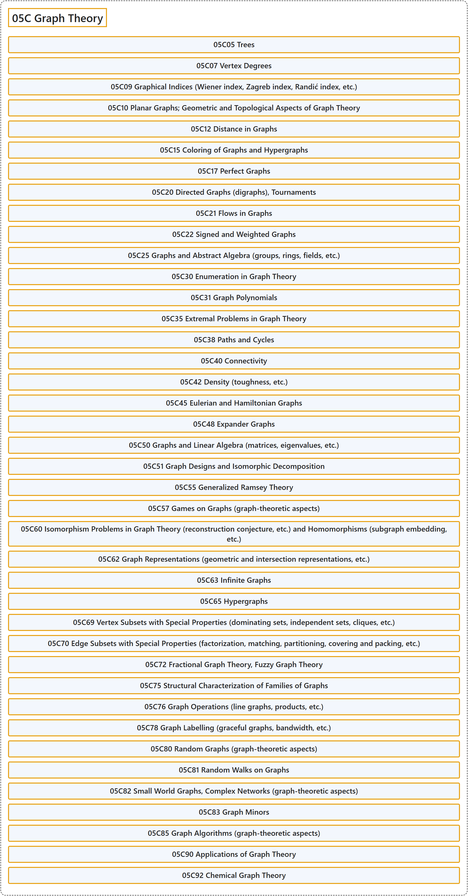

# 05C Graph Theory

## Classification

## Glossary

| Term | Definition | 中文翻译 | Source |
|---|---|---|---|
| **05C Graph Theory** 图论 | (No definition) | （无定义） | [Associate Editors of Mathematical Reviews and zbMATH, 2020](https://msc2020.org/) |
| **05C05 Trees** 树 | (No definition) | （无定义） | [Associate Editors of Mathematical Reviews and zbMATH, 2020](https://msc2020.org/) |
| **05C07 Vertex Degrees** 顶点度 | (No definition) | （无定义） | [Associate Editors of Mathematical Reviews and zbMATH, 2020](https://msc2020.org/) |
| **05C09 Graphical Indices (Wiener index, Zagreb index, Randić index, etc.)** 图指标（Wiener 指标、Zagreb 指标、Randić 指标等） | (No definition) | （无定义） | [Associate Editors of Mathematical Reviews and zbMATH, 2020](https://msc2020.org/) |
| **05C10 Planar Graphs; Geometric and Topological Aspects of Graph Theory** 平面图；图论的几何与拓扑方面 | (No definition) | （无定义） | [Associate Editors of Mathematical Reviews and zbMATH, 2020](https://msc2020.org/) |
| **05C12 Distance in Graphs** 图中的距离 | (No definition) | （无定义） | [Associate Editors of Mathematical Reviews and zbMATH, 2020](https://msc2020.org/) |
| **05C15 Coloring of Graphs and Hypergraphs** 图与超图的着色 | (No definition) | （无定义） | [Associate Editors of Mathematical Reviews and zbMATH, 2020](https://msc2020.org/) |
| **05C17 Perfect Graphs** 完美图 | (No definition) | （无定义） | [Associate Editors of Mathematical Reviews and zbMATH, 2020](https://msc2020.org/) |
| **05C20 Directed Graphs (digraphs), Tournaments** 有向图、竞赛图 | (No definition) | （无定义） | [Associate Editors of Mathematical Reviews and zbMATH, 2020](https://msc2020.org/) |
| **05C21 Flows in Graphs** 图中的流 | (No definition) | （无定义） | [Associate Editors of Mathematical Reviews and zbMATH, 2020](https://msc2020.org/) |
| **05C22 Signed and Weighted Graphs** 符号图与加权图 | (No definition) | （无定义） | [Associate Editors of Mathematical Reviews and zbMATH, 2020](https://msc2020.org/) |
| **05C25 Graphs and Abstract Algebra (groups, rings, fields, etc.)** 图与抽象代数（群、环、域等） | (No definition) | （无定义） | [Associate Editors of Mathematical Reviews and zbMATH, 2020](https://msc2020.org/) |
| **05C30 Enumeration in Graph Theory** 图论中的计数 | (No definition) | （无定义） | [Associate Editors of Mathematical Reviews and zbMATH, 2020](https://msc2020.org/) |
| **05C31 Graph Polynomials** 图多项式 | (No definition) | （无定义） | [Associate Editors of Mathematical Reviews and zbMATH, 2020](https://msc2020.org/) |
| **05C35 Extremal Problems in Graph Theory** 图论中的极值问题 | (No definition) | （无定义） | [Associate Editors of Mathematical Reviews and zbMATH, 2020](https://msc2020.org/) |
| **05C38 Paths and Cycles** 路与圈 | (No definition) | （无定义） | [Associate Editors of Mathematical Reviews and zbMATH, 2020](https://msc2020.org/) |
| **05C40 Connectivity** 连通性 | (No definition) | （无定义） | [Associate Editors of Mathematical Reviews and zbMATH, 2020](https://msc2020.org/) |
| **05C42 Density (toughness, etc.)** 密度（韧度等） | (No definition) | （无定义） | [Associate Editors of Mathematical Reviews and zbMATH, 2020](https://msc2020.org/) |
| **05C45 Eulerian and Hamiltonian Graphs** 欧拉图与哈密顿图 | (No definition) | （无定义） | [Associate Editors of Mathematical Reviews and zbMATH, 2020](https://msc2020.org/) |
| **05C48 Expander Graphs** 扩展图 | (No definition) | （无定义） | [Associate Editors of Mathematical Reviews and zbMATH, 2020](https://msc2020.org/) |
| **05C50 Graphs and Linear Algebra (matrices, eigenvalues, etc.)** 图与线性代数（矩阵、特征值等） | (No definition) | （无定义） | [Associate Editors of Mathematical Reviews and zbMATH, 2020](https://msc2020.org/) |
| **05C51 Graph Designs and Isomorphic Decomposition** 图设计与同构分解 | (No definition) | （无定义） | [Associate Editors of Mathematical Reviews and zbMATH, 2020](https://msc2020.org/) |
| **05C55 Generalized Ramsey Theory** 广义拉姆齐理论 | (No definition) | （无定义） | [Associate Editors of Mathematical Reviews and zbMATH, 2020](https://msc2020.org/) |
| **05C57 Games on Graphs (graph-theoretic aspects)** 图上的博弈（图论方面） | (No definition) | （无定义） | [Associate Editors of Mathematical Reviews and zbMATH, 2020](https://msc2020.org/) |
| **05C60 Isomorphism Problems in Graph Theory (reconstruction conjecture, etc.) and Homomorphisms (subgraph embedding, etc.)** 图论中的同构问题（重构猜想等）与同态（子图嵌入等） | (No definition) | （无定义） | [Associate Editors of Mathematical Reviews and zbMATH, 2020](https://msc2020.org/) |
| **05C62 Graph Representations (geometric and intersection representations, etc.)** 图的表示（几何表示与相交表示等） | (No definition) | （无定义） | [Associate Editors of Mathematical Reviews and zbMATH, 2020](https://msc2020.org/) |
| **05C63 Infinite Graphs** 无限图 | (No definition) | （无定义） | [Associate Editors of Mathematical Reviews and zbMATH, 2020](https://msc2020.org/) |
| **05C65 Hypergraphs** 超图 | (No definition) | （无定义） | [Associate Editors of Mathematical Reviews and zbMATH, 2020](https://msc2020.org/) |
| **05C69 Vertex Subsets with Special Properties (dominating sets, independent sets, cliques, etc.)** 具特殊性质的顶点子集（支配集、独立集、团等） | (No definition) | （无定义） | [Associate Editors of Mathematical Reviews and zbMATH, 2020](https://msc2020.org/) |
| **05C70 Edge Subsets with Special Properties (factorization, matching, partitioning, covering and packing, etc.)** 具特殊性质的边子集（因子分解、匹配、划分、覆盖与填充等） | (No definition) | （无定义） | [Associate Editors of Mathematical Reviews and zbMATH, 2020](https://msc2020.org/) |
| **05C72 Fractional Graph Theory, Fuzzy Graph Theory** 分数图论、模糊图论 | (No definition) | （无定义） | [Associate Editors of Mathematical Reviews and zbMATH, 2020](https://msc2020.org/) |
| **05C75 Structural Characterization of Families of Graphs** 图族的结构刻画 | (No definition) | （无定义） | [Associate Editors of Mathematical Reviews and zbMATH, 2020](https://msc2020.org/) |
| **05C76 Graph Operations (line graphs, products, etc.)** 图运算（线图、积等） | (No definition) | （无定义） | [Associate Editors of Mathematical Reviews and zbMATH, 2020](https://msc2020.org/) |
| **05C78 Graph Labelling (graceful graphs, bandwidth, etc.)** 图标号（优美图、带宽等） | (No definition) | （无定义） | [Associate Editors of Mathematical Reviews and zbMATH, 2020](https://msc2020.org/) |
| **05C80 Random Graphs (graph-theoretic aspects)** 随机图（图论方面） | (No definition) | （无定义） | [Associate Editors of Mathematical Reviews and zbMATH, 2020](https://msc2020.org/) |
| **05C81 Random Walks on Graphs** 图上的随机游动 | (No definition) | （无定义） | [Associate Editors of Mathematical Reviews and zbMATH, 2020](https://msc2020.org/) |
| **05C82 Small World Graphs, Complex Networks (graph-theoretic aspects)** 小世界图、复杂网络（图论方面） | (No definition) | （无定义） | [Associate Editors of Mathematical Reviews and zbMATH, 2020](https://msc2020.org/) |
| **05C83 Graph Minors** 图子式 | (No definition) | （无定义） | [Associate Editors of Mathematical Reviews and zbMATH, 2020](https://msc2020.org/) |
| **05C85 Graph Algorithms (graph-theoretic aspects)** 图算法（图论方面） | (No definition) | （无定义） | [Associate Editors of Mathematical Reviews and zbMATH, 2020](https://msc2020.org/) |
| **05C90 Applications of Graph Theory** 图论的应用 | (No definition) | （无定义） | [Associate Editors of Mathematical Reviews and zbMATH, 2020](https://msc2020.org/) |
| **05C92 Chemical Graph Theory** 化学图论 | (No definition) | （无定义） | [Associate Editors of Mathematical Reviews and zbMATH, 2020](https://msc2020.org/) |

## References

Associate Editors of Mathematical Reviews and zbMATH. (2020). *MSC2020: Mathematics Subject Classification system*. Retrieved October 27, 2026, from <https://msc2020.org/>
