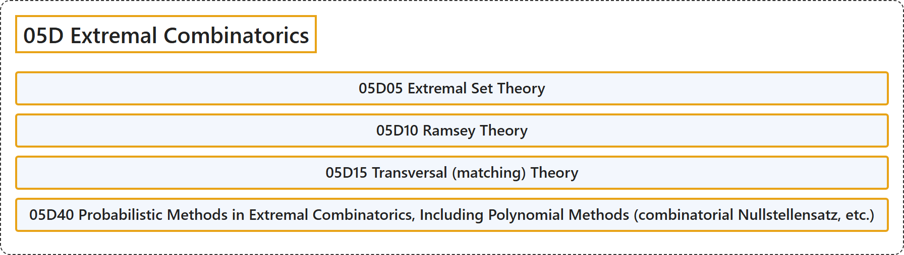

# 05D Extremal Combinatorics

## Classification

## Glossary

| Term | Definition | 中文翻译 | Source |
|---|---|---|---|
| **05D Extremal Combinatorics** 极值组合学 | (No definition) | （无定义） | [Associate Editors of Mathematical Reviews and zbMATH, 2020](https://msc2020.org/) |
| **05D05 Extremal Set Theory** 极值集合论 | (No definition) | （无定义） | [Associate Editors of Mathematical Reviews and zbMATH, 2020](https://msc2020.org/) |
| **05D10 Ramsey Theory** 拉姆齐理论 | (No definition) | （无定义） | [Associate Editors of Mathematical Reviews and zbMATH, 2020](https://msc2020.org/) |
| **05D15 Transversal (matching) Theory** 横截（匹配）理论 | (No definition) | （无定义） | [Associate Editors of Mathematical Reviews and zbMATH, 2020](https://msc2020.org/) |
| **05D40 Probabilistic Methods in Extremal Combinatorics, Including Polynomial Methods (combinatorial Nullstellensatz, etc.)** 极值组合学中的概率方法，包括多项式方法（组合零点定理等） | (No definition) | （无定义） | [Associate Editors of Mathematical Reviews and zbMATH, 2020](https://msc2020.org/) |

## References

Associate Editors of Mathematical Reviews and zbMATH. (2020). *MSC2020: Mathematics Subject Classification system*. Retrieved October 27, 2026, from <https://msc2020.org/>
