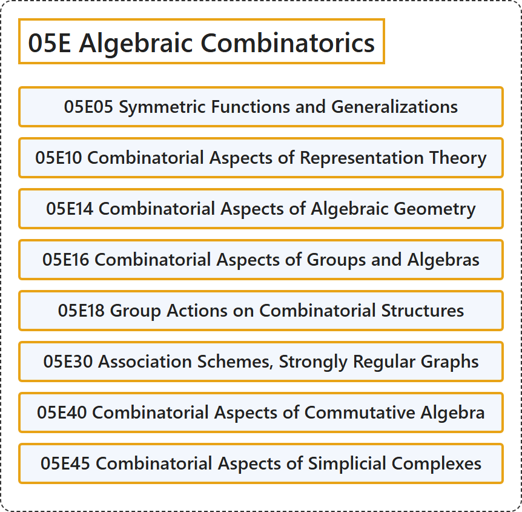

# 05E Algebraic Combinatorics

## Classification

## Glossary

| Term | Definition | 中文翻译 | Source |
|---|---|---|---|
| **05E Algebraic Combinatorics** 代数组合学 | (No definition) | （无定义） | [Associate Editors of Mathematical Reviews and zbMATH, 2020](https://msc2020.org/) |
| **05E05 Symmetric Functions and Generalizations** 对称函数及其推广 | (No definition) | （无定义） | [Associate Editors of Mathematical Reviews and zbMATH, 2020](https://msc2020.org/) |
| **05E10 Combinatorial Aspects of Representation Theory** 表示论的组合方面 | (No definition) | （无定义） | [Associate Editors of Mathematical Reviews and zbMATH, 2020](https://msc2020.org/) |
| **05E14 Combinatorial Aspects of Algebraic Geometry** 代数几何的组合方面 | (No definition) | （无定义） | [Associate Editors of Mathematical Reviews and zbMATH, 2020](https://msc2020.org/) |
| **05E16 Combinatorial Aspects of Groups and Algebras** 群与代数的组合方面 | (No definition) | （无定义） | [Associate Editors of Mathematical Reviews and zbMATH, 2020](https://msc2020.org/) |
| **05E18 Group Actions on Combinatorial Structures** 组合结构上的群作用 | (No definition) | （无定义） | [Associate Editors of Mathematical Reviews and zbMATH, 2020](https://msc2020.org/) |
| **05E30 Association Schemes, Strongly Regular Graphs** 结合方案、强正则图 | (No definition) | （无定义） | [Associate Editors of Mathematical Reviews and zbMATH, 2020](https://msc2020.org/) |
| **05E40 Combinatorial Aspects of Commutative Algebra** 交换代数的组合方面 | (No definition) | （无定义） | [Associate Editors of Mathematical Reviews and zbMATH, 2020](https://msc2020.org/) |
| **05E45 Combinatorial Aspects of Simplicial Complexes** 单纯复形的组合方面 | (No definition) | （无定义） | [Associate Editors of Mathematical Reviews and zbMATH, 2020](https://msc2020.org/) |

## References

Associate Editors of Mathematical Reviews and zbMATH. (2020). *MSC2020: Mathematics Subject Classification system*. Retrieved October 27, 2026, from <https://msc2020.org/>
