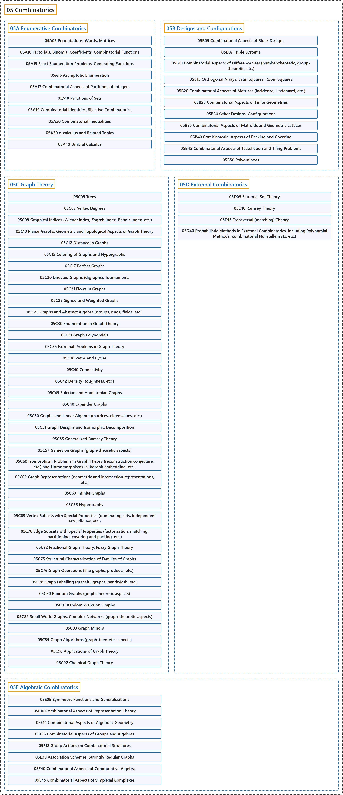

# 05 Combinatorics

## Classification

## Glossary

| Term | Definition | 中文翻译 | Source |
|---|---|---|---|
| **05 Combinatorics** 组合数学 | "Combinatorics, also called combinatorial mathematics, is the branch of discrete mathematics concerned with **enumeration problems, existence problems, constructions, and structural properties** of discrete objects." | 组合数学（也称组合学）是离散数学的一个分支，研究离散对象的**计数问题、存在性问题、构造以及结构性质**。 | [Weisstein, n.d., "Combinatorics" entry, para. 1](https://mathworld.wolfram.com/Combinatorics.html#:~:text=is%20the%20branch%20of%20discrete%20mathematics%20concerned%20with%20enumeration%20problems) |
| **[05A Enumerative Combinatorics](05a-enumerative-combinatorics.md)** 计数组合学 | (No definition) | （无定义） | [Associate Editors of Mathematical Reviews and zbMATH, 2020](https://msc2020.org/) |
| **[05B Designs and Configurations](05b-designs-and-configurations.md)** 设计与构形 | (No definition) | （无定义） | [Associate Editors of Mathematical Reviews and zbMATH, 2020](https://msc2020.org/) |
| **[05C Graph Theory](05c-graph-theory.md)** 图论 | (No definition) | （无定义） | [Associate Editors of Mathematical Reviews and zbMATH, 2020](https://msc2020.org/) |
| **[05D Extremal Combinatorics](05d-extremal-combinatorics.md)** 极值组合学 | (No definition) | （无定义） | [Associate Editors of Mathematical Reviews and zbMATH, 2020](https://msc2020.org/) |
| **[05E Algebraic Combinatorics](05e-algebraic-combinatorics.md)** 代数组合学 | (No definition) | （无定义） | [Associate Editors of Mathematical Reviews and zbMATH, 2020](https://msc2020.org/) |

## References

Associate Editors of Mathematical Reviews and zbMATH. (2020). *MSC2020: Mathematics Subject Classification system*. Retrieved October 27, 2026, from <https://msc2020.org/>

Weisstein, E. W. (n.d.). *Combinatorics*. MathWorld: A Wolfram Resource. Retrieved October 27, 2026, from <https://mathworld.wolfram.com/Combinatorics.html>
