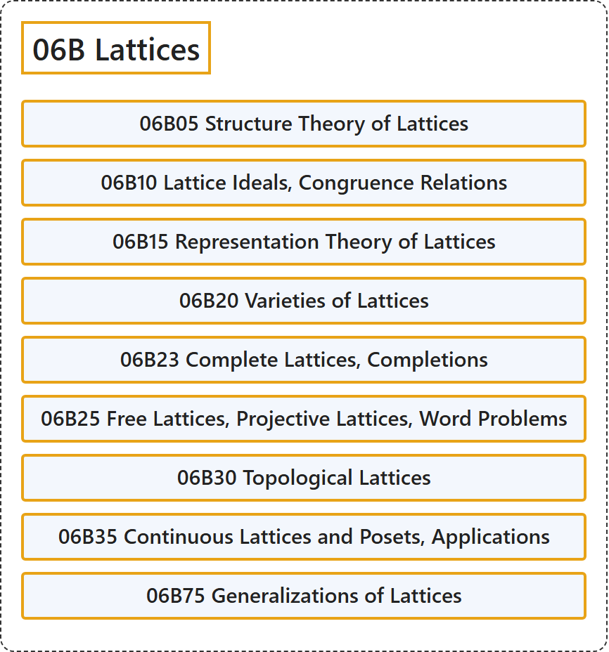

# 06B Lattices

## Classification

## Glossary

| Term | Definition | 中文翻译 | Source |
|---|---|---|---|
| **06B Lattices** 格 | (No definition) | （无定义） | [Associate Editors of Mathematical Reviews and zbMATH, 2020](https://msc2020.org/) |
| **06B05 Structure Theory of Lattices** 格的结构理论 | (No definition) | （无定义） | [Associate Editors of Mathematical Reviews and zbMATH, 2020](https://msc2020.org/) |
| **06B10 Lattice Ideals, Congruence Relations** 格理想、同余关系 | (No definition) | （无定义） | [Associate Editors of Mathematical Reviews and zbMATH, 2020](https://msc2020.org/) |
| **06B15 Representation Theory of Lattices** 格的表示论 | (No definition) | （无定义） | [Associate Editors of Mathematical Reviews and zbMATH, 2020](https://msc2020.org/) |
| **06B20 Varieties of Lattices** 格的簇 | (No definition) | （无定义） | [Associate Editors of Mathematical Reviews and zbMATH, 2020](https://msc2020.org/) |
| **06B23 Complete Lattices, Completions** 完备格、完备化 | (No definition) | （无定义） | [Associate Editors of Mathematical Reviews and zbMATH, 2020](https://msc2020.org/) |
| **06B25 Free Lattices, Projective Lattices, Word Problems** 自由格、投射格、字问题 | (No definition) | （无定义） | [Associate Editors of Mathematical Reviews and zbMATH, 2020](https://msc2020.org/) |
| **06B30 Topological Lattices** 拓扑格 | (No definition) | （无定义） | [Associate Editors of Mathematical Reviews and zbMATH, 2020](https://msc2020.org/) |
| **06B35 Continuous Lattices and Posets, Applications** 连续格与偏序集、应用 | (No definition) | （无定义） | [Associate Editors of Mathematical Reviews and zbMATH, 2020](https://msc2020.org/) |
| **06B75 Generalizations of Lattices** 格的推广 | (No definition) | （无定义） | [Associate Editors of Mathematical Reviews and zbMATH, 2020](https://msc2020.org/) |

## References

Associate Editors of Mathematical Reviews and zbMATH. (2020). *MSC2020: Mathematics Subject Classification system*. Retrieved October 27, 2026, from <https://msc2020.org/>
