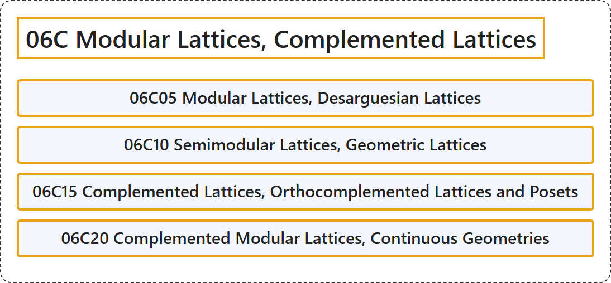

# 06C Modular Lattices, Complemented Lattices

## Classification

## Glossary

| Term | Definition | 中文翻译 | Source |
|---|---|---|---|
| **06C Modular Lattices, Complemented Lattices** 模格、有补格 | (No definition) | （无定义） | [Associate Editors of Mathematical Reviews and zbMATH, 2020](https://msc2020.org/) |
| **06C05 Modular Lattices, Desarguesian Lattices** 模格、Desargues 格 | (No definition) | （无定义） | [Associate Editors of Mathematical Reviews and zbMATH, 2020](https://msc2020.org/) |
| **06C10 Semimodular Lattices, Geometric Lattices** 半模格、几何格 | (No definition) | （无定义） | [Associate Editors of Mathematical Reviews and zbMATH, 2020](https://msc2020.org/) |
| **06C15 Complemented Lattices, Orthocomplemented Lattices and Posets** 有补格、正交有补格与偏序集 | (No definition) | （无定义） | [Associate Editors of Mathematical Reviews and zbMATH, 2020](https://msc2020.org/) |
| **06C20 Complemented Modular Lattices, Continuous Geometries** 有补模格、连续几何 | (No definition) | （无定义） | [Associate Editors of Mathematical Reviews and zbMATH, 2020](https://msc2020.org/) |

## References

Associate Editors of Mathematical Reviews and zbMATH. (2020). *MSC2020: Mathematics Subject Classification system*. Retrieved October 27, 2026, from <https://msc2020.org/>
