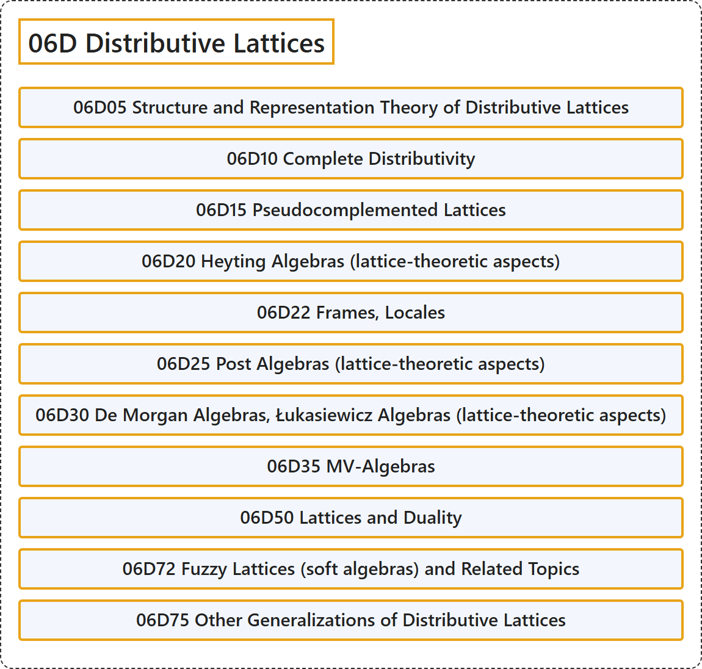

# 06D Distributive Lattices

## Classification

## Glossary

| Term | Definition | 中文翻译 | Source |
|---|---|---|---|
| **06D Distributive Lattices** 分配格 | (No definition) | （无定义） | [Associate Editors of Mathematical Reviews and zbMATH, 2020](https://msc2020.org/) |
| **06D05 Structure and Representation Theory of Distributive Lattices** 分配格的结构与表示论 | (No definition) | （无定义） | [Associate Editors of Mathematical Reviews and zbMATH, 2020](https://msc2020.org/) |
| **06D10 Complete Distributivity** 完全分配性 | (No definition) | （无定义） | [Associate Editors of Mathematical Reviews and zbMATH, 2020](https://msc2020.org/) |
| **06D15 Pseudocomplemented Lattices** 伪补格 | (No definition) | （无定义） | [Associate Editors of Mathematical Reviews and zbMATH, 2020](https://msc2020.org/) |
| **06D20 Heyting Algebras (lattice-theoretic aspects)** Heyting 代数（格论方面） | (No definition) | （无定义） | [Associate Editors of Mathematical Reviews and zbMATH, 2020](https://msc2020.org/) |
| **06D22 Frames, Locales** 框架、位式 | (No definition) | （无定义） | [Associate Editors of Mathematical Reviews and zbMATH, 2020](https://msc2020.org/) |
| **06D25 Post Algebras (lattice-theoretic aspects)** Post 代数（格论方面） | (No definition) | （无定义） | [Associate Editors of Mathematical Reviews and zbMATH, 2020](https://msc2020.org/) |
| **06D30 De Morgan Algebras, Łukasiewicz Algebras (lattice-theoretic aspects)** 德摩根代数、卢卡西维茨代数（格论方面） | (No definition) | （无定义） | [Associate Editors of Mathematical Reviews and zbMATH, 2020](https://msc2020.org/) |
| **06D35 MV-Algebras** MV 代数 | (No definition) | （无定义） | [Associate Editors of Mathematical Reviews and zbMATH, 2020](https://msc2020.org/) |
| **06D50 Lattices and Duality** 格与对偶 | (No definition) | （无定义） | [Associate Editors of Mathematical Reviews and zbMATH, 2020](https://msc2020.org/) |
| **06D72 Fuzzy Lattices (soft algebras) and Related Topics** 模糊格（软代数）及相关专题 | (No definition) | （无定义） | [Associate Editors of Mathematical Reviews and zbMATH, 2020](https://msc2020.org/) |
| **06D75 Other Generalizations of Distributive Lattices** 分配格的其他推广 | (No definition) | （无定义） | [Associate Editors of Mathematical Reviews and zbMATH, 2020](https://msc2020.org/) |

## References

Associate Editors of Mathematical Reviews and zbMATH. (2020). *MSC2020: Mathematics Subject Classification system*. Retrieved October 27, 2026, from <https://msc2020.org/>
