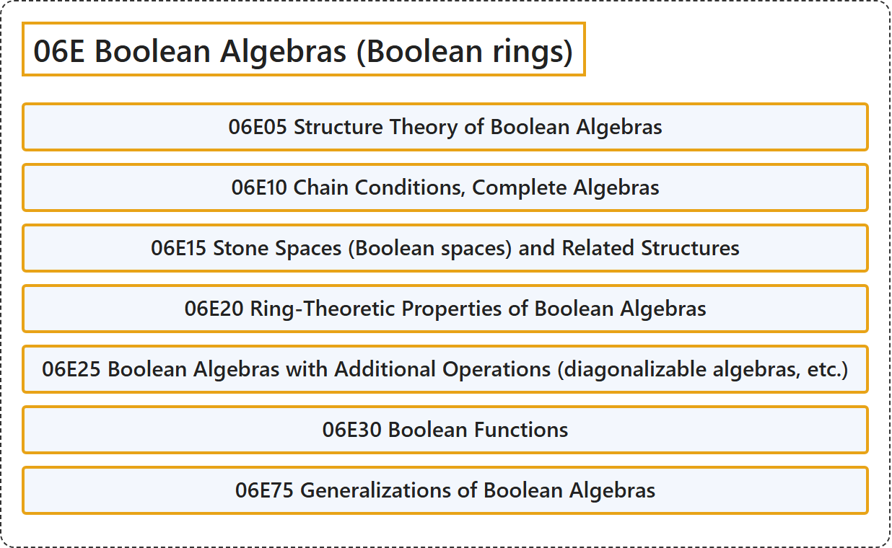

# 06E Boolean Algebras (Boolean rings)

## Classification

## Glossary

| Term | Definition | 中文翻译 | Source |
|---|---|---|---|
| **06E Boolean Algebras (Boolean rings)** 布尔代数（布尔环） | (No definition) | （无定义） | [Associate Editors of Mathematical Reviews and zbMATH, 2020](https://msc2020.org/) |
| **06E05 Structure Theory of Boolean Algebras** 布尔代数的结构理论 | (No definition) | （无定义） | [Associate Editors of Mathematical Reviews and zbMATH, 2020](https://msc2020.org/) |
| **06E10 Chain Conditions, Complete Algebras** 链条件、完备代数 | (No definition) | （无定义） | [Associate Editors of Mathematical Reviews and zbMATH, 2020](https://msc2020.org/) |
| **06E15 Stone Spaces (Boolean spaces) and Related Structures** 斯通空间（布尔空间）及相关结构 | (No definition) | （无定义） | [Associate Editors of Mathematical Reviews and zbMATH, 2020](https://msc2020.org/) |
| **06E20 Ring-Theoretic Properties of Boolean Algebras** 布尔代数的环论性质 | (No definition) | （无定义） | [Associate Editors of Mathematical Reviews and zbMATH, 2020](https://msc2020.org/) |
| **06E25 Boolean Algebras with Additional Operations (diagonalizable algebras, etc.)** 带附加运算的布尔代数（可对角化代数等） | (No definition) | （无定义） | [Associate Editors of Mathematical Reviews and zbMATH, 2020](https://msc2020.org/) |
| **06E30 Boolean Functions** 布尔函数 | (No definition) | （无定义） | [Associate Editors of Mathematical Reviews and zbMATH, 2020](https://msc2020.org/) |
| **06E75 Generalizations of Boolean Algebras** 布尔代数的推广 | (No definition) | （无定义） | [Associate Editors of Mathematical Reviews and zbMATH, 2020](https://msc2020.org/) |

## References

Associate Editors of Mathematical Reviews and zbMATH. (2020). *MSC2020: Mathematics Subject Classification system*. Retrieved October 27, 2026, from <https://msc2020.org/>
