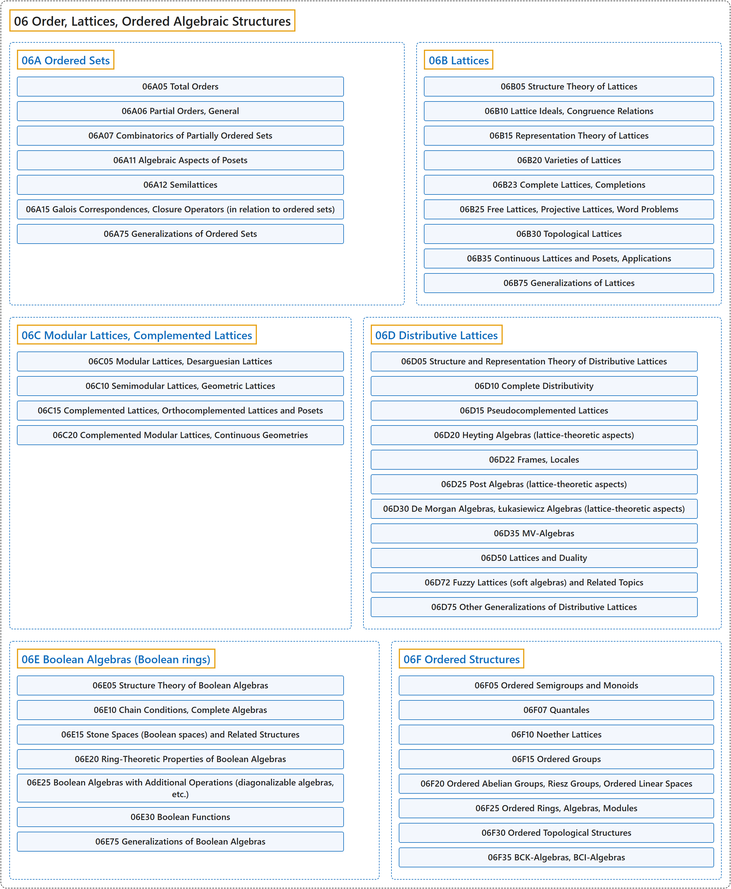

# 06 Order, Lattices, Ordered Algebraic Structures

## Classification

## Glossary

| Term | Definition | 中文翻译 | Source |
|---|---|---|---|
| **06 Order, Lattices, Ordered Algebraic Structures** 序、格、有序代数结构 | (context) "A partially ordered set (or poset) is **a set taken together with a partial order on it**." | （语境）偏序集（poset）是**一个集合连同它上面的一个偏序**。 | [Weisstein, n.d., "Partially ordered set" entry, para. 1](https://mathworld.wolfram.com/PartiallyOrderedSet.html#:~:text=A%20partially%20ordered%20set%20%28or%20poset%29%20is%20a%20set%20taken%20together) |
| **[06A Ordered Sets](06a-ordered-sets.md)** 序集 | (No definition) | （无定义） | [Associate Editors of Mathematical Reviews and zbMATH, 2020](https://msc2020.org/) |
| **[06B Lattices](06b-lattices.md)** 格 | (No definition) | （无定义） | [Associate Editors of Mathematical Reviews and zbMATH, 2020](https://msc2020.org/) |
| **[06C Modular Lattices, Complemented Lattices](06c-modular-lattices-complemented-lattices.md)** 模格、有补格 | (No definition) | （无定义） | [Associate Editors of Mathematical Reviews and zbMATH, 2020](https://msc2020.org/) |
| **[06D Distributive Lattices](06d-distributive-lattices.md)** 分配格 | (No definition) | （无定义） | [Associate Editors of Mathematical Reviews and zbMATH, 2020](https://msc2020.org/) |
| **[06E Boolean Algebras (Boolean rings)](06e-boolean-algebras-boolean-rings.md)** 布尔代数（布尔环） | (No definition) | （无定义） | [Associate Editors of Mathematical Reviews and zbMATH, 2020](https://msc2020.org/) |
| **[06F Ordered Structures](06f-ordered-structures.md)** 序结构 | (No definition) | （无定义） | [Associate Editors of Mathematical Reviews and zbMATH, 2020](https://msc2020.org/) |

## References

Associate Editors of Mathematical Reviews and zbMATH. (2020). *MSC2020: Mathematics Subject Classification system*. Retrieved October 27, 2026, from <https://msc2020.org/>

Weisstein, E. W. (n.d.). *Partially ordered set*. MathWorld: A Wolfram Resource. Retrieved October 27, 2026, from <https://mathworld.wolfram.com/PartiallyOrderedSet.html>
