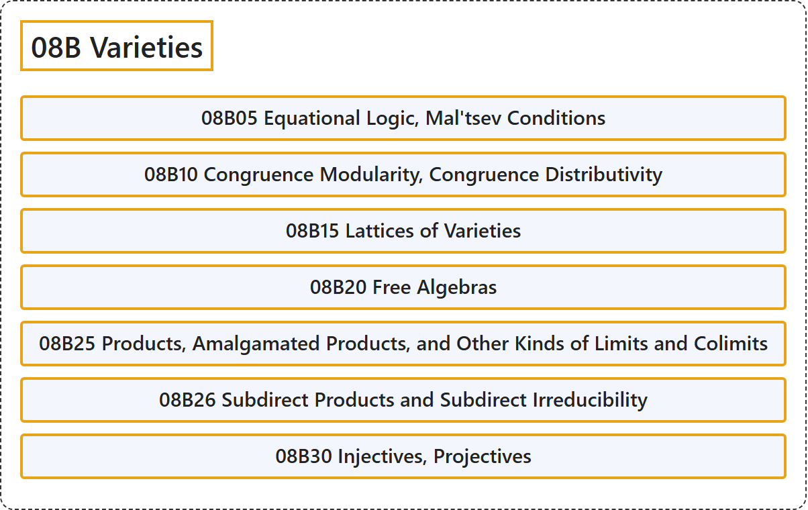

# 08B Varieties

## Classification

## Glossary

| Term | Definition | 中文翻译 | Source |
|---|---|---|---|
| **08B Varieties** 簇 | (No definition) | （无定义） | [Associate Editors of Mathematical Reviews and zbMATH, 2020](https://msc2020.org/) |
| **08B05 Equational Logic, Mal'tsev Conditions** 方程逻辑、Mal'tsev 条件 | (No definition) | （无定义） | [Associate Editors of Mathematical Reviews and zbMATH, 2020](https://msc2020.org/) |
| **08B10 Congruence Modularity, Congruence Distributivity** 同余模性、同余分配性 | (No definition) | （无定义） | [Associate Editors of Mathematical Reviews and zbMATH, 2020](https://msc2020.org/) |
| **08B15 Lattices of Varieties** 簇的格 | (No definition) | （无定义） | [Associate Editors of Mathematical Reviews and zbMATH, 2020](https://msc2020.org/) |
| **08B20 Free Algebras** 自由代数 | (No definition) | （无定义） | [Associate Editors of Mathematical Reviews and zbMATH, 2020](https://msc2020.org/) |
| **08B25 Products, Amalgamated Products, and Other Kinds of Limits and Colimits** 积、融合积及其他类型的极限与余极限 | (No definition) | （无定义） | [Associate Editors of Mathematical Reviews and zbMATH, 2020](https://msc2020.org/) |
| **08B26 Subdirect Products and Subdirect Irreducibility** 次直积与次直不可约性 | (No definition) | （无定义） | [Associate Editors of Mathematical Reviews and zbMATH, 2020](https://msc2020.org/) |
| **08B30 Injectives, Projectives** 内射对象、投射对象 | (No definition) | （无定义） | [Associate Editors of Mathematical Reviews and zbMATH, 2020](https://msc2020.org/) |

## References

Associate Editors of Mathematical Reviews and zbMATH. (2020). *MSC2020: Mathematics Subject Classification system*. Retrieved October 27, 2026, from <https://msc2020.org/>
