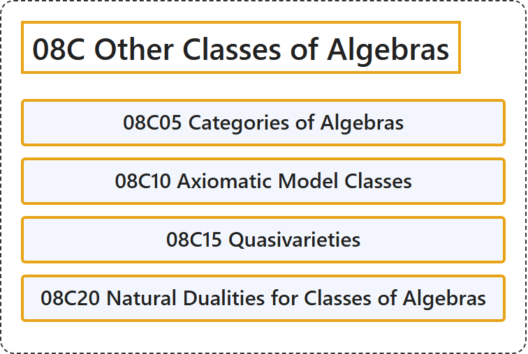

# 08C Other Classes of Algebras

## Classification

## Glossary

| Term | Definition | 中文翻译 | Source |
|---|---|---|---|
| **08C Other Classes of Algebras** 其他代数类 | (No definition) | （无定义） | [Associate Editors of Mathematical Reviews and zbMATH, 2020](https://msc2020.org/) |
| **08C05 Categories of Algebras** 代数的范畴 | (No definition) | （无定义） | [Associate Editors of Mathematical Reviews and zbMATH, 2020](https://msc2020.org/) |
| **08C10 Axiomatic Model Classes** 公理化模型类 | (No definition) | （无定义） | [Associate Editors of Mathematical Reviews and zbMATH, 2020](https://msc2020.org/) |
| **08C15 Quasivarieties** 拟簇 | (No definition) | （无定义） | [Associate Editors of Mathematical Reviews and zbMATH, 2020](https://msc2020.org/) |
| **08C20 Natural Dualities for Classes of Algebras** 代数类的自然对偶 | (No definition) | （无定义） | [Associate Editors of Mathematical Reviews and zbMATH, 2020](https://msc2020.org/) |

## References

Associate Editors of Mathematical Reviews and zbMATH. (2020). *MSC2020: Mathematics Subject Classification system*. Retrieved October 27, 2026, from <https://msc2020.org/>
