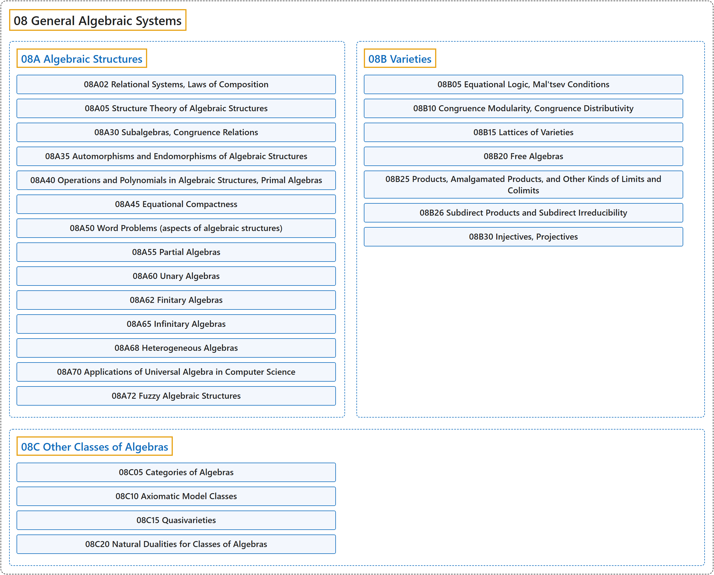

# 08 General Algebraic Systems

## Classification

## Glossary

| Term | Definition | 中文翻译 | Source |
|---|---|---|---|
| **08 General Algebraic Systems** 一般代数系统 | (context) "Universal algebra studies **common properties of all algebraic structures**, including groups, rings, fields, lattices, etc." | （语境）泛代数研究**所有代数结构的共同性质**，这些结构包括群、环、域、格等。 | [Weisstein, n.d., "Universal algebra" entry, para. 1](https://mathworld.wolfram.com/UniversalAlgebra.html#:~:text=Universal%20algebra%20studies%20common%20properties%20of%20all%20algebraic%20structures) |
| **[08A Algebraic Structures](08a-algebraic-structures.md)** 代数结构 | (No definition) | （无定义） | [Associate Editors of Mathematical Reviews and zbMATH, 2020](https://msc2020.org/) |
| **[08B Varieties](08b-varieties.md)** 簇 | (No definition) | （无定义） | [Associate Editors of Mathematical Reviews and zbMATH, 2020](https://msc2020.org/) |
| **[08C Other Classes of Algebras](08c-other-classes-of-algebras.md)** 其他代数类 | (No definition) | （无定义） | [Associate Editors of Mathematical Reviews and zbMATH, 2020](https://msc2020.org/) |

## References

Associate Editors of Mathematical Reviews and zbMATH. (2020). *MSC2020: Mathematics Subject Classification system*. Retrieved October 27, 2026, from <https://msc2020.org/>

Weisstein, E. W. (n.d.). *Universal algebra*. MathWorld: A Wolfram Resource. Retrieved October 27, 2026, from <https://mathworld.wolfram.com/UniversalAlgebra.html>
