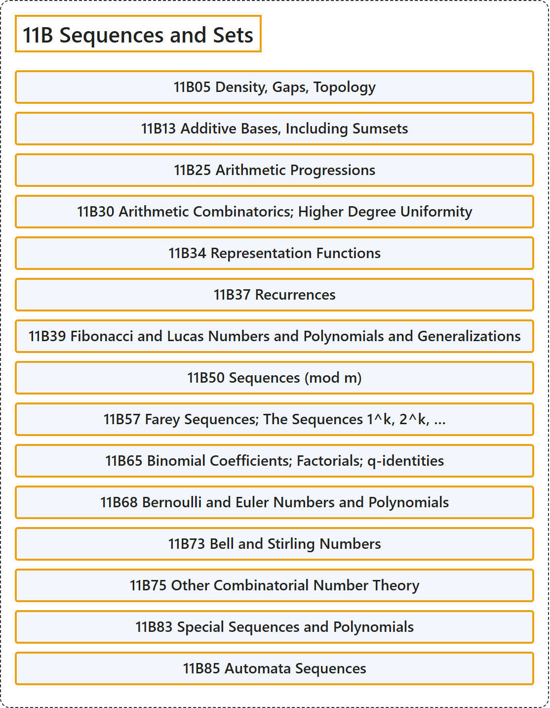

# 11B Sequences and Sets

## Classification

## Glossary

| Term | Definition | 中文翻译 | Source |
|---|---|---|---|
| **11B Sequences and Sets** 序列与集合 | (No definition) | （无定义） | [Associate Editors of Mathematical Reviews and zbMATH, 2020](https://msc2020.org/) |
| **11B05 Density, Gaps, Topology** 密度、间隙、拓扑 | (No definition) | （无定义） | [Associate Editors of Mathematical Reviews and zbMATH, 2020](https://msc2020.org/) |
| **11B13 Additive Bases, Including Sumsets** 加性基，包括和集 | (No definition) | （无定义） | [Associate Editors of Mathematical Reviews and zbMATH, 2020](https://msc2020.org/) |
| **11B25 Arithmetic Progressions** 等差数列 | (No definition) | （无定义） | [Associate Editors of Mathematical Reviews and zbMATH, 2020](https://msc2020.org/) |
| **11B30 Arithmetic Combinatorics; Higher Degree Uniformity** 算术组合学；高阶一致性 | (No definition) | （无定义） | [Associate Editors of Mathematical Reviews and zbMATH, 2020](https://msc2020.org/) |
| **11B34 Representation Functions** 表示函数 | (No definition) | （无定义） | [Associate Editors of Mathematical Reviews and zbMATH, 2020](https://msc2020.org/) |
| **11B37 Recurrences** 递推 | (No definition) | （无定义） | [Associate Editors of Mathematical Reviews and zbMATH, 2020](https://msc2020.org/) |
| **11B39 Fibonacci and Lucas Numbers and Polynomials and Generalizations** 斐波那契数与卢卡斯数及多项式与推广 | (No definition) | （无定义） | [Associate Editors of Mathematical Reviews and zbMATH, 2020](https://msc2020.org/) |
| **11B50 Sequences (mod m)** 序列（模 m） | (No definition) | （无定义） | [Associate Editors of Mathematical Reviews and zbMATH, 2020](https://msc2020.org/) |
| **11B57 Farey Sequences; The Sequences 1^k, 2^k, …** 法里序列；序列 1^k, 2^k, … | (No definition) | （无定义） | [Associate Editors of Mathematical Reviews and zbMATH, 2020](https://msc2020.org/) |
| **11B65 Binomial Coefficients; Factorials; q-identities** 二项式系数；阶乘；q 恒等式 | (No definition) | （无定义） | [Associate Editors of Mathematical Reviews and zbMATH, 2020](https://msc2020.org/) |
| **11B68 Bernoulli and Euler Numbers and Polynomials** 伯努利数与欧拉数及多项式 | (No definition) | （无定义） | [Associate Editors of Mathematical Reviews and zbMATH, 2020](https://msc2020.org/) |
| **11B73 Bell and Stirling Numbers** 贝尔数与斯特林数 | (No definition) | （无定义） | [Associate Editors of Mathematical Reviews and zbMATH, 2020](https://msc2020.org/) |
| **11B75 Other Combinatorial Number Theory** 其他组合数论 | (No definition) | （无定义） | [Associate Editors of Mathematical Reviews and zbMATH, 2020](https://msc2020.org/) |
| **11B83 Special Sequences and Polynomials** 特殊序列与多项式 | (No definition) | （无定义） | [Associate Editors of Mathematical Reviews and zbMATH, 2020](https://msc2020.org/) |
| **11B85 Automata Sequences** 自动机序列 | (No definition) | （无定义） | [Associate Editors of Mathematical Reviews and zbMATH, 2020](https://msc2020.org/) |

## References

Associate Editors of Mathematical Reviews and zbMATH. (2020). *MSC2020: Mathematics Subject Classification system*. Retrieved October 27, 2026, from <https://msc2020.org/>
