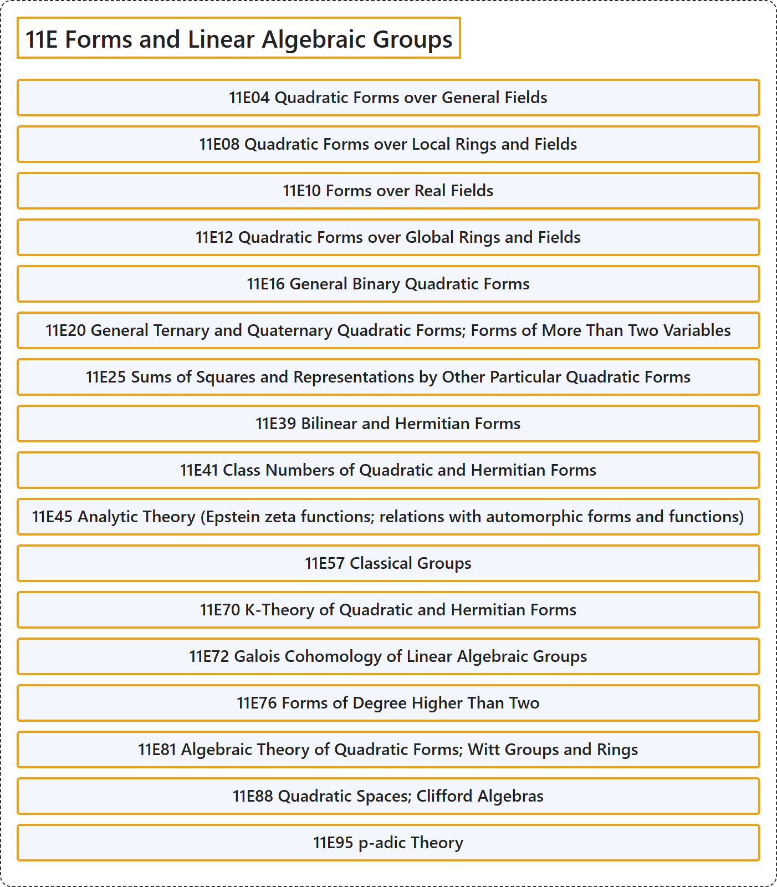

# 11E Forms and Linear Algebraic Groups

## Classification

## Glossary

| Term | Definition | 中文翻译 | Source |
|---|---|---|---|
| **11E Forms and Linear Algebraic Groups** 型与线性代数群 | (No definition) | （无定义） | [Associate Editors of Mathematical Reviews and zbMATH, 2020](https://msc2020.org/) |
| **11E04 Quadratic Forms over General Fields** 一般域上的二次型 | (No definition) | （无定义） | [Associate Editors of Mathematical Reviews and zbMATH, 2020](https://msc2020.org/) |
| **11E08 Quadratic Forms over Local Rings and Fields** 局部环与局部域上的二次型 | (No definition) | （无定义） | [Associate Editors of Mathematical Reviews and zbMATH, 2020](https://msc2020.org/) |
| **11E10 Forms over Real Fields** 实域上的型 | (No definition) | （无定义） | [Associate Editors of Mathematical Reviews and zbMATH, 2020](https://msc2020.org/) |
| **11E12 Quadratic Forms over Global Rings and Fields** 整体环与整体域上的二次型 | (No definition) | （无定义） | [Associate Editors of Mathematical Reviews and zbMATH, 2020](https://msc2020.org/) |
| **11E16 General Binary Quadratic Forms** 一般二元二次型 | (No definition) | （无定义） | [Associate Editors of Mathematical Reviews and zbMATH, 2020](https://msc2020.org/) |
| **11E20 General Ternary and Quaternary Quadratic Forms; Forms of More Than Two Variables** 一般三元与四元二次型；多于两个变量的型 | (No definition) | （无定义） | [Associate Editors of Mathematical Reviews and zbMATH, 2020](https://msc2020.org/) |
| **11E25 Sums of Squares and Representations by Other Particular Quadratic Forms** 平方和及由其他特殊二次型的表示 | (No definition) | （无定义） | [Associate Editors of Mathematical Reviews and zbMATH, 2020](https://msc2020.org/) |
| **11E39 Bilinear and Hermitian Forms** 双线性型与埃尔米特型 | (No definition) | （无定义） | [Associate Editors of Mathematical Reviews and zbMATH, 2020](https://msc2020.org/) |
| **11E41 Class Numbers of Quadratic and Hermitian Forms** 二次型与埃尔米特型的类数 | (No definition) | （无定义） | [Associate Editors of Mathematical Reviews and zbMATH, 2020](https://msc2020.org/) |
| **11E45 Analytic Theory (Epstein zeta functions; relations with automorphic forms and functions)** 解析理论（爱泼斯坦 zeta 函数；与自守形式及自守函数的关系） | (No definition) | （无定义） | [Associate Editors of Mathematical Reviews and zbMATH, 2020](https://msc2020.org/) |
| **11E57 Classical Groups** 典型群 | (No definition) | （无定义） | [Associate Editors of Mathematical Reviews and zbMATH, 2020](https://msc2020.org/) |
| **11E70 K-Theory of Quadratic and Hermitian Forms** 二次型与埃尔米特型的 K 理论 | (No definition) | （无定义） | [Associate Editors of Mathematical Reviews and zbMATH, 2020](https://msc2020.org/) |
| **11E72 Galois Cohomology of Linear Algebraic Groups** 线性代数群的伽罗瓦上同调 | (No definition) | （无定义） | [Associate Editors of Mathematical Reviews and zbMATH, 2020](https://msc2020.org/) |
| **11E76 Forms of Degree Higher Than Two** 高于二次的型 | (No definition) | （无定义） | [Associate Editors of Mathematical Reviews and zbMATH, 2020](https://msc2020.org/) |
| **11E81 Algebraic Theory of Quadratic Forms; Witt Groups and Rings** 二次型的代数理论；Witt 群与 Witt 环 | (No definition) | （无定义） | [Associate Editors of Mathematical Reviews and zbMATH, 2020](https://msc2020.org/) |
| **11E88 Quadratic Spaces; Clifford Algebras** 二次空间；克利福德代数 | (No definition) | （无定义） | [Associate Editors of Mathematical Reviews and zbMATH, 2020](https://msc2020.org/) |
| **11E95 p-adic Theory** p 进理论 | (No definition) | （无定义） | [Associate Editors of Mathematical Reviews and zbMATH, 2020](https://msc2020.org/) |

## References

Associate Editors of Mathematical Reviews and zbMATH. (2020). *MSC2020: Mathematics Subject Classification system*. Retrieved October 27, 2026, from <https://msc2020.org/>
