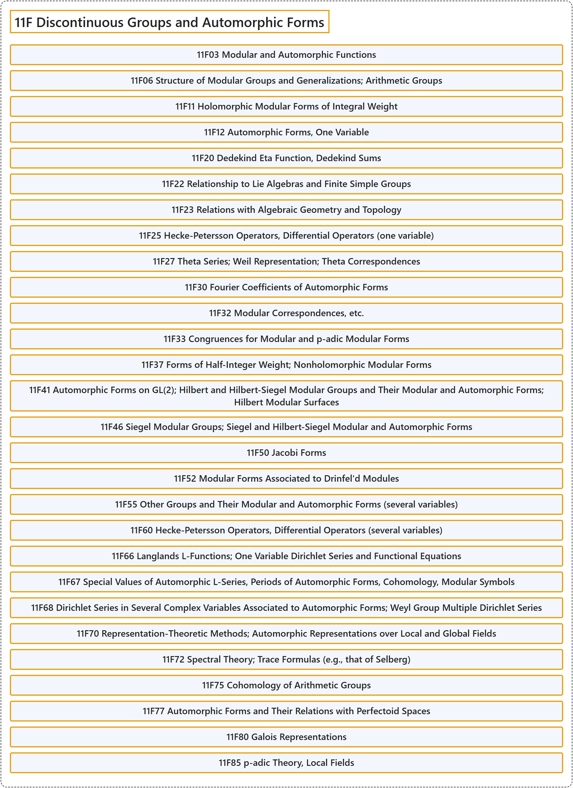

# 11F Discontinuous Groups and Automorphic Forms

## Classification

## Glossary

| Term | Definition | 中文翻译 | Source |
|---|---|---|---|
| **11F Discontinuous Groups and Automorphic Forms** 不连续群与自守形式 | (No definition) | （无定义） | [Associate Editors of Mathematical Reviews and zbMATH, 2020](https://msc2020.org/) |
| **11F03 Modular and Automorphic Functions** 模函数与自守函数 | (No definition) | （无定义） | [Associate Editors of Mathematical Reviews and zbMATH, 2020](https://msc2020.org/) |
| **11F06 Structure of Modular Groups and Generalizations; Arithmetic Groups** 模群的结构及其推广；算术群 | (No definition) | （无定义） | [Associate Editors of Mathematical Reviews and zbMATH, 2020](https://msc2020.org/) |
| **11F11 Holomorphic Modular Forms of Integral Weight** 整权全纯模形式 | (No definition) | （无定义） | [Associate Editors of Mathematical Reviews and zbMATH, 2020](https://msc2020.org/) |
| **11F12 Automorphic Forms, One Variable** 自守形式，一变量 | (No definition) | （无定义） | [Associate Editors of Mathematical Reviews and zbMATH, 2020](https://msc2020.org/) |
| **11F20 Dedekind Eta Function, Dedekind Sums** 戴德金 eta 函数、戴德金和 | (No definition) | （无定义） | [Associate Editors of Mathematical Reviews and zbMATH, 2020](https://msc2020.org/) |
| **11F22 Relationship to Lie Algebras and Finite Simple Groups** 与李代数及有限单群的关系 | (No definition) | （无定义） | [Associate Editors of Mathematical Reviews and zbMATH, 2020](https://msc2020.org/) |
| **11F23 Relations with Algebraic Geometry and Topology** 与代数几何及拓扑的关系 | (No definition) | （无定义） | [Associate Editors of Mathematical Reviews and zbMATH, 2020](https://msc2020.org/) |
| **11F25 Hecke-Petersson Operators, Differential Operators (one variable)** Hecke-Petersson 算子、微分算子（一变量） | (No definition) | （无定义） | [Associate Editors of Mathematical Reviews and zbMATH, 2020](https://msc2020.org/) |
| **11F27 Theta Series; Weil Representation; Theta Correspondences** theta 级数；Weil 表示；theta 对应 | (No definition) | （无定义） | [Associate Editors of Mathematical Reviews and zbMATH, 2020](https://msc2020.org/) |
| **11F30 Fourier Coefficients of Automorphic Forms** 自守形式的傅里叶系数 | (No definition) | （无定义） | [Associate Editors of Mathematical Reviews and zbMATH, 2020](https://msc2020.org/) |
| **11F32 Modular Correspondences, etc.** 模对应等 | (No definition) | （无定义） | [Associate Editors of Mathematical Reviews and zbMATH, 2020](https://msc2020.org/) |
| **11F33 Congruences for Modular and p-adic Modular Forms** 模形式与 p 进模形式的同余 | (No definition) | （无定义） | [Associate Editors of Mathematical Reviews and zbMATH, 2020](https://msc2020.org/) |
| **11F37 Forms of Half-Integer Weight; Nonholomorphic Modular Forms** 半整权形式；非全纯模形式 | (No definition) | （无定义） | [Associate Editors of Mathematical Reviews and zbMATH, 2020](https://msc2020.org/) |
| **11F41 Automorphic Forms on GL(2); Hilbert and Hilbert-Siegel Modular Groups and Their Modular and Automorphic Forms; Hilbert Modular Surfaces** GL(2) 上的自守形式；希尔伯特与希尔伯特-西格尔模群及其模形式与自守形式；希尔伯特模曲面 | (No definition) | （无定义） | [Associate Editors of Mathematical Reviews and zbMATH, 2020](https://msc2020.org/) |
| **11F46 Siegel Modular Groups; Siegel and Hilbert-Siegel Modular and Automorphic Forms** 西格尔模群；西格尔与希尔伯特-西格尔模形式及自守形式 | (No definition) | （无定义） | [Associate Editors of Mathematical Reviews and zbMATH, 2020](https://msc2020.org/) |
| **11F50 Jacobi Forms** 雅可比形式 | (No definition) | （无定义） | [Associate Editors of Mathematical Reviews and zbMATH, 2020](https://msc2020.org/) |
| **11F52 Modular Forms Associated to Drinfel'd Modules** 与 Drinfel'd 模相关的模形式 | (No definition) | （无定义） | [Associate Editors of Mathematical Reviews and zbMATH, 2020](https://msc2020.org/) |
| **11F55 Other Groups and Their Modular and Automorphic Forms (several variables)** 其他群及其模形式与自守形式（多变量） | (No definition) | （无定义） | [Associate Editors of Mathematical Reviews and zbMATH, 2020](https://msc2020.org/) |
| **11F60 Hecke-Petersson Operators, Differential Operators (several variables)** Hecke-Petersson 算子、微分算子（多变量） | (No definition) | （无定义） | [Associate Editors of Mathematical Reviews and zbMATH, 2020](https://msc2020.org/) |
| **11F66 Langlands L-Functions; One Variable Dirichlet Series and Functional Equations** 朗兰兹 L 函数；一变量狄利克雷级数与函数方程 | (No definition) | （无定义） | [Associate Editors of Mathematical Reviews and zbMATH, 2020](https://msc2020.org/) |
| **11F67 Special Values of Automorphic L-Series, Periods of Automorphic Forms, Cohomology, Modular Symbols** 自守 L 级数的特殊值、自守形式的周期、上同调、模符号 | (No definition) | （无定义） | [Associate Editors of Mathematical Reviews and zbMATH, 2020](https://msc2020.org/) |
| **11F68 Dirichlet Series in Several Complex Variables Associated to Automorphic Forms; Weyl Group Multiple Dirichlet Series** 与自守形式相关的多复变狄利克雷级数；外尔群多重狄利克雷级数 | (No definition) | （无定义） | [Associate Editors of Mathematical Reviews and zbMATH, 2020](https://msc2020.org/) |
| **11F70 Representation-Theoretic Methods; Automorphic Representations over Local and Global Fields** 表示论方法；局部域与整体域上的自守表示 | (No definition) | （无定义） | [Associate Editors of Mathematical Reviews and zbMATH, 2020](https://msc2020.org/) |
| **11F72 Spectral Theory; Trace Formulas (e.g., that of Selberg)** 谱理论；迹公式（例如塞尔伯格迹公式） | (No definition) | （无定义） | [Associate Editors of Mathematical Reviews and zbMATH, 2020](https://msc2020.org/) |
| **11F75 Cohomology of Arithmetic Groups** 算术群的上同调 | (No definition) | （无定义） | [Associate Editors of Mathematical Reviews and zbMATH, 2020](https://msc2020.org/) |
| **11F77 Automorphic Forms and Their Relations with Perfectoid Spaces** 自守形式及其与完美胚空间的关系 | (No definition) | （无定义） | [Associate Editors of Mathematical Reviews and zbMATH, 2020](https://msc2020.org/) |
| **11F80 Galois Representations** 伽罗瓦表示 | (No definition) | （无定义） | [Associate Editors of Mathematical Reviews and zbMATH, 2020](https://msc2020.org/) |
| **11F85 p-adic Theory, Local Fields** p 进理论、局部域 | (No definition) | （无定义） | [Associate Editors of Mathematical Reviews and zbMATH, 2020](https://msc2020.org/) |

## References

Associate Editors of Mathematical Reviews and zbMATH. (2020). *MSC2020: Mathematics Subject Classification system*. Retrieved October 27, 2026, from <https://msc2020.org/>
