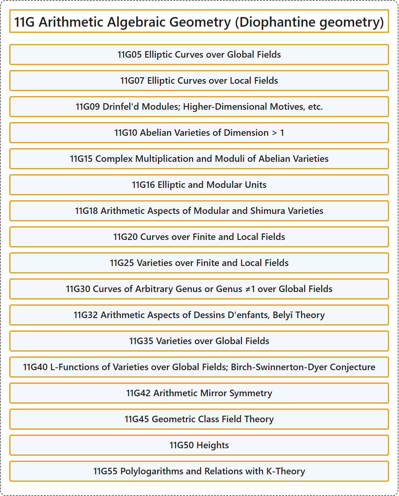

# 11G Arithmetic Algebraic Geometry (Diophantine geometry)

## Classification

## Glossary

| Term | Definition | 中文翻译 | Source |
|---|---|---|---|
| **11G Arithmetic Algebraic Geometry (Diophantine geometry)** 算术代数几何（丢番图几何） | (No definition) | （无定义） | [Associate Editors of Mathematical Reviews and zbMATH, 2020](https://msc2020.org/) |
| **11G05 Elliptic Curves over Global Fields** 整体域上的椭圆曲线 | (No definition) | （无定义） | [Associate Editors of Mathematical Reviews and zbMATH, 2020](https://msc2020.org/) |
| **11G07 Elliptic Curves over Local Fields** 局部域上的椭圆曲线 | (No definition) | （无定义） | [Associate Editors of Mathematical Reviews and zbMATH, 2020](https://msc2020.org/) |
| **11G09 Drinfel'd Modules; Higher-Dimensional Motives, etc.** Drinfel'd 模；高维 motive 等 | (No definition) | （无定义） | [Associate Editors of Mathematical Reviews and zbMATH, 2020](https://msc2020.org/) |
| **11G10 Abelian Varieties of Dimension > 1** 维数 > 1 的阿贝尔簇 | (No definition) | （无定义） | [Associate Editors of Mathematical Reviews and zbMATH, 2020](https://msc2020.org/) |
| **11G15 Complex Multiplication and Moduli of Abelian Varieties** 复乘法与阿贝尔簇的模 | (No definition) | （无定义） | [Associate Editors of Mathematical Reviews and zbMATH, 2020](https://msc2020.org/) |
| **11G16 Elliptic and Modular Units** 椭圆单位与模单位 | (No definition) | （无定义） | [Associate Editors of Mathematical Reviews and zbMATH, 2020](https://msc2020.org/) |
| **11G18 Arithmetic Aspects of Modular and Shimura Varieties** 模簇与志村簇的算术方面 | (No definition) | （无定义） | [Associate Editors of Mathematical Reviews and zbMATH, 2020](https://msc2020.org/) |
| **11G20 Curves over Finite and Local Fields** 有限域与局部域上的曲线 | (No definition) | （无定义） | [Associate Editors of Mathematical Reviews and zbMATH, 2020](https://msc2020.org/) |
| **11G25 Varieties over Finite and Local Fields** 有限域与局部域上的簇 | (No definition) | （无定义） | [Associate Editors of Mathematical Reviews and zbMATH, 2020](https://msc2020.org/) |
| **11G30 Curves of Arbitrary Genus or Genus ≠1 over Global Fields** 整体域上任意亏格或亏格 ≠1 的曲线 | (No definition) | （无定义） | [Associate Editors of Mathematical Reviews and zbMATH, 2020](https://msc2020.org/) |
| **11G32 Arithmetic Aspects of Dessins D'enfants, Belyĭ Theory** dessins d'enfants 的算术方面、Belyĭ 理论 | (No definition) | （无定义） | [Associate Editors of Mathematical Reviews and zbMATH, 2020](https://msc2020.org/) |
| **11G35 Varieties over Global Fields** 整体域上的簇 | (No definition) | （无定义） | [Associate Editors of Mathematical Reviews and zbMATH, 2020](https://msc2020.org/) |
| **11G40 L-Functions of Varieties over Global Fields; Birch-Swinnerton-Dyer Conjecture** 整体域上簇的 L 函数；伯奇-斯温纳顿-戴尔猜想 | (No definition) | （无定义） | [Associate Editors of Mathematical Reviews and zbMATH, 2020](https://msc2020.org/) |
| **11G42 Arithmetic Mirror Symmetry** 算术镜像对称 | (No definition) | （无定义） | [Associate Editors of Mathematical Reviews and zbMATH, 2020](https://msc2020.org/) |
| **11G45 Geometric Class Field Theory** 几何类域论 | (No definition) | （无定义） | [Associate Editors of Mathematical Reviews and zbMATH, 2020](https://msc2020.org/) |
| **11G50 Heights** 高度 | (No definition) | （无定义） | [Associate Editors of Mathematical Reviews and zbMATH, 2020](https://msc2020.org/) |
| **11G55 Polylogarithms and Relations with K-Theory** 多重对数与同 K 理论的关系 | (No definition) | （无定义） | [Associate Editors of Mathematical Reviews and zbMATH, 2020](https://msc2020.org/) |

## References

Associate Editors of Mathematical Reviews and zbMATH. (2020). *MSC2020: Mathematics Subject Classification system*. Retrieved October 27, 2026, from <https://msc2020.org/>
