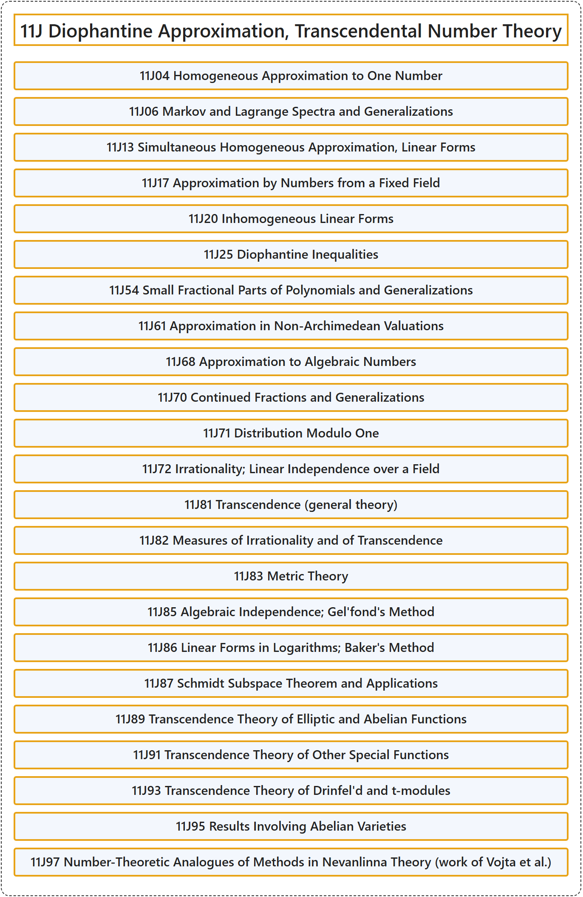

# 11J Diophantine Approximation, Transcendental Number Theory

## Classification

## Glossary

| Term | Definition | 中文翻译 | Source |
|---|---|---|---|
| **11J Diophantine Approximation, Transcendental Number Theory** 丢番图逼近、超越数论 | (No definition) | （无定义） | [Associate Editors of Mathematical Reviews and zbMATH, 2020](https://msc2020.org/) |
| **11J04 Homogeneous Approximation to One Number** 对一个数的齐次逼近 | (No definition) | （无定义） | [Associate Editors of Mathematical Reviews and zbMATH, 2020](https://msc2020.org/) |
| **11J06 Markov and Lagrange Spectra and Generalizations** 马尔可夫谱与拉格朗日谱及推广 | (No definition) | （无定义） | [Associate Editors of Mathematical Reviews and zbMATH, 2020](https://msc2020.org/) |
| **11J13 Simultaneous Homogeneous Approximation, Linear Forms** 联立齐次逼近、线性型 | (No definition) | （无定义） | [Associate Editors of Mathematical Reviews and zbMATH, 2020](https://msc2020.org/) |
| **11J17 Approximation by Numbers from a Fixed Field** 用固定域中的数逼近 | (No definition) | （无定义） | [Associate Editors of Mathematical Reviews and zbMATH, 2020](https://msc2020.org/) |
| **11J20 Inhomogeneous Linear Forms** 非齐次线性型 | (No definition) | （无定义） | [Associate Editors of Mathematical Reviews and zbMATH, 2020](https://msc2020.org/) |
| **11J25 Diophantine Inequalities** 丢番图不等式 | (No definition) | （无定义） | [Associate Editors of Mathematical Reviews and zbMATH, 2020](https://msc2020.org/) |
| **11J54 Small Fractional Parts of Polynomials and Generalizations** 多项式的小分数部分及推广 | (No definition) | （无定义） | [Associate Editors of Mathematical Reviews and zbMATH, 2020](https://msc2020.org/) |
| **11J61 Approximation in Non-Archimedean Valuations** 非阿基米德赋值下的逼近 | (No definition) | （无定义） | [Associate Editors of Mathematical Reviews and zbMATH, 2020](https://msc2020.org/) |
| **11J68 Approximation to Algebraic Numbers** 代数数的逼近 | (No definition) | （无定义） | [Associate Editors of Mathematical Reviews and zbMATH, 2020](https://msc2020.org/) |
| **11J70 Continued Fractions and Generalizations** 连分数及推广 | (No definition) | （无定义） | [Associate Editors of Mathematical Reviews and zbMATH, 2020](https://msc2020.org/) |
| **11J71 Distribution Modulo One** 模 1 分布 | (No definition) | （无定义） | [Associate Editors of Mathematical Reviews and zbMATH, 2020](https://msc2020.org/) |
| **11J72 Irrationality; Linear Independence over a Field** 无理性；域上的线性无关性 | (No definition) | （无定义） | [Associate Editors of Mathematical Reviews and zbMATH, 2020](https://msc2020.org/) |
| **11J81 Transcendence (general theory)** 超越性（一般理论） | (No definition) | （无定义） | [Associate Editors of Mathematical Reviews and zbMATH, 2020](https://msc2020.org/) |
| **11J82 Measures of Irrationality and of Transcendence** 无理性与超越性的度量 | (No definition) | （无定义） | [Associate Editors of Mathematical Reviews and zbMATH, 2020](https://msc2020.org/) |
| **11J83 Metric Theory** 度量理论 | (No definition) | （无定义） | [Associate Editors of Mathematical Reviews and zbMATH, 2020](https://msc2020.org/) |
| **11J85 Algebraic Independence; Gel'fond's Method** 代数无关性；Gel'fond 方法 | (No definition) | （无定义） | [Associate Editors of Mathematical Reviews and zbMATH, 2020](https://msc2020.org/) |
| **11J86 Linear Forms in Logarithms; Baker's Method** 对数线性型；贝克方法 | (No definition) | （无定义） | [Associate Editors of Mathematical Reviews and zbMATH, 2020](https://msc2020.org/) |
| **11J87 Schmidt Subspace Theorem and Applications** 施密特子空间定理及应用 | (No definition) | （无定义） | [Associate Editors of Mathematical Reviews and zbMATH, 2020](https://msc2020.org/) |
| **11J89 Transcendence Theory of Elliptic and Abelian Functions** 椭圆函数与阿贝尔函数的超越理论 | (No definition) | （无定义） | [Associate Editors of Mathematical Reviews and zbMATH, 2020](https://msc2020.org/) |
| **11J91 Transcendence Theory of Other Special Functions** 其他特殊函数的超越理论 | (No definition) | （无定义） | [Associate Editors of Mathematical Reviews and zbMATH, 2020](https://msc2020.org/) |
| **11J93 Transcendence Theory of Drinfel'd and t-modules** Drinfel'd 模与 t 模的超越理论 | (No definition) | （无定义） | [Associate Editors of Mathematical Reviews and zbMATH, 2020](https://msc2020.org/) |
| **11J95 Results Involving Abelian Varieties** 涉及阿贝尔簇的结果 | (No definition) | （无定义） | [Associate Editors of Mathematical Reviews and zbMATH, 2020](https://msc2020.org/) |
| **11J97 Number-Theoretic Analogues of Methods in Nevanlinna Theory (work of Vojta et al.)** 奈望林纳理论方法的数论类比（Vojta 等人的工作） | (No definition) | （无定义） | [Associate Editors of Mathematical Reviews and zbMATH, 2020](https://msc2020.org/) |

## References

Associate Editors of Mathematical Reviews and zbMATH. (2020). *MSC2020: Mathematics Subject Classification system*. Retrieved October 27, 2026, from <https://msc2020.org/>
