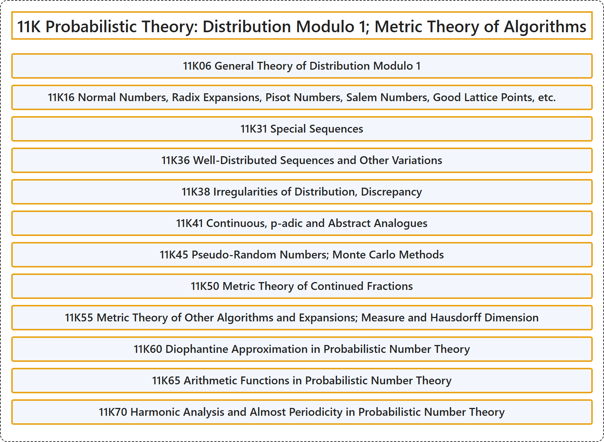

# 11K Probabilistic Theory: Distribution Modulo 1; Metric Theory of Algorithms

## Classification

## Glossary

| Term | Definition | 中文翻译 | Source |
|---|---|---|---|
| **11K Probabilistic Theory: Distribution Modulo 1; Metric Theory of Algorithms** 概率理论：模 1 分布；算法的度量理论 | (No definition) | （无定义） | [Associate Editors of Mathematical Reviews and zbMATH, 2020](https://msc2020.org/) |
| **11K06 General Theory of Distribution Modulo 1** 模 1 分布的一般理论 | (No definition) | （无定义） | [Associate Editors of Mathematical Reviews and zbMATH, 2020](https://msc2020.org/) |
| **11K16 Normal Numbers, Radix Expansions, Pisot Numbers, Salem Numbers, Good Lattice Points, etc.** 正规数、进位展开、Pisot 数、Salem 数、好格点等 | (No definition) | （无定义） | [Associate Editors of Mathematical Reviews and zbMATH, 2020](https://msc2020.org/) |
| **11K31 Special Sequences** 特殊序列 | (No definition) | （无定义） | [Associate Editors of Mathematical Reviews and zbMATH, 2020](https://msc2020.org/) |
| **11K36 Well-Distributed Sequences and Other Variations** 良分布序列及其他变体 | (No definition) | （无定义） | [Associate Editors of Mathematical Reviews and zbMATH, 2020](https://msc2020.org/) |
| **11K38 Irregularities of Distribution, Discrepancy** 分布的不规则性、偏差 | (No definition) | （无定义） | [Associate Editors of Mathematical Reviews and zbMATH, 2020](https://msc2020.org/) |
| **11K41 Continuous, p-adic and Abstract Analogues** 连续、p 进与抽象类比 | (No definition) | （无定义） | [Associate Editors of Mathematical Reviews and zbMATH, 2020](https://msc2020.org/) |
| **11K45 Pseudo-Random Numbers; Monte Carlo Methods** 伪随机数；蒙特卡罗方法 | (No definition) | （无定义） | [Associate Editors of Mathematical Reviews and zbMATH, 2020](https://msc2020.org/) |
| **11K50 Metric Theory of Continued Fractions** 连分数的度量理论 | (No definition) | （无定义） | [Associate Editors of Mathematical Reviews and zbMATH, 2020](https://msc2020.org/) |
| **11K55 Metric Theory of Other Algorithms and Expansions; Measure and Hausdorff Dimension** 其他算法与展开的度量理论；测度与豪斯多夫维数 | (No definition) | （无定义） | [Associate Editors of Mathematical Reviews and zbMATH, 2020](https://msc2020.org/) |
| **11K60 Diophantine Approximation in Probabilistic Number Theory** 概率数论中的丢番图逼近 | (No definition) | （无定义） | [Associate Editors of Mathematical Reviews and zbMATH, 2020](https://msc2020.org/) |
| **11K65 Arithmetic Functions in Probabilistic Number Theory** 概率数论中的算术函数 | (No definition) | （无定义） | [Associate Editors of Mathematical Reviews and zbMATH, 2020](https://msc2020.org/) |
| **11K70 Harmonic Analysis and Almost Periodicity in Probabilistic Number Theory** 概率数论中的调和分析与几乎周期性 | (No definition) | （无定义） | [Associate Editors of Mathematical Reviews and zbMATH, 2020](https://msc2020.org/) |

## References

Associate Editors of Mathematical Reviews and zbMATH. (2020). *MSC2020: Mathematics Subject Classification system*. Retrieved October 27, 2026, from <https://msc2020.org/>
