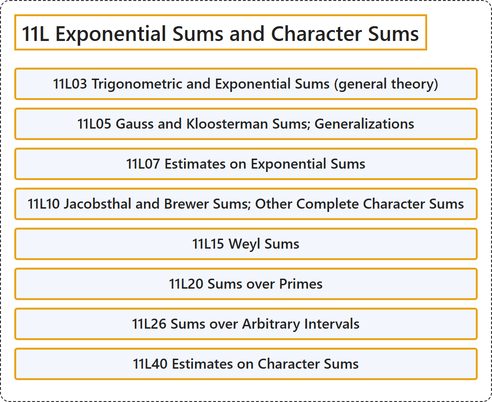

# 11L Exponential Sums and Character Sums

## Classification

## Glossary

| Term | Definition | 中文翻译 | Source |
|---|---|---|---|
| **11L Exponential Sums and Character Sums** 指数和与特征和 | (No definition) | （无定义） | [Associate Editors of Mathematical Reviews and zbMATH, 2020](https://msc2020.org/) |
| **11L03 Trigonometric and Exponential Sums (general theory)** 三角和与指数和（一般理论） | (No definition) | （无定义） | [Associate Editors of Mathematical Reviews and zbMATH, 2020](https://msc2020.org/) |
| **11L05 Gauss and Kloosterman Sums; Generalizations** 高斯和与克鲁斯特曼和；推广 | (No definition) | （无定义） | [Associate Editors of Mathematical Reviews and zbMATH, 2020](https://msc2020.org/) |
| **11L07 Estimates on Exponential Sums** 指数和的估计 | (No definition) | （无定义） | [Associate Editors of Mathematical Reviews and zbMATH, 2020](https://msc2020.org/) |
| **11L10 Jacobsthal and Brewer Sums; Other Complete Character Sums** Jacobsthal 和与 Brewer 和；其他完全特征和 | (No definition) | （无定义） | [Associate Editors of Mathematical Reviews and zbMATH, 2020](https://msc2020.org/) |
| **11L15 Weyl Sums** 外尔和 | (No definition) | （无定义） | [Associate Editors of Mathematical Reviews and zbMATH, 2020](https://msc2020.org/) |
| **11L20 Sums over Primes** 素数上的和 | (No definition) | （无定义） | [Associate Editors of Mathematical Reviews and zbMATH, 2020](https://msc2020.org/) |
| **11L26 Sums over Arbitrary Intervals** 任意区间上的和 | (No definition) | （无定义） | [Associate Editors of Mathematical Reviews and zbMATH, 2020](https://msc2020.org/) |
| **11L40 Estimates on Character Sums** 特征和的估计 | (No definition) | （无定义） | [Associate Editors of Mathematical Reviews and zbMATH, 2020](https://msc2020.org/) |

## References

Associate Editors of Mathematical Reviews and zbMATH. (2020). *MSC2020: Mathematics Subject Classification system*. Retrieved October 27, 2026, from <https://msc2020.org/>
