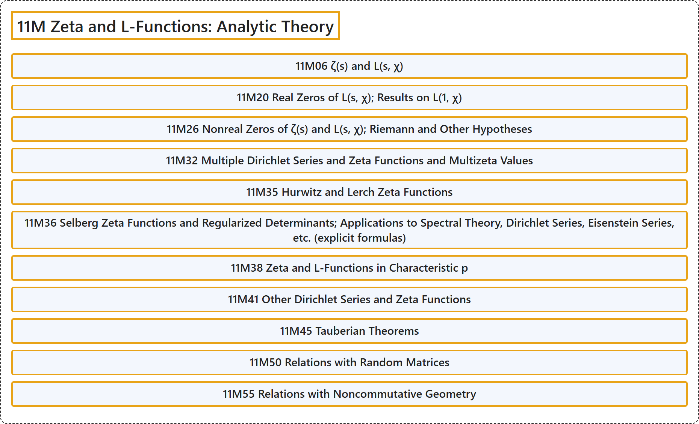

# 11M Zeta and L-Functions: Analytic Theory

## Classification

## Glossary

| Term | Definition | 中文翻译 | Source |
|---|---|---|---|
| **11M Zeta and L-Functions: Analytic Theory** zeta 函数与 L 函数：解析理论 | (No definition) | （无定义） | [Associate Editors of Mathematical Reviews and zbMATH, 2020](https://msc2020.org/) |
| **11M06 ζ(s) and L(s, χ)** ζ(s) 与 L(s, χ) | (No definition) | （无定义） | [Associate Editors of Mathematical Reviews and zbMATH, 2020](https://msc2020.org/) |
| **11M20 Real Zeros of L(s, χ); Results on L(1, χ)** L(s, χ) 的实零点；关于 L(1, χ) 的结果 | (No definition) | （无定义） | [Associate Editors of Mathematical Reviews and zbMATH, 2020](https://msc2020.org/) |
| **11M26 Nonreal Zeros of ζ(s) and L(s, χ); Riemann and Other Hypotheses** ζ(s) 与 L(s, χ) 的非实零点；黎曼假设及其他假设 | (No definition) | （无定义） | [Associate Editors of Mathematical Reviews and zbMATH, 2020](https://msc2020.org/) |
| **11M32 Multiple Dirichlet Series and Zeta Functions and Multizeta Values** 多重狄利克雷级数与 zeta 函数及多重 zeta 值 | (No definition) | （无定义） | [Associate Editors of Mathematical Reviews and zbMATH, 2020](https://msc2020.org/) |
| **11M35 Hurwitz and Lerch Zeta Functions** 赫尔维茨与勒奇 zeta 函数 | (No definition) | （无定义） | [Associate Editors of Mathematical Reviews and zbMATH, 2020](https://msc2020.org/) |
| **11M36 Selberg Zeta Functions and Regularized Determinants; Applications to Spectral Theory, Dirichlet Series, Eisenstein Series, etc. (explicit formulas)** 塞尔伯格 zeta 函数与正规化行列式；在谱理论、狄利克雷级数、艾森斯坦级数等中的应用（显式公式） | (No definition) | （无定义） | [Associate Editors of Mathematical Reviews and zbMATH, 2020](https://msc2020.org/) |
| **11M38 Zeta and L-Functions in Characteristic p** 特征 p 中的 zeta 函数与 L 函数 | (No definition) | （无定义） | [Associate Editors of Mathematical Reviews and zbMATH, 2020](https://msc2020.org/) |
| **11M41 Other Dirichlet Series and Zeta Functions** 其他狄利克雷级数与 zeta 函数 | (No definition) | （无定义） | [Associate Editors of Mathematical Reviews and zbMATH, 2020](https://msc2020.org/) |
| **11M45 Tauberian Theorems** 陶贝尔定理 | (No definition) | （无定义） | [Associate Editors of Mathematical Reviews and zbMATH, 2020](https://msc2020.org/) |
| **11M50 Relations with Random Matrices** 与随机矩阵的关系 | (No definition) | （无定义） | [Associate Editors of Mathematical Reviews and zbMATH, 2020](https://msc2020.org/) |
| **11M55 Relations with Noncommutative Geometry** 与非交换几何的关系 | (No definition) | （无定义） | [Associate Editors of Mathematical Reviews and zbMATH, 2020](https://msc2020.org/) |

## References

Associate Editors of Mathematical Reviews and zbMATH. (2020). *MSC2020: Mathematics Subject Classification system*. Retrieved October 27, 2026, from <https://msc2020.org/>
