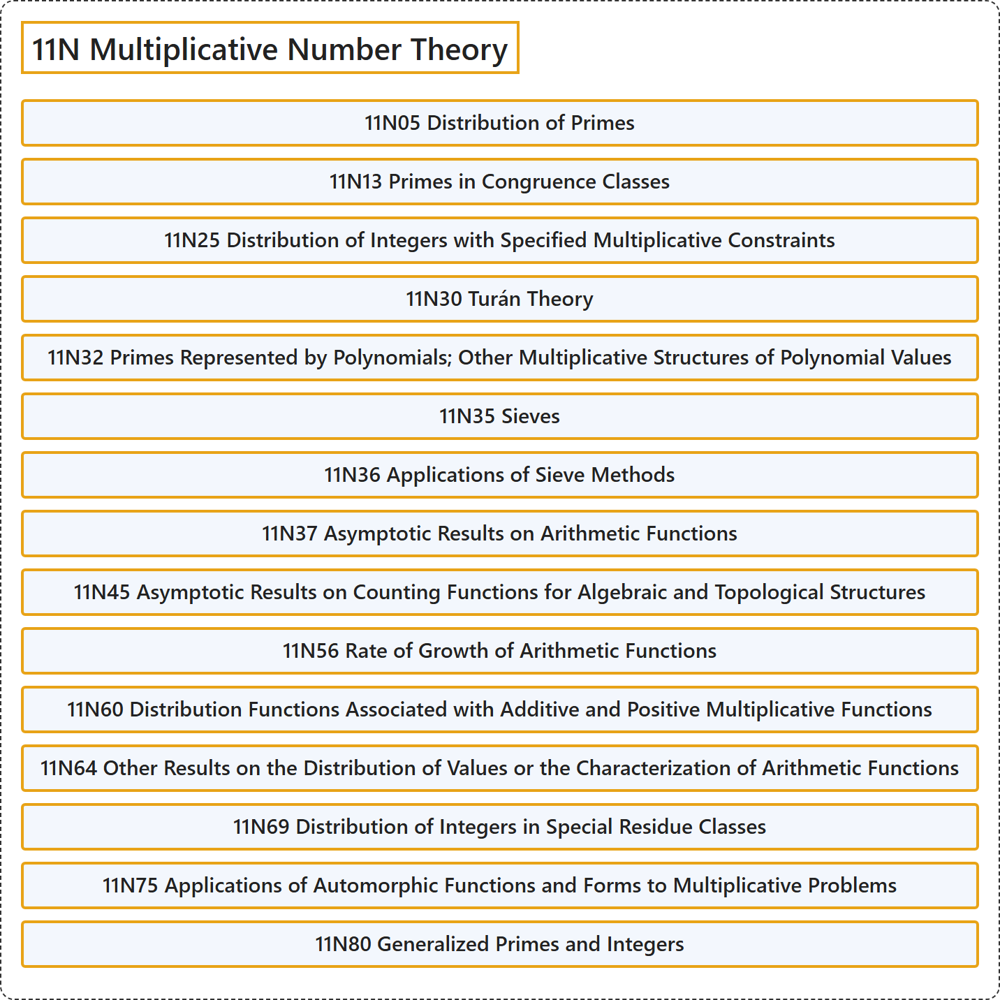

# 11N Multiplicative Number Theory

## Classification

## Glossary

| Term | Definition | 中文翻译 | Source |
|---|---|---|---|
| **11N Multiplicative Number Theory** 乘性数论 | (No definition) | （无定义） | [Associate Editors of Mathematical Reviews and zbMATH, 2020](https://msc2020.org/) |
| **11N05 Distribution of Primes** 素数的分布 | (No definition) | （无定义） | [Associate Editors of Mathematical Reviews and zbMATH, 2020](https://msc2020.org/) |
| **11N13 Primes in Congruence Classes** 同余类中的素数 | (No definition) | （无定义） | [Associate Editors of Mathematical Reviews and zbMATH, 2020](https://msc2020.org/) |
| **11N25 Distribution of Integers with Specified Multiplicative Constraints** 具指定乘性约束的整数分布 | (No definition) | （无定义） | [Associate Editors of Mathematical Reviews and zbMATH, 2020](https://msc2020.org/) |
| **11N30 Turán Theory** 图兰理论 | (No definition) | （无定义） | [Associate Editors of Mathematical Reviews and zbMATH, 2020](https://msc2020.org/) |
| **11N32 Primes Represented by Polynomials; Other Multiplicative Structures of Polynomial Values** 由多项式表示的素数；多项式值的其他乘性结构 | (No definition) | （无定义） | [Associate Editors of Mathematical Reviews and zbMATH, 2020](https://msc2020.org/) |
| **11N35 Sieves** 筛法 | (No definition) | （无定义） | [Associate Editors of Mathematical Reviews and zbMATH, 2020](https://msc2020.org/) |
| **11N36 Applications of Sieve Methods** 筛法的应用 | (No definition) | （无定义） | [Associate Editors of Mathematical Reviews and zbMATH, 2020](https://msc2020.org/) |
| **11N37 Asymptotic Results on Arithmetic Functions** 算术函数的渐近结果 | (No definition) | （无定义） | [Associate Editors of Mathematical Reviews and zbMATH, 2020](https://msc2020.org/) |
| **11N45 Asymptotic Results on Counting Functions for Algebraic and Topological Structures** 代数与拓扑结构计数函数的渐近结果 | (No definition) | （无定义） | [Associate Editors of Mathematical Reviews and zbMATH, 2020](https://msc2020.org/) |
| **11N56 Rate of Growth of Arithmetic Functions** 算术函数的增长率 | (No definition) | （无定义） | [Associate Editors of Mathematical Reviews and zbMATH, 2020](https://msc2020.org/) |
| **11N60 Distribution Functions Associated with Additive and Positive Multiplicative Functions** 与加性及正乘性函数相关的分布函数 | (No definition) | （无定义） | [Associate Editors of Mathematical Reviews and zbMATH, 2020](https://msc2020.org/) |
| **11N64 Other Results on the Distribution of Values or the Characterization of Arithmetic Functions** 关于算术函数取值分布或刻画的其他结果 | (No definition) | （无定义） | [Associate Editors of Mathematical Reviews and zbMATH, 2020](https://msc2020.org/) |
| **11N69 Distribution of Integers in Special Residue Classes** 特殊剩余类中的整数分布 | (No definition) | （无定义） | [Associate Editors of Mathematical Reviews and zbMATH, 2020](https://msc2020.org/) |
| **11N75 Applications of Automorphic Functions and Forms to Multiplicative Problems** 自守函数与自守形式在乘性问题中的应用 | (No definition) | （无定义） | [Associate Editors of Mathematical Reviews and zbMATH, 2020](https://msc2020.org/) |
| **11N80 Generalized Primes and Integers** 广义素数与整数 | (No definition) | （无定义） | [Associate Editors of Mathematical Reviews and zbMATH, 2020](https://msc2020.org/) |

## References

Associate Editors of Mathematical Reviews and zbMATH. (2020). *MSC2020: Mathematics Subject Classification system*. Retrieved October 27, 2026, from <https://msc2020.org/>
