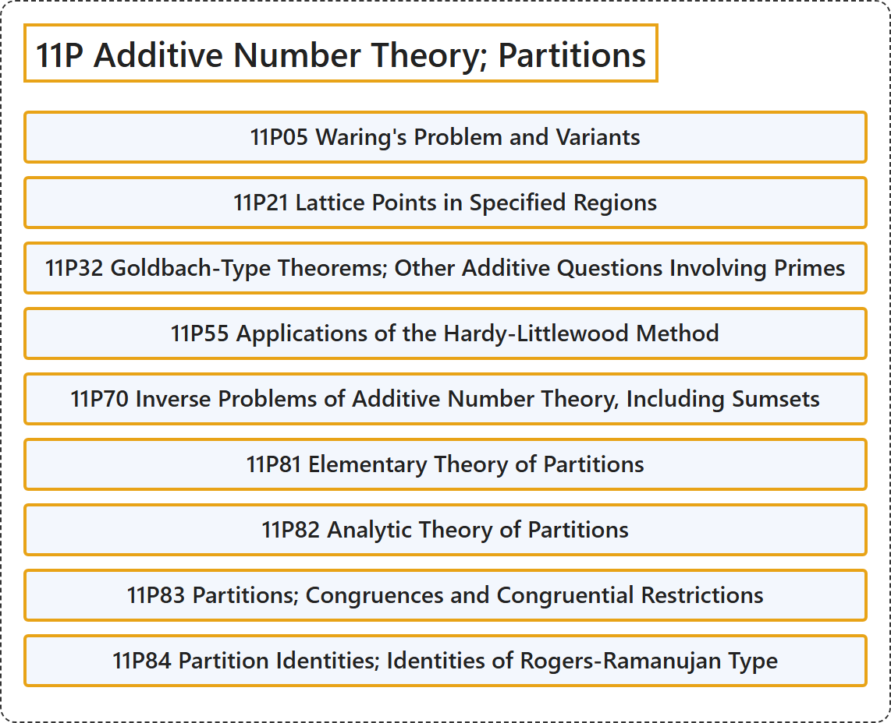

# 11P Additive Number Theory; Partitions

## Classification

## Glossary

| Term | Definition | 中文翻译 | Source |
|---|---|---|---|
| **11P Additive Number Theory; Partitions** 加性数论；分拆 | (No definition) | （无定义） | [Associate Editors of Mathematical Reviews and zbMATH, 2020](https://msc2020.org/) |
| **11P05 Waring's Problem and Variants** 华林问题及其变体 | (No definition) | （无定义） | [Associate Editors of Mathematical Reviews and zbMATH, 2020](https://msc2020.org/) |
| **11P21 Lattice Points in Specified Regions** 指定区域中的格点 | (No definition) | （无定义） | [Associate Editors of Mathematical Reviews and zbMATH, 2020](https://msc2020.org/) |
| **11P32 Goldbach-Type Theorems; Other Additive Questions Involving Primes** 哥德巴赫型定理；涉及素数的其他加性问题 | (No definition) | （无定义） | [Associate Editors of Mathematical Reviews and zbMATH, 2020](https://msc2020.org/) |
| **11P55 Applications of the Hardy-Littlewood Method** 哈代-李特尔伍德方法的应用 | (No definition) | （无定义） | [Associate Editors of Mathematical Reviews and zbMATH, 2020](https://msc2020.org/) |
| **11P70 Inverse Problems of Additive Number Theory, Including Sumsets** 加性数论的反问题，包括和集 | (No definition) | （无定义） | [Associate Editors of Mathematical Reviews and zbMATH, 2020](https://msc2020.org/) |
| **11P81 Elementary Theory of Partitions** 分拆的初等理论 | (No definition) | （无定义） | [Associate Editors of Mathematical Reviews and zbMATH, 2020](https://msc2020.org/) |
| **11P82 Analytic Theory of Partitions** 分拆的解析理论 | (No definition) | （无定义） | [Associate Editors of Mathematical Reviews and zbMATH, 2020](https://msc2020.org/) |
| **11P83 Partitions; Congruences and Congruential Restrictions** 分拆；同余与同余限制 | (No definition) | （无定义） | [Associate Editors of Mathematical Reviews and zbMATH, 2020](https://msc2020.org/) |
| **11P84 Partition Identities; Identities of Rogers-Ramanujan Type** 分拆恒等式；罗杰斯-拉马努金型恒等式 | (No definition) | （无定义） | [Associate Editors of Mathematical Reviews and zbMATH, 2020](https://msc2020.org/) |

## References

Associate Editors of Mathematical Reviews and zbMATH. (2020). *MSC2020: Mathematics Subject Classification system*. Retrieved October 27, 2026, from <https://msc2020.org/>
