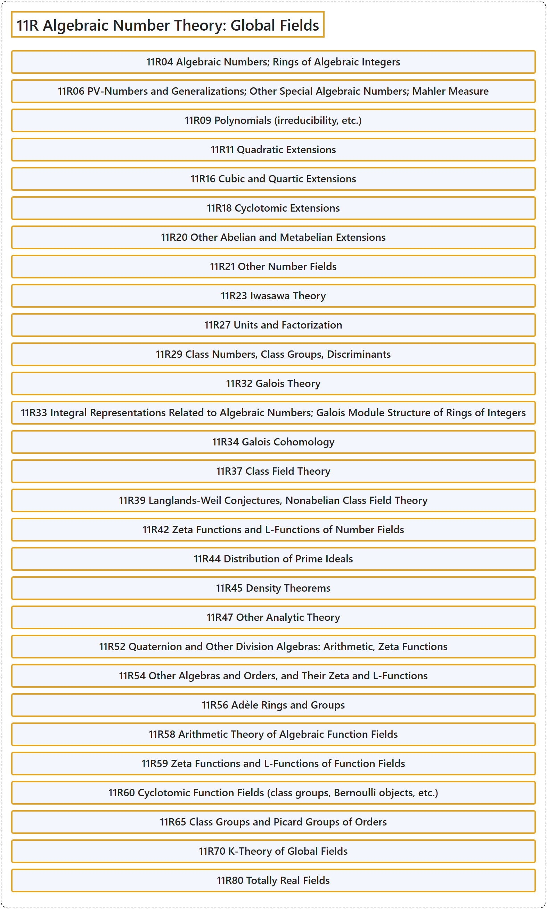

# 11R Algebraic Number Theory: Global Fields

## Classification

## Glossary

| Term | Definition | 中文翻译 | Source |
|---|---|---|---|
| **11R Algebraic Number Theory: Global Fields** 代数数论：整体域 | (No definition) | （无定义） | [Associate Editors of Mathematical Reviews and zbMATH, 2020](https://msc2020.org/) |
| **11R04 Algebraic Numbers; Rings of Algebraic Integers** 代数数；代数整数环 | (No definition) | （无定义） | [Associate Editors of Mathematical Reviews and zbMATH, 2020](https://msc2020.org/) |
| **11R06 PV-Numbers and Generalizations; Other Special Algebraic Numbers; Mahler Measure** PV 数及推广；其他特殊代数数；马勒测度 | (No definition) | （无定义） | [Associate Editors of Mathematical Reviews and zbMATH, 2020](https://msc2020.org/) |
| **11R09 Polynomials (irreducibility, etc.)** 多项式（不可约性等） | (No definition) | （无定义） | [Associate Editors of Mathematical Reviews and zbMATH, 2020](https://msc2020.org/) |
| **11R11 Quadratic Extensions** 二次扩张 | (No definition) | （无定义） | [Associate Editors of Mathematical Reviews and zbMATH, 2020](https://msc2020.org/) |
| **11R16 Cubic and Quartic Extensions** 三次与四次扩张 | (No definition) | （无定义） | [Associate Editors of Mathematical Reviews and zbMATH, 2020](https://msc2020.org/) |
| **11R18 Cyclotomic Extensions** 分圆扩张 | (No definition) | （无定义） | [Associate Editors of Mathematical Reviews and zbMATH, 2020](https://msc2020.org/) |
| **11R20 Other Abelian and Metabelian Extensions** 其他阿贝尔与亚阿贝尔扩张 | (No definition) | （无定义） | [Associate Editors of Mathematical Reviews and zbMATH, 2020](https://msc2020.org/) |
| **11R21 Other Number Fields** 其他数域 | (No definition) | （无定义） | [Associate Editors of Mathematical Reviews and zbMATH, 2020](https://msc2020.org/) |
| **11R23 Iwasawa Theory** 岩泽理论 | (No definition) | （无定义） | [Associate Editors of Mathematical Reviews and zbMATH, 2020](https://msc2020.org/) |
| **11R27 Units and Factorization** 单位与因子分解 | (No definition) | （无定义） | [Associate Editors of Mathematical Reviews and zbMATH, 2020](https://msc2020.org/) |
| **11R29 Class Numbers, Class Groups, Discriminants** 类数、类群、判别式 | (No definition) | （无定义） | [Associate Editors of Mathematical Reviews and zbMATH, 2020](https://msc2020.org/) |
| **11R32 Galois Theory** 伽罗瓦理论 | (No definition) | （无定义） | [Associate Editors of Mathematical Reviews and zbMATH, 2020](https://msc2020.org/) |
| **11R33 Integral Representations Related to Algebraic Numbers; Galois Module Structure of Rings of Integers** 与代数数相关的整表示；整数环的伽罗瓦模结构 | (No definition) | （无定义） | [Associate Editors of Mathematical Reviews and zbMATH, 2020](https://msc2020.org/) |
| **11R34 Galois Cohomology** 伽罗瓦上同调 | (No definition) | （无定义） | [Associate Editors of Mathematical Reviews and zbMATH, 2020](https://msc2020.org/) |
| **11R37 Class Field Theory** 类域论 | (No definition) | （无定义） | [Associate Editors of Mathematical Reviews and zbMATH, 2020](https://msc2020.org/) |
| **11R39 Langlands-Weil Conjectures, Nonabelian Class Field Theory** 朗兰兹-韦伊猜想、非阿贝尔类域论 | (No definition) | （无定义） | [Associate Editors of Mathematical Reviews and zbMATH, 2020](https://msc2020.org/) |
| **11R42 Zeta Functions and L-Functions of Number Fields** 数域的 zeta 函数与 L 函数 | (No definition) | （无定义） | [Associate Editors of Mathematical Reviews and zbMATH, 2020](https://msc2020.org/) |
| **11R44 Distribution of Prime Ideals** 素理想的分布 | (No definition) | （无定义） | [Associate Editors of Mathematical Reviews and zbMATH, 2020](https://msc2020.org/) |
| **11R45 Density Theorems** 密度定理 | (No definition) | （无定义） | [Associate Editors of Mathematical Reviews and zbMATH, 2020](https://msc2020.org/) |
| **11R47 Other Analytic Theory** 其他解析理论 | (No definition) | （无定义） | [Associate Editors of Mathematical Reviews and zbMATH, 2020](https://msc2020.org/) |
| **11R52 Quaternion and Other Division Algebras: Arithmetic, Zeta Functions** 四元数及其他除代数：算术、zeta 函数 | (No definition) | （无定义） | [Associate Editors of Mathematical Reviews and zbMATH, 2020](https://msc2020.org/) |
| **11R54 Other Algebras and Orders, and Their Zeta and L-Functions** 其他代数与序，及其 zeta 函数与 L 函数 | (No definition) | （无定义） | [Associate Editors of Mathematical Reviews and zbMATH, 2020](https://msc2020.org/) |
| **11R56 Adèle Rings and Groups** 阿代尔环与阿代尔群 | (No definition) | （无定义） | [Associate Editors of Mathematical Reviews and zbMATH, 2020](https://msc2020.org/) |
| **11R58 Arithmetic Theory of Algebraic Function Fields** 代数函数域的算术理论 | (No definition) | （无定义） | [Associate Editors of Mathematical Reviews and zbMATH, 2020](https://msc2020.org/) |
| **11R59 Zeta Functions and L-Functions of Function Fields** 函数域的 zeta 函数与 L 函数 | (No definition) | （无定义） | [Associate Editors of Mathematical Reviews and zbMATH, 2020](https://msc2020.org/) |
| **11R60 Cyclotomic Function Fields (class groups, Bernoulli objects, etc.)** 分圆函数域（类群、伯努利对象等） | (No definition) | （无定义） | [Associate Editors of Mathematical Reviews and zbMATH, 2020](https://msc2020.org/) |
| **11R65 Class Groups and Picard Groups of Orders** 序的类群与皮卡群 | (No definition) | （无定义） | [Associate Editors of Mathematical Reviews and zbMATH, 2020](https://msc2020.org/) |
| **11R70 K-Theory of Global Fields** 整体域的 K 理论 | (No definition) | （无定义） | [Associate Editors of Mathematical Reviews and zbMATH, 2020](https://msc2020.org/) |
| **11R80 Totally Real Fields** 全实域 | (No definition) | （无定义） | [Associate Editors of Mathematical Reviews and zbMATH, 2020](https://msc2020.org/) |

## References

Associate Editors of Mathematical Reviews and zbMATH. (2020). *MSC2020: Mathematics Subject Classification system*. Retrieved October 27, 2026, from <https://msc2020.org/>
