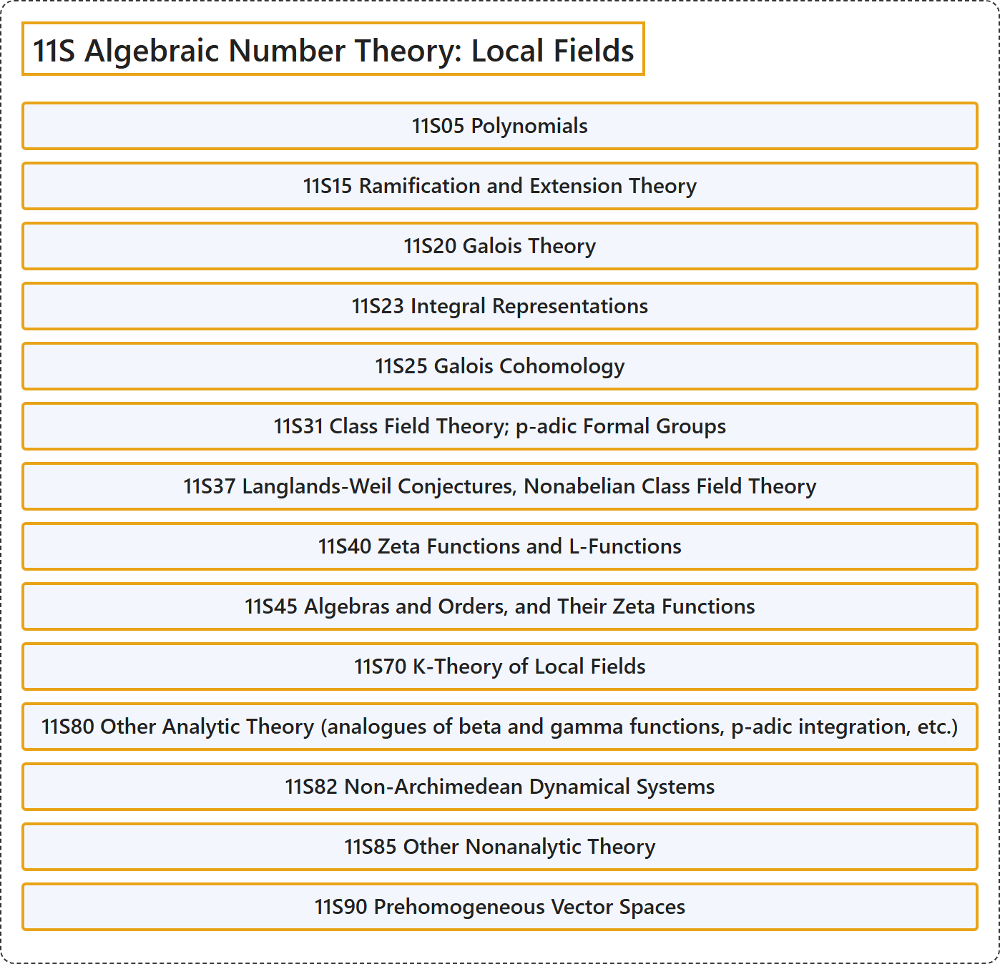

# 11S Algebraic Number Theory: Local Fields

## Classification

## Glossary

| Term | Definition | 中文翻译 | Source |
|---|---|---|---|
| **11S Algebraic Number Theory: Local Fields** 代数数论：局部域 | (No definition) | （无定义） | [Associate Editors of Mathematical Reviews and zbMATH, 2020](https://msc2020.org/) |
| **11S05 Polynomials** 多项式 | (No definition) | （无定义） | [Associate Editors of Mathematical Reviews and zbMATH, 2020](https://msc2020.org/) |
| **11S15 Ramification and Extension Theory** 分歧与扩张理论 | (No definition) | （无定义） | [Associate Editors of Mathematical Reviews and zbMATH, 2020](https://msc2020.org/) |
| **11S20 Galois Theory** 伽罗瓦理论 | (No definition) | （无定义） | [Associate Editors of Mathematical Reviews and zbMATH, 2020](https://msc2020.org/) |
| **11S23 Integral Representations** 整表示 | (No definition) | （无定义） | [Associate Editors of Mathematical Reviews and zbMATH, 2020](https://msc2020.org/) |
| **11S25 Galois Cohomology** 伽罗瓦上同调 | (No definition) | （无定义） | [Associate Editors of Mathematical Reviews and zbMATH, 2020](https://msc2020.org/) |
| **11S31 Class Field Theory; p-adic Formal Groups** 类域论；p 进形式群 | (No definition) | （无定义） | [Associate Editors of Mathematical Reviews and zbMATH, 2020](https://msc2020.org/) |
| **11S37 Langlands-Weil Conjectures, Nonabelian Class Field Theory** 朗兰兹-韦伊猜想、非阿贝尔类域论 | (No definition) | （无定义） | [Associate Editors of Mathematical Reviews and zbMATH, 2020](https://msc2020.org/) |
| **11S40 Zeta Functions and L-Functions** zeta 函数与 L 函数 | (No definition) | （无定义） | [Associate Editors of Mathematical Reviews and zbMATH, 2020](https://msc2020.org/) |
| **11S45 Algebras and Orders, and Their Zeta Functions** 代数与序，及其 zeta 函数 | (No definition) | （无定义） | [Associate Editors of Mathematical Reviews and zbMATH, 2020](https://msc2020.org/) |
| **11S70 K-Theory of Local Fields** 局部域的 K 理论 | (No definition) | （无定义） | [Associate Editors of Mathematical Reviews and zbMATH, 2020](https://msc2020.org/) |
| **11S80 Other Analytic Theory (analogues of beta and gamma functions, p-adic integration, etc.)** 其他解析理论（beta 函数与 gamma 函数的类比、p 进积分等） | (No definition) | （无定义） | [Associate Editors of Mathematical Reviews and zbMATH, 2020](https://msc2020.org/) |
| **11S82 Non-Archimedean Dynamical Systems** 非阿基米德动力系统 | (No definition) | （无定义） | [Associate Editors of Mathematical Reviews and zbMATH, 2020](https://msc2020.org/) |
| **11S85 Other Nonanalytic Theory** 其他非解析理论 | (No definition) | （无定义） | [Associate Editors of Mathematical Reviews and zbMATH, 2020](https://msc2020.org/) |
| **11S90 Prehomogeneous Vector Spaces** 预齐性向量空间 | (No definition) | （无定义） | [Associate Editors of Mathematical Reviews and zbMATH, 2020](https://msc2020.org/) |

## References

Associate Editors of Mathematical Reviews and zbMATH. (2020). *MSC2020: Mathematics Subject Classification system*. Retrieved October 27, 2026, from <https://msc2020.org/>
