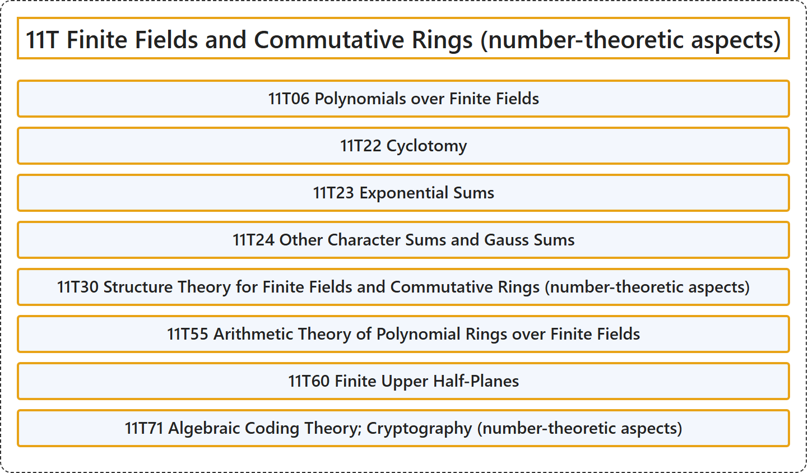

# 11T Finite Fields and Commutative Rings (number-theoretic aspects)

## Classification

## Glossary

| Term | Definition | 中文翻译 | Source |
|---|---|---|---|
| **11T Finite Fields and Commutative Rings (number-theoretic aspects)** 有限域与交换环（数论方面） | (No definition) | （无定义） | [Associate Editors of Mathematical Reviews and zbMATH, 2020](https://msc2020.org/) |
| **11T06 Polynomials over Finite Fields** 有限域上的多项式 | (No definition) | （无定义） | [Associate Editors of Mathematical Reviews and zbMATH, 2020](https://msc2020.org/) |
| **11T22 Cyclotomy** 分圆 | (No definition) | （无定义） | [Associate Editors of Mathematical Reviews and zbMATH, 2020](https://msc2020.org/) |
| **11T23 Exponential Sums** 指数和 | (No definition) | （无定义） | [Associate Editors of Mathematical Reviews and zbMATH, 2020](https://msc2020.org/) |
| **11T24 Other Character Sums and Gauss Sums** 其他特征和与高斯和 | (No definition) | （无定义） | [Associate Editors of Mathematical Reviews and zbMATH, 2020](https://msc2020.org/) |
| **11T30 Structure Theory for Finite Fields and Commutative Rings (number-theoretic aspects)** 有限域与交换环的结构理论（数论方面） | (No definition) | （无定义） | [Associate Editors of Mathematical Reviews and zbMATH, 2020](https://msc2020.org/) |
| **11T55 Arithmetic Theory of Polynomial Rings over Finite Fields** 有限域上多项式环的算术理论 | (No definition) | （无定义） | [Associate Editors of Mathematical Reviews and zbMATH, 2020](https://msc2020.org/) |
| **11T60 Finite Upper Half-Planes** 有限上半平面 | (No definition) | （无定义） | [Associate Editors of Mathematical Reviews and zbMATH, 2020](https://msc2020.org/) |
| **11T71 Algebraic Coding Theory; Cryptography (number-theoretic aspects)** 代数编码理论；密码学（数论方面） | (No definition) | （无定义） | [Associate Editors of Mathematical Reviews and zbMATH, 2020](https://msc2020.org/) |

## References

Associate Editors of Mathematical Reviews and zbMATH. (2020). *MSC2020: Mathematics Subject Classification system*. Retrieved October 27, 2026, from <https://msc2020.org/>
