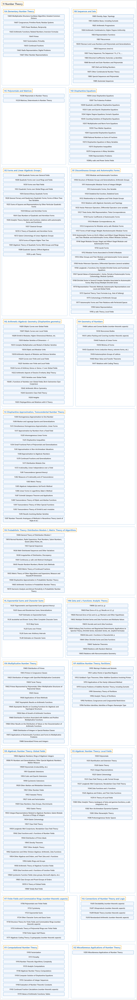

# 11 Number Theory

## Classification

## Glossary

| Term | Definition | 中文翻译 | Source |
|---|---|---|---|
| **11 Number Theory** 数论 | "Number theory is a vast and fascinating field of mathematics, sometimes called 'higher arithmetic,' consisting of **the study of the properties of whole numbers**." | 数论是一个广阔而迷人的数学领域，有时被称为“高等算术”，它由**对整数性质的研究**构成。 | [Weisstein, n.d., "Number theory" entry, para. 1](https://mathworld.wolfram.com/NumberTheory.html#:~:text=consisting%20of%20the%20study%20of%20the%20properties%20of%20whole%20numbers) |
| **[11A Elementary Number Theory](11a-elementary-number-theory.md)** 初等数论 | (No definition) | （无定义） | [Associate Editors of Mathematical Reviews and zbMATH, 2020](https://msc2020.org/) |
| **[11B Sequences and Sets](11b-sequences-and-sets.md)** 序列与集合 | (No definition) | （无定义） | [Associate Editors of Mathematical Reviews and zbMATH, 2020](https://msc2020.org/) |
| **[11C Polynomials and Matrices](11c-polynomials-and-matrices.md)** 多项式与矩阵 | (No definition) | （无定义） | [Associate Editors of Mathematical Reviews and zbMATH, 2020](https://msc2020.org/) |
| **[11D Diophantine Equations](11d-diophantine-equations.md)** 丢番图方程 | (No definition) | （无定义） | [Associate Editors of Mathematical Reviews and zbMATH, 2020](https://msc2020.org/) |
| **[11E Forms and Linear Algebraic Groups](11e-forms-and-linear-algebraic-groups.md)** 型与线性代数群 | (No definition) | （无定义） | [Associate Editors of Mathematical Reviews and zbMATH, 2020](https://msc2020.org/) |
| **[11F Discontinuous Groups and Automorphic Forms](11f-discontinuous-groups-and-automorphic-forms.md)** 不连续群与自守形式 | (No definition) | （无定义） | [Associate Editors of Mathematical Reviews and zbMATH, 2020](https://msc2020.org/) |
| **[11G Arithmetic Algebraic Geometry (Diophantine geometry)](11g-arithmetic-algebraic-geometry-diophantine-geometry.md)** 算术代数几何（丢番图几何） | (No definition) | （无定义） | [Associate Editors of Mathematical Reviews and zbMATH, 2020](https://msc2020.org/) |
| **[11H Geometry of Numbers](11h-geometry-of-numbers.md)** 数的几何 | (No definition) | （无定义） | [Associate Editors of Mathematical Reviews and zbMATH, 2020](https://msc2020.org/) |
| **[11J Diophantine Approximation, Transcendental Number Theory](11j-diophantine-approximation-transcendental-number-theory.md)** 丢番图逼近、超越数论 | (No definition) | （无定义） | [Associate Editors of Mathematical Reviews and zbMATH, 2020](https://msc2020.org/) |
| **[11K Probabilistic Theory: Distribution Modulo 1; Metric Theory of Algorithms](11k-probabilistic-theory-distribution-modulo-1-metric-theory-of.md)** 概率理论：模 1 分布；算法的度量理论 | (No definition) | （无定义） | [Associate Editors of Mathematical Reviews and zbMATH, 2020](https://msc2020.org/) |
| **[11L Exponential Sums and Character Sums](11l-exponential-sums-and-character-sums.md)** 指数和与特征和 | (No definition) | （无定义） | [Associate Editors of Mathematical Reviews and zbMATH, 2020](https://msc2020.org/) |
| **[11M Zeta and L-Functions: Analytic Theory](11m-zeta-and-l-functions-analytic-theory.md)** zeta 函数与 L 函数：解析理论 | (No definition) | （无定义） | [Associate Editors of Mathematical Reviews and zbMATH, 2020](https://msc2020.org/) |
| **[11N Multiplicative Number Theory](11n-multiplicative-number-theory.md)** 乘性数论 | (No definition) | （无定义） | [Associate Editors of Mathematical Reviews and zbMATH, 2020](https://msc2020.org/) |
| **[11P Additive Number Theory; Partitions](11p-additive-number-theory-partitions.md)** 加性数论；分拆 | (No definition) | （无定义） | [Associate Editors of Mathematical Reviews and zbMATH, 2020](https://msc2020.org/) |
| **[11R Algebraic Number Theory: Global Fields](11r-algebraic-number-theory-global-fields.md)** 代数数论：整体域 | (No definition) | （无定义） | [Associate Editors of Mathematical Reviews and zbMATH, 2020](https://msc2020.org/) |
| **[11S Algebraic Number Theory: Local Fields](11s-algebraic-number-theory-local-fields.md)** 代数数论：局部域 | (No definition) | （无定义） | [Associate Editors of Mathematical Reviews and zbMATH, 2020](https://msc2020.org/) |
| **[11T Finite Fields and Commutative Rings (number-theoretic aspects)](11t-finite-fields-and-commutative-rings-number-theoretic-aspects.md)** 有限域与交换环（数论方面） | (No definition) | （无定义） | [Associate Editors of Mathematical Reviews and zbMATH, 2020](https://msc2020.org/) |
| **[11U Connections of Number Theory and Logic](11u-connections-of-number-theory-and-logic.md)** 数论与逻辑的联系 | (No definition) | （无定义） | [Associate Editors of Mathematical Reviews and zbMATH, 2020](https://msc2020.org/) |
| **[11Y Computational Number Theory](11y-computational-number-theory.md)** 计算数论 | (No definition) | （无定义） | [Associate Editors of Mathematical Reviews and zbMATH, 2020](https://msc2020.org/) |
| **[11Z Miscellaneous Applications of Number Theory](11z-miscellaneous-applications-of-number-theory.md)** 数论的杂项应用 | (No definition) | （无定义） | [Associate Editors of Mathematical Reviews and zbMATH, 2020](https://msc2020.org/) |

## References

Associate Editors of Mathematical Reviews and zbMATH. (2020). *MSC2020: Mathematics Subject Classification system*. Retrieved October 27, 2026, from <https://msc2020.org/>

Weisstein, E. W. (n.d.). *Number theory*. MathWorld: A Wolfram Resource. Retrieved October 27, 2026, from <https://mathworld.wolfram.com/NumberTheory.html>
