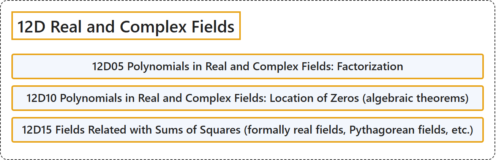

# 12D Real and Complex Fields

## Classification

## Glossary

| Term | Definition | 中文翻译 | Source |
|---|---|---|---|
| **12D Real and Complex Fields** 实域与复域 | (No definition) | （无定义） | [Associate Editors of Mathematical Reviews and zbMATH, 2020](https://msc2020.org/) |
| **12D05 Polynomials in Real and Complex Fields: Factorization** 实域与复域中的多项式：因式分解 | (No definition) | （无定义） | [Associate Editors of Mathematical Reviews and zbMATH, 2020](https://msc2020.org/) |
| **12D10 Polynomials in Real and Complex Fields: Location of Zeros (algebraic theorems)** 实域与复域中的多项式：零点的位置（代数定理） | (No definition) | （无定义） | [Associate Editors of Mathematical Reviews and zbMATH, 2020](https://msc2020.org/) |
| **12D15 Fields Related with Sums of Squares (formally real fields, Pythagorean fields, etc.)** 与平方和有关的域（形式实域、毕达哥拉斯域等） | (No definition) | （无定义） | [Associate Editors of Mathematical Reviews and zbMATH, 2020](https://msc2020.org/) |

## References

Associate Editors of Mathematical Reviews and zbMATH. (2020). *MSC2020: Mathematics Subject Classification system*. Retrieved October 27, 2026, from <https://msc2020.org/>
