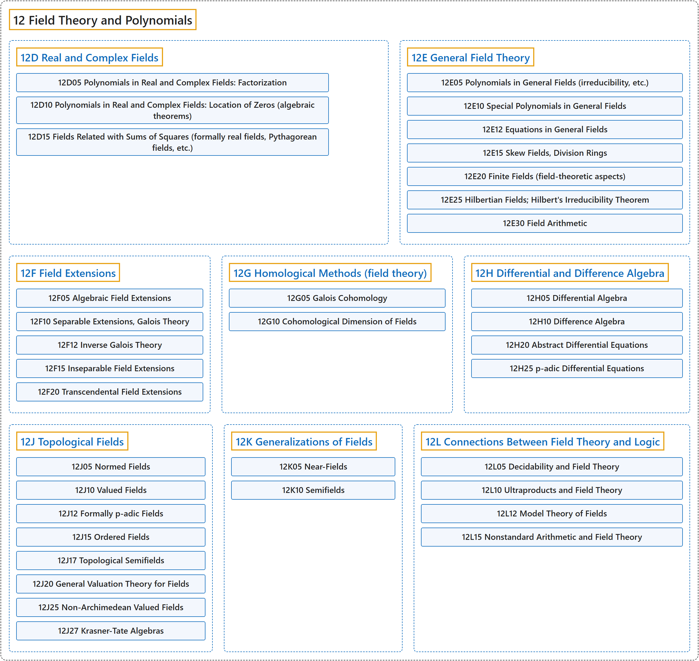

# 12 Field Theory and Polynomials

## Classification

## Glossary

| Term | Definition | 中文翻译 | Source |
|---|---|---|---|
| **12 Field Theory and Polynomials** 域论与多项式 | "A field is any set of elements that satisfies the **field axioms for both addition and multiplication** and is a **commutative division algebra**." | 域是满足**加法和乘法两方面的域公理**、并且是**交换除代数**的任意元素集合。 | [Weisstein, n.d., "Field" entry, para. 1](https://mathworld.wolfram.com/Field.html#:~:text=A%20field%20is%20any%20set%20of%20elements%20that%20satisfies%20the%20field%20axioms) |
| **[12D Real and Complex Fields](12d-real-and-complex-fields.md)** 实域与复域 | (No definition) | （无定义） | [Associate Editors of Mathematical Reviews and zbMATH, 2020](https://msc2020.org/) |
| **[12E General Field Theory](12e-general-field-theory.md)** 一般域论 | (No definition) | （无定义） | [Associate Editors of Mathematical Reviews and zbMATH, 2020](https://msc2020.org/) |
| **[12F Field Extensions](12f-field-extensions.md)** 域扩张 | (No definition) | （无定义） | [Associate Editors of Mathematical Reviews and zbMATH, 2020](https://msc2020.org/) |
| **[12G Homological Methods (field theory)](12g-homological-methods-field-theory.md)** 同调方法（域论） | (No definition) | （无定义） | [Associate Editors of Mathematical Reviews and zbMATH, 2020](https://msc2020.org/) |
| **[12H Differential and Difference Algebra](12h-differential-and-difference-algebra.md)** 微分与差分代数 | (No definition) | （无定义） | [Associate Editors of Mathematical Reviews and zbMATH, 2020](https://msc2020.org/) |
| **[12J Topological Fields](12j-topological-fields.md)** 拓扑域 | (No definition) | （无定义） | [Associate Editors of Mathematical Reviews and zbMATH, 2020](https://msc2020.org/) |
| **[12K Generalizations of Fields](12k-generalizations-of-fields.md)** 域的推广 | (No definition) | （无定义） | [Associate Editors of Mathematical Reviews and zbMATH, 2020](https://msc2020.org/) |
| **[12L Connections Between Field Theory and Logic](12l-connections-between-field-theory-and-logic.md)** 域论与逻辑的联系 | (No definition) | （无定义） | [Associate Editors of Mathematical Reviews and zbMATH, 2020](https://msc2020.org/) |

## References

Associate Editors of Mathematical Reviews and zbMATH. (2020). *MSC2020: Mathematics Subject Classification system*. Retrieved October 27, 2026, from <https://msc2020.org/>

Weisstein, E. W. (n.d.). *Field*. MathWorld: A Wolfram Resource. Retrieved October 27, 2026, from <https://mathworld.wolfram.com/Field.html>
