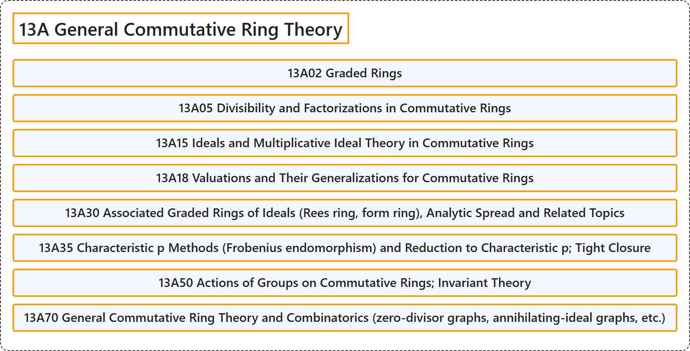

# 13A General Commutative Ring Theory

## Classification

## Glossary

| Term | Definition | 中文翻译 | Source |
|---|---|---|---|
| **13A General Commutative Ring Theory** 一般交换环论 | (No definition) | （无定义） | [Associate Editors of Mathematical Reviews and zbMATH, 2020](https://msc2020.org/) |
| **13A02 Graded Rings** 分次环 | (No definition) | （无定义） | [Associate Editors of Mathematical Reviews and zbMATH, 2020](https://msc2020.org/) |
| **13A05 Divisibility and Factorizations in Commutative Rings** 交换环中的整除性与因子分解 | (No definition) | （无定义） | [Associate Editors of Mathematical Reviews and zbMATH, 2020](https://msc2020.org/) |
| **13A15 Ideals and Multiplicative Ideal Theory in Commutative Rings** 交换环中的理想与乘法理想理论 | (No definition) | （无定义） | [Associate Editors of Mathematical Reviews and zbMATH, 2020](https://msc2020.org/) |
| **13A18 Valuations and Their Generalizations for Commutative Rings** 交换环的赋值及其推广 | (No definition) | （无定义） | [Associate Editors of Mathematical Reviews and zbMATH, 2020](https://msc2020.org/) |
| **13A30 Associated Graded Rings of Ideals (Rees ring, form ring), Analytic Spread and Related Topics** 理想的伴随分次环（里斯环、形式环）、解析扩张度及相关课题 | (No definition) | （无定义） | [Associate Editors of Mathematical Reviews and zbMATH, 2020](https://msc2020.org/) |
| **13A35 Characteristic p Methods (Frobenius endomorphism) and Reduction to Characteristic p; Tight Closure** 特征p方法（弗罗贝尼乌斯自同态）与到特征p的约化；紧闭包 | (No definition) | （无定义） | [Associate Editors of Mathematical Reviews and zbMATH, 2020](https://msc2020.org/) |
| **13A50 Actions of Groups on Commutative Rings; Invariant Theory** 群在交换环上的作用；不变量理论 | (No definition) | （无定义） | [Associate Editors of Mathematical Reviews and zbMATH, 2020](https://msc2020.org/) |
| **13A70 General Commutative Ring Theory and Combinatorics (zero-divisor graphs, annihilating-ideal graphs, etc.)** 一般交换环论与组合学（零因子图、零化理想图等） | (No definition) | （无定义） | [Associate Editors of Mathematical Reviews and zbMATH, 2020](https://msc2020.org/) |

## References

Associate Editors of Mathematical Reviews and zbMATH. (2020). *MSC2020: Mathematics Subject Classification system*. Retrieved October 27, 2026, from <https://msc2020.org/>
