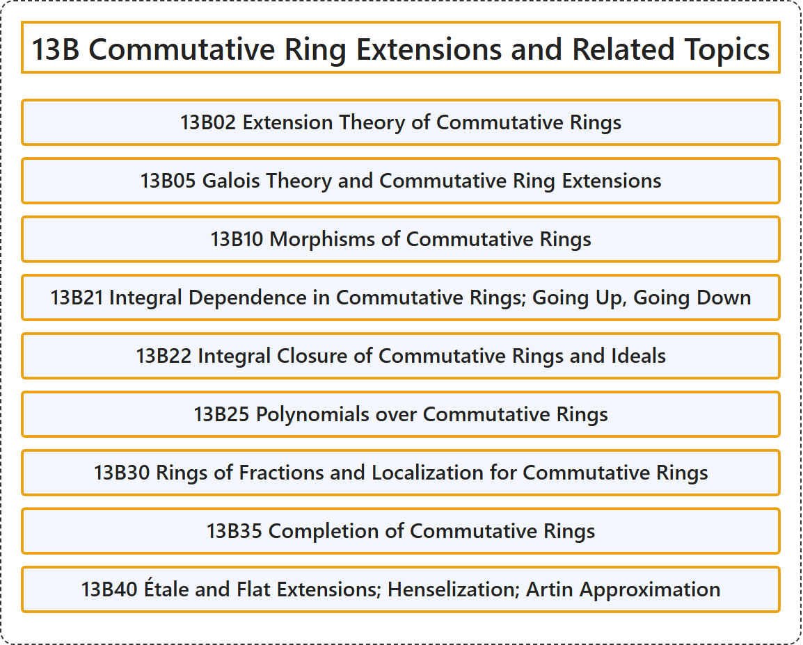

# 13B Commutative Ring Extensions and Related Topics

## Classification

## Glossary

| Term | Definition | 中文翻译 | Source |
|---|---|---|---|
| **13B Commutative Ring Extensions and Related Topics** 交换环扩张及相关专题 | (No definition) | （无定义） | [Associate Editors of Mathematical Reviews and zbMATH, 2020](https://msc2020.org/) |
| **13B02 Extension Theory of Commutative Rings** 交换环的扩张理论 | (No definition) | （无定义） | [Associate Editors of Mathematical Reviews and zbMATH, 2020](https://msc2020.org/) |
| **13B05 Galois Theory and Commutative Ring Extensions** 伽罗瓦理论与交换环扩张 | (No definition) | （无定义） | [Associate Editors of Mathematical Reviews and zbMATH, 2020](https://msc2020.org/) |
| **13B10 Morphisms of Commutative Rings** 交换环的态射 | (No definition) | （无定义） | [Associate Editors of Mathematical Reviews and zbMATH, 2020](https://msc2020.org/) |
| **13B21 Integral Dependence in Commutative Rings; Going Up, Going Down** 交换环中的整相关性；上升、下降 | (No definition) | （无定义） | [Associate Editors of Mathematical Reviews and zbMATH, 2020](https://msc2020.org/) |
| **13B22 Integral Closure of Commutative Rings and Ideals** 交换环与理想的整闭包 | (No definition) | （无定义） | [Associate Editors of Mathematical Reviews and zbMATH, 2020](https://msc2020.org/) |
| **13B25 Polynomials over Commutative Rings** 交换环上的多项式 | (No definition) | （无定义） | [Associate Editors of Mathematical Reviews and zbMATH, 2020](https://msc2020.org/) |
| **13B30 Rings of Fractions and Localization for Commutative Rings** 交换环的分式环与局部化 | (No definition) | （无定义） | [Associate Editors of Mathematical Reviews and zbMATH, 2020](https://msc2020.org/) |
| **13B35 Completion of Commutative Rings** 交换环的完备化 | (No definition) | （无定义） | [Associate Editors of Mathematical Reviews and zbMATH, 2020](https://msc2020.org/) |
| **13B40 Étale and Flat Extensions; Henselization; Artin Approximation** 平展扩张与平坦扩张；亨泽尔化；阿廷逼近 | (No definition) | （无定义） | [Associate Editors of Mathematical Reviews and zbMATH, 2020](https://msc2020.org/) |

## References

Associate Editors of Mathematical Reviews and zbMATH. (2020). *MSC2020: Mathematics Subject Classification system*. Retrieved October 27, 2026, from <https://msc2020.org/>
