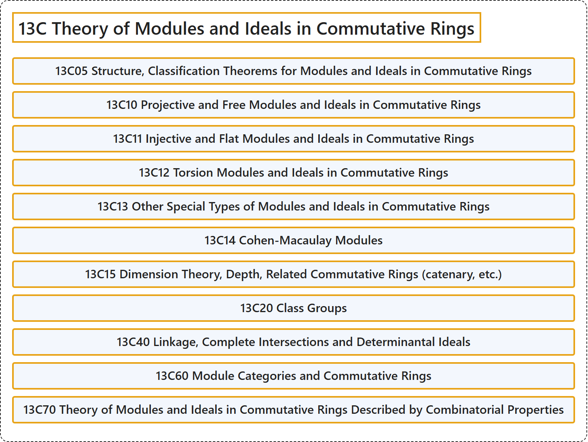

# 13C Theory of Modules and Ideals in Commutative Rings

## Classification

## Glossary

| Term | Definition | 中文翻译 | Source |
|---|---|---|---|
| **13C Theory of Modules and Ideals in Commutative Rings** 交换环中的模与理想理论 | (No definition) | （无定义） | [Associate Editors of Mathematical Reviews and zbMATH, 2020](https://msc2020.org/) |
| **13C05 Structure, Classification Theorems for Modules and Ideals in Commutative Rings** 交换环中模与理想的结构、分类定理 | (No definition) | （无定义） | [Associate Editors of Mathematical Reviews and zbMATH, 2020](https://msc2020.org/) |
| **13C10 Projective and Free Modules and Ideals in Commutative Rings** 交换环中的射影模与自由模及理想 | (No definition) | （无定义） | [Associate Editors of Mathematical Reviews and zbMATH, 2020](https://msc2020.org/) |
| **13C11 Injective and Flat Modules and Ideals in Commutative Rings** 交换环中的内射模与平坦模及理想 | (No definition) | （无定义） | [Associate Editors of Mathematical Reviews and zbMATH, 2020](https://msc2020.org/) |
| **13C12 Torsion Modules and Ideals in Commutative Rings** 交换环中的挠模与理想 | (No definition) | （无定义） | [Associate Editors of Mathematical Reviews and zbMATH, 2020](https://msc2020.org/) |
| **13C13 Other Special Types of Modules and Ideals in Commutative Rings** 交换环中其他特殊类型的模与理想 | (No definition) | （无定义） | [Associate Editors of Mathematical Reviews and zbMATH, 2020](https://msc2020.org/) |
| **13C14 Cohen-Macaulay Modules** 科恩-麦考利模 | (No definition) | （无定义） | [Associate Editors of Mathematical Reviews and zbMATH, 2020](https://msc2020.org/) |
| **13C15 Dimension Theory, Depth, Related Commutative Rings (catenary, etc.)** 维数理论、深度、相关交换环（链环等） | (No definition) | （无定义） | [Associate Editors of Mathematical Reviews and zbMATH, 2020](https://msc2020.org/) |
| **13C20 Class Groups** 类群 | (No definition) | （无定义） | [Associate Editors of Mathematical Reviews and zbMATH, 2020](https://msc2020.org/) |
| **13C40 Linkage, Complete Intersections and Determinantal Ideals** 联络、完全交与行列式理想 | (No definition) | （无定义） | [Associate Editors of Mathematical Reviews and zbMATH, 2020](https://msc2020.org/) |
| **13C60 Module Categories and Commutative Rings** 模范畴与交换环 | (No definition) | （无定义） | [Associate Editors of Mathematical Reviews and zbMATH, 2020](https://msc2020.org/) |
| **13C70 Theory of Modules and Ideals in Commutative Rings Described by Combinatorial Properties** 由组合性质刻画的交换环中的模与理想理论 | (No definition) | （无定义） | [Associate Editors of Mathematical Reviews and zbMATH, 2020](https://msc2020.org/) |

## References

Associate Editors of Mathematical Reviews and zbMATH. (2020). *MSC2020: Mathematics Subject Classification system*. Retrieved October 27, 2026, from <https://msc2020.org/>
