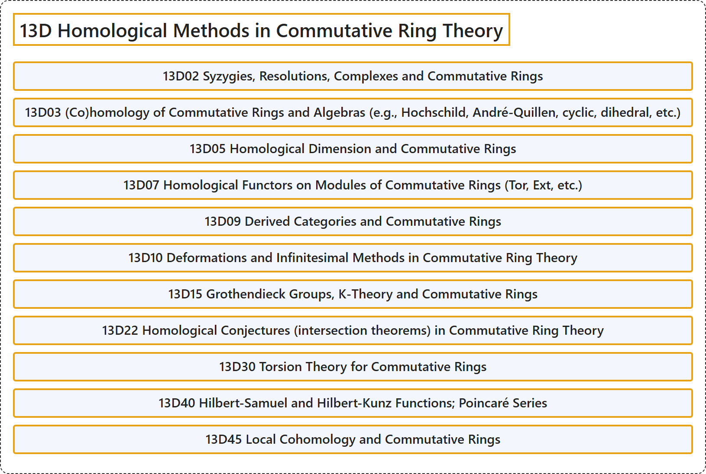

# 13D Homological Methods in Commutative Ring Theory

## Classification

## Glossary

| Term | Definition | 中文翻译 | Source |
|---|---|---|---|
| **13D Homological Methods in Commutative Ring Theory** 交换环论中的同调方法 | (No definition) | （无定义） | [Associate Editors of Mathematical Reviews and zbMATH, 2020](https://msc2020.org/) |
| **13D02 Syzygies, Resolutions, Complexes and Commutative Rings** 合冲、分解、复形与交换环 | (No definition) | （无定义） | [Associate Editors of Mathematical Reviews and zbMATH, 2020](https://msc2020.org/) |
| **13D03 (Co)homology of Commutative Rings and Algebras (e.g., Hochschild, André-Quillen, cyclic, dihedral, etc.)** 交换环与代数的（上）同调（例如霍赫希尔德、安德烈-奎伦、循环、二面体等） | (No definition) | （无定义） | [Associate Editors of Mathematical Reviews and zbMATH, 2020](https://msc2020.org/) |
| **13D05 Homological Dimension and Commutative Rings** 同调维数与交换环 | (No definition) | （无定义） | [Associate Editors of Mathematical Reviews and zbMATH, 2020](https://msc2020.org/) |
| **13D07 Homological Functors on Modules of Commutative Rings (Tor, Ext, etc.)** 交换环的模上的同调函子（Tor、Ext等） | (No definition) | （无定义） | [Associate Editors of Mathematical Reviews and zbMATH, 2020](https://msc2020.org/) |
| **13D09 Derived Categories and Commutative Rings** 导出范畴与交换环 | (No definition) | （无定义） | [Associate Editors of Mathematical Reviews and zbMATH, 2020](https://msc2020.org/) |
| **13D10 Deformations and Infinitesimal Methods in Commutative Ring Theory** 交换环论中的形变与无穷小方法 | (No definition) | （无定义） | [Associate Editors of Mathematical Reviews and zbMATH, 2020](https://msc2020.org/) |
| **13D15 Grothendieck Groups, K-Theory and Commutative Rings** 格罗滕迪克群、K理论与交换环 | (No definition) | （无定义） | [Associate Editors of Mathematical Reviews and zbMATH, 2020](https://msc2020.org/) |
| **13D22 Homological Conjectures (intersection theorems) in Commutative Ring Theory** 交换环论中的同调猜想（相交定理） | (No definition) | （无定义） | [Associate Editors of Mathematical Reviews and zbMATH, 2020](https://msc2020.org/) |
| **13D30 Torsion Theory for Commutative Rings** 交换环的挠理论 | (No definition) | （无定义） | [Associate Editors of Mathematical Reviews and zbMATH, 2020](https://msc2020.org/) |
| **13D40 Hilbert-Samuel and Hilbert-Kunz Functions; Poincaré Series** 希尔伯特-塞缪尔函数与希尔伯特-昆茨函数；庞加莱级数 | (No definition) | （无定义） | [Associate Editors of Mathematical Reviews and zbMATH, 2020](https://msc2020.org/) |
| **13D45 Local Cohomology and Commutative Rings** 局部上同调与交换环 | (No definition) | （无定义） | [Associate Editors of Mathematical Reviews and zbMATH, 2020](https://msc2020.org/) |

## References

Associate Editors of Mathematical Reviews and zbMATH. (2020). *MSC2020: Mathematics Subject Classification system*. Retrieved October 27, 2026, from <https://msc2020.org/>
