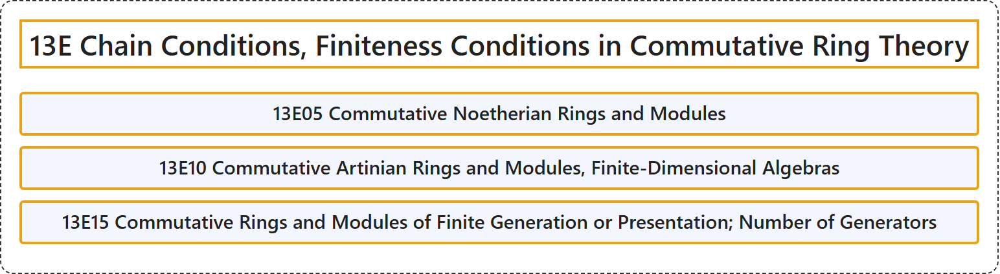

# 13E Chain Conditions, Finiteness Conditions in Commutative Ring Theory

## Classification

## Glossary

| Term | Definition | 中文翻译 | Source |
|---|---|---|---|
| **13E Chain Conditions, Finiteness Conditions in Commutative Ring Theory** 交换环论中的链条件、有限性条件 | (No definition) | （无定义） | [Associate Editors of Mathematical Reviews and zbMATH, 2020](https://msc2020.org/) |
| **13E05 Commutative Noetherian Rings and Modules** 交换诺特环与模 | (No definition) | （无定义） | [Associate Editors of Mathematical Reviews and zbMATH, 2020](https://msc2020.org/) |
| **13E10 Commutative Artinian Rings and Modules, Finite-Dimensional Algebras** 交换阿廷环与模、有限维代数 | (No definition) | （无定义） | [Associate Editors of Mathematical Reviews and zbMATH, 2020](https://msc2020.org/) |
| **13E15 Commutative Rings and Modules of Finite Generation or Presentation; Number of Generators** 有限生成或有限表现的交换环与模；生成元的个数 | (No definition) | （无定义） | [Associate Editors of Mathematical Reviews and zbMATH, 2020](https://msc2020.org/) |

## References

Associate Editors of Mathematical Reviews and zbMATH. (2020). *MSC2020: Mathematics Subject Classification system*. Retrieved October 27, 2026, from <https://msc2020.org/>
