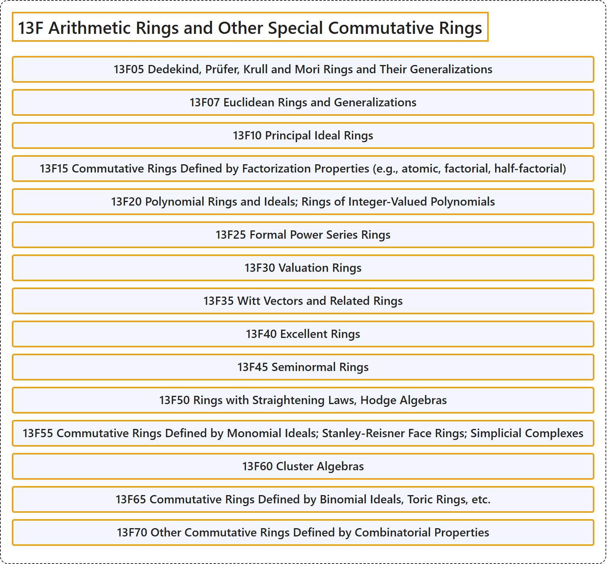

# 13F Arithmetic Rings and Other Special Commutative Rings

## Classification

## Glossary

| Term | Definition | 中文翻译 | Source |
|---|---|---|---|
| **13F Arithmetic Rings and Other Special Commutative Rings** 算术环与其他特殊交换环 | (No definition) | （无定义） | [Associate Editors of Mathematical Reviews and zbMATH, 2020](https://msc2020.org/) |
| **13F05 Dedekind, Prüfer, Krull and Mori Rings and Their Generalizations** 戴德金环、普吕弗环、克鲁尔环与森田环及其推广 | (No definition) | （无定义） | [Associate Editors of Mathematical Reviews and zbMATH, 2020](https://msc2020.org/) |
| **13F07 Euclidean Rings and Generalizations** 欧几里得环及其推广 | (No definition) | （无定义） | [Associate Editors of Mathematical Reviews and zbMATH, 2020](https://msc2020.org/) |
| **13F10 Principal Ideal Rings** 主理想环 | (No definition) | （无定义） | [Associate Editors of Mathematical Reviews and zbMATH, 2020](https://msc2020.org/) |
| **13F15 Commutative Rings Defined by Factorization Properties (e.g., atomic, factorial, half-factorial)** 由因子分解性质定义的交换环（例如原子环、唯一分解环、半唯一分解环） | (No definition) | （无定义） | [Associate Editors of Mathematical Reviews and zbMATH, 2020](https://msc2020.org/) |
| **13F20 Polynomial Rings and Ideals; Rings of Integer-Valued Polynomials** 多项式环与理想；整值多项式环 | (No definition) | （无定义） | [Associate Editors of Mathematical Reviews and zbMATH, 2020](https://msc2020.org/) |
| **13F25 Formal Power Series Rings** 形式幂级数环 | (No definition) | （无定义） | [Associate Editors of Mathematical Reviews and zbMATH, 2020](https://msc2020.org/) |
| **13F30 Valuation Rings** 赋值环 | (No definition) | （无定义） | [Associate Editors of Mathematical Reviews and zbMATH, 2020](https://msc2020.org/) |
| **13F35 Witt Vectors and Related Rings** 维特向量及相关环 | (No definition) | （无定义） | [Associate Editors of Mathematical Reviews and zbMATH, 2020](https://msc2020.org/) |
| **13F40 Excellent Rings** 优环 | (No definition) | （无定义） | [Associate Editors of Mathematical Reviews and zbMATH, 2020](https://msc2020.org/) |
| **13F45 Seminormal Rings** 半正规环 | (No definition) | （无定义） | [Associate Editors of Mathematical Reviews and zbMATH, 2020](https://msc2020.org/) |
| **13F50 Rings with Straightening Laws, Hodge Algebras** 带直化律的环、霍奇代数 | (No definition) | （无定义） | [Associate Editors of Mathematical Reviews and zbMATH, 2020](https://msc2020.org/) |
| **13F55 Commutative Rings Defined by Monomial Ideals; Stanley-Reisner Face Rings; Simplicial Complexes** 由单项式理想定义的交换环；斯坦利-赖斯纳面环；单纯复形 | (No definition) | （无定义） | [Associate Editors of Mathematical Reviews and zbMATH, 2020](https://msc2020.org/) |
| **13F60 Cluster Algebras** 团簇代数 | (No definition) | （无定义） | [Associate Editors of Mathematical Reviews and zbMATH, 2020](https://msc2020.org/) |
| **13F65 Commutative Rings Defined by Binomial Ideals, Toric Rings, etc.** 由二项式理想定义的交换环、环面环等 | (No definition) | （无定义） | [Associate Editors of Mathematical Reviews and zbMATH, 2020](https://msc2020.org/) |
| **13F70 Other Commutative Rings Defined by Combinatorial Properties** 由组合性质定义的其他交换环 | (No definition) | （无定义） | [Associate Editors of Mathematical Reviews and zbMATH, 2020](https://msc2020.org/) |

## References

Associate Editors of Mathematical Reviews and zbMATH. (2020). *MSC2020: Mathematics Subject Classification system*. Retrieved October 27, 2026, from <https://msc2020.org/>
