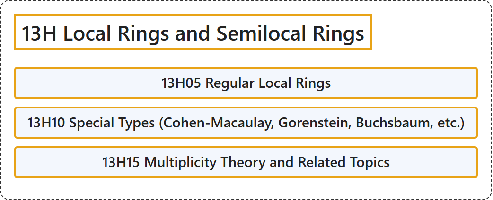

# 13H Local Rings and Semilocal Rings

## Classification

## Glossary

| Term | Definition | 中文翻译 | Source |
|---|---|---|---|
| **13H Local Rings and Semilocal Rings** 局部环与半局部环 | (No definition) | （无定义） | [Associate Editors of Mathematical Reviews and zbMATH, 2020](https://msc2020.org/) |
| **13H05 Regular Local Rings** 正则局部环 | (No definition) | （无定义） | [Associate Editors of Mathematical Reviews and zbMATH, 2020](https://msc2020.org/) |
| **13H10 Special Types (Cohen-Macaulay, Gorenstein, Buchsbaum, etc.)** 特殊类型（科恩-麦考利、戈伦斯坦、布赫斯鲍姆等） | (No definition) | （无定义） | [Associate Editors of Mathematical Reviews and zbMATH, 2020](https://msc2020.org/) |
| **13H15 Multiplicity Theory and Related Topics** 重数理论及相关课题 | (No definition) | （无定义） | [Associate Editors of Mathematical Reviews and zbMATH, 2020](https://msc2020.org/) |

## References

Associate Editors of Mathematical Reviews and zbMATH. (2020). *MSC2020: Mathematics Subject Classification system*. Retrieved October 27, 2026, from <https://msc2020.org/>
