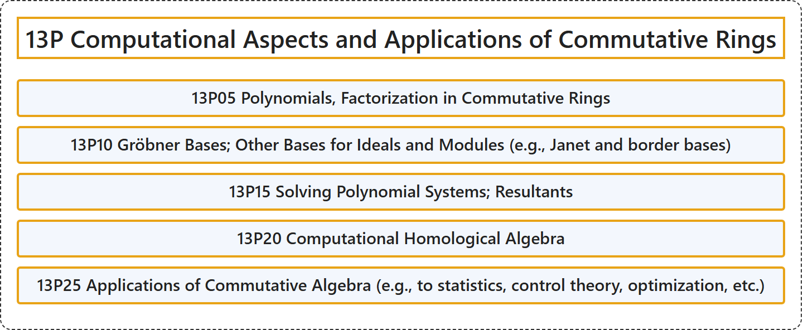

# 13P Computational Aspects and Applications of Commutative Rings

## Classification

## Glossary

| Term | Definition | 中文翻译 | Source |
|---|---|---|---|
| **13P Computational Aspects and Applications of Commutative Rings** 交换环的计算方面及应用 | (No definition) | （无定义） | [Associate Editors of Mathematical Reviews and zbMATH, 2020](https://msc2020.org/) |
| **13P05 Polynomials, Factorization in Commutative Rings** 交换环中的多项式、因子分解 | (No definition) | （无定义） | [Associate Editors of Mathematical Reviews and zbMATH, 2020](https://msc2020.org/) |
| **13P10 Gröbner Bases; Other Bases for Ideals and Modules (e.g., Janet and border bases)** 格罗布纳基；理想与模的其他基（例如Janet基与边界基） | (No definition) | （无定义） | [Associate Editors of Mathematical Reviews and zbMATH, 2020](https://msc2020.org/) |
| **13P15 Solving Polynomial Systems; Resultants** 多项式方程组求解；结式 | (No definition) | （无定义） | [Associate Editors of Mathematical Reviews and zbMATH, 2020](https://msc2020.org/) |
| **13P20 Computational Homological Algebra** 计算同调代数 | (No definition) | （无定义） | [Associate Editors of Mathematical Reviews and zbMATH, 2020](https://msc2020.org/) |
| **13P25 Applications of Commutative Algebra (e.g., to statistics, control theory, optimization, etc.)** 交换代数的应用（例如在统计学、控制论、最优化等方面） | (No definition) | （无定义） | [Associate Editors of Mathematical Reviews and zbMATH, 2020](https://msc2020.org/) |

## References

Associate Editors of Mathematical Reviews and zbMATH. (2020). *MSC2020: Mathematics Subject Classification system*. Retrieved October 27, 2026, from <https://msc2020.org/>
