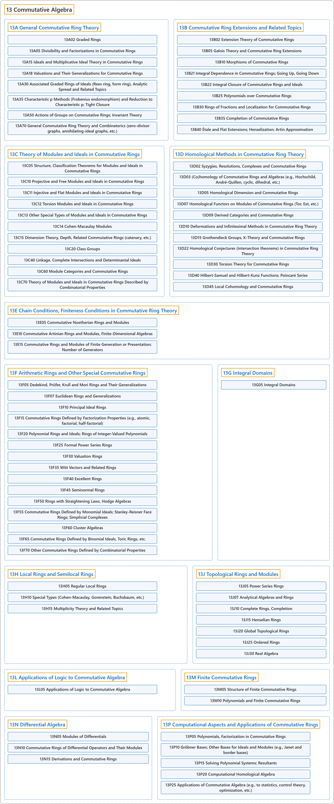

# 13 Commutative Algebra

## Classification

## Glossary

| Term | Definition | 中文翻译 | Source |
|---|---|---|---|
| **13 Commutative Algebra** 交换代数 | "A commutative algebra over a field k is a **vector space A over k** equipped with **bilinear multiplication** satisfying ab=ba for all a,b in A." | 域 k 上的交换代数是 **k 上的向量空间 A**，它配有**双线性乘法**，并对 A 中所有 a、b 满足 ab=ba。 | [Weisstein, n.d., "Commutative algebra" entry, para. 1](https://mathworld.wolfram.com/CommutativeAlgebra.html#:~:text=A%20commutative%20algebra%20over%20a%20field%20k%20is%20a%20vector%20space) |
| **[13A General Commutative Ring Theory](13a-general-commutative-ring-theory.md)** 一般交换环论 | (No definition) | （无定义） | [Associate Editors of Mathematical Reviews and zbMATH, 2020](https://msc2020.org/) |
| **[13B Commutative Ring Extensions and Related Topics](13b-commutative-ring-extensions-and-related-topics.md)** 交换环扩张及相关专题 | (No definition) | （无定义） | [Associate Editors of Mathematical Reviews and zbMATH, 2020](https://msc2020.org/) |
| **[13C Theory of Modules and Ideals in Commutative Rings](13c-theory-of-modules-and-ideals-in-commutative-rings.md)** 交换环中的模与理想理论 | (No definition) | （无定义） | [Associate Editors of Mathematical Reviews and zbMATH, 2020](https://msc2020.org/) |
| **[13D Homological Methods in Commutative Ring Theory](13d-homological-methods-in-commutative-ring-theory.md)** 交换环论中的同调方法 | (No definition) | （无定义） | [Associate Editors of Mathematical Reviews and zbMATH, 2020](https://msc2020.org/) |
| **[13E Chain Conditions, Finiteness Conditions in Commutative Ring Theory](13e-chain-conditions-finiteness-conditions-in-commutative-ring-t.md)** 交换环论中的链条件、有限性条件 | (No definition) | （无定义） | [Associate Editors of Mathematical Reviews and zbMATH, 2020](https://msc2020.org/) |
| **[13F Arithmetic Rings and Other Special Commutative Rings](13f-arithmetic-rings-and-other-special-commutative-rings.md)** 算术环与其他特殊交换环 | (No definition) | （无定义） | [Associate Editors of Mathematical Reviews and zbMATH, 2020](https://msc2020.org/) |
| **[13G Integral Domains](13g-integral-domains.md)** 整环 | (No definition) | （无定义） | [Associate Editors of Mathematical Reviews and zbMATH, 2020](https://msc2020.org/) |
| **[13H Local Rings and Semilocal Rings](13h-local-rings-and-semilocal-rings.md)** 局部环与半局部环 | (No definition) | （无定义） | [Associate Editors of Mathematical Reviews and zbMATH, 2020](https://msc2020.org/) |
| **[13J Topological Rings and Modules](13j-topological-rings-and-modules.md)** 拓扑环与拓扑模 | (No definition) | （无定义） | [Associate Editors of Mathematical Reviews and zbMATH, 2020](https://msc2020.org/) |
| **[13L Applications of Logic to Commutative Algebra](13l-applications-of-logic-to-commutative-algebra.md)** 逻辑在交换代数中的应用 | (No definition) | （无定义） | [Associate Editors of Mathematical Reviews and zbMATH, 2020](https://msc2020.org/) |
| **[13M Finite Commutative Rings](13m-finite-commutative-rings.md)** 有限交换环 | (No definition) | （无定义） | [Associate Editors of Mathematical Reviews and zbMATH, 2020](https://msc2020.org/) |
| **[13N Differential Algebra](13n-differential-algebra.md)** 微分代数 | (No definition) | （无定义） | [Associate Editors of Mathematical Reviews and zbMATH, 2020](https://msc2020.org/) |
| **[13P Computational Aspects and Applications of Commutative Rings](13p-computational-aspects-and-applications-of-commutative-rings.md)** 交换环的计算方面及应用 | (No definition) | （无定义） | [Associate Editors of Mathematical Reviews and zbMATH, 2020](https://msc2020.org/) |

## References

Associate Editors of Mathematical Reviews and zbMATH. (2020). *MSC2020: Mathematics Subject Classification system*. Retrieved October 27, 2026, from <https://msc2020.org/>

Weisstein, E. W. (n.d.). *Commutative algebra*. MathWorld: A Wolfram Resource. Retrieved October 27, 2026, from <https://mathworld.wolfram.com/CommutativeAlgebra.html>
